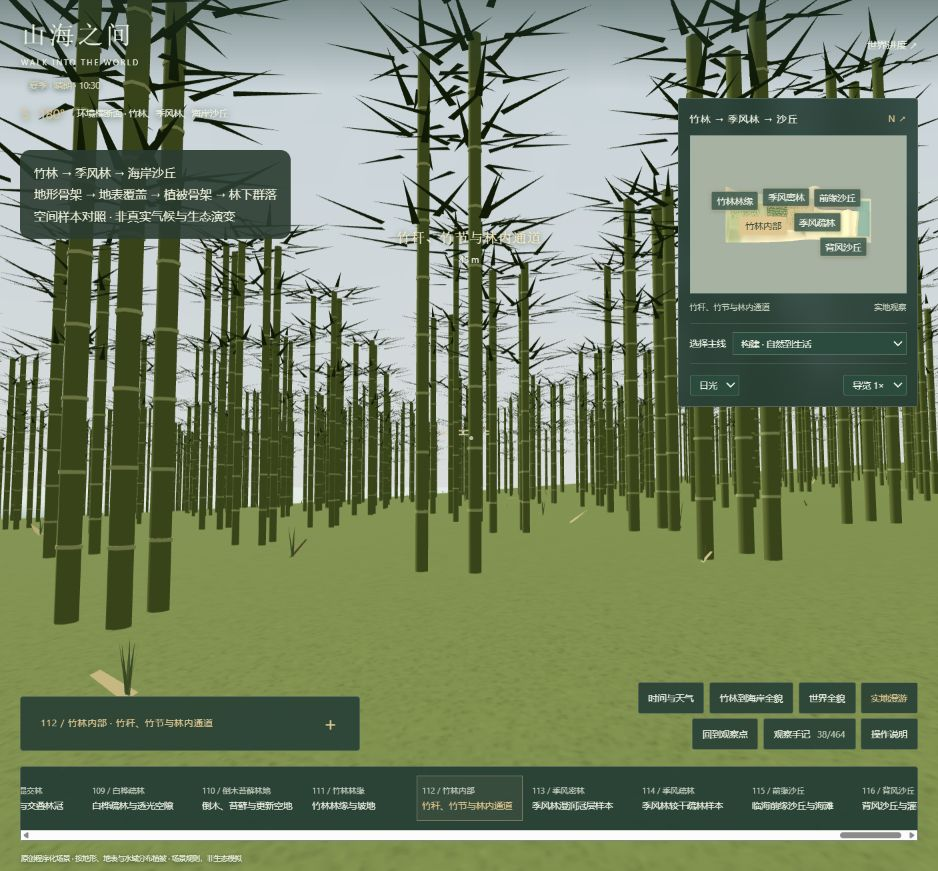
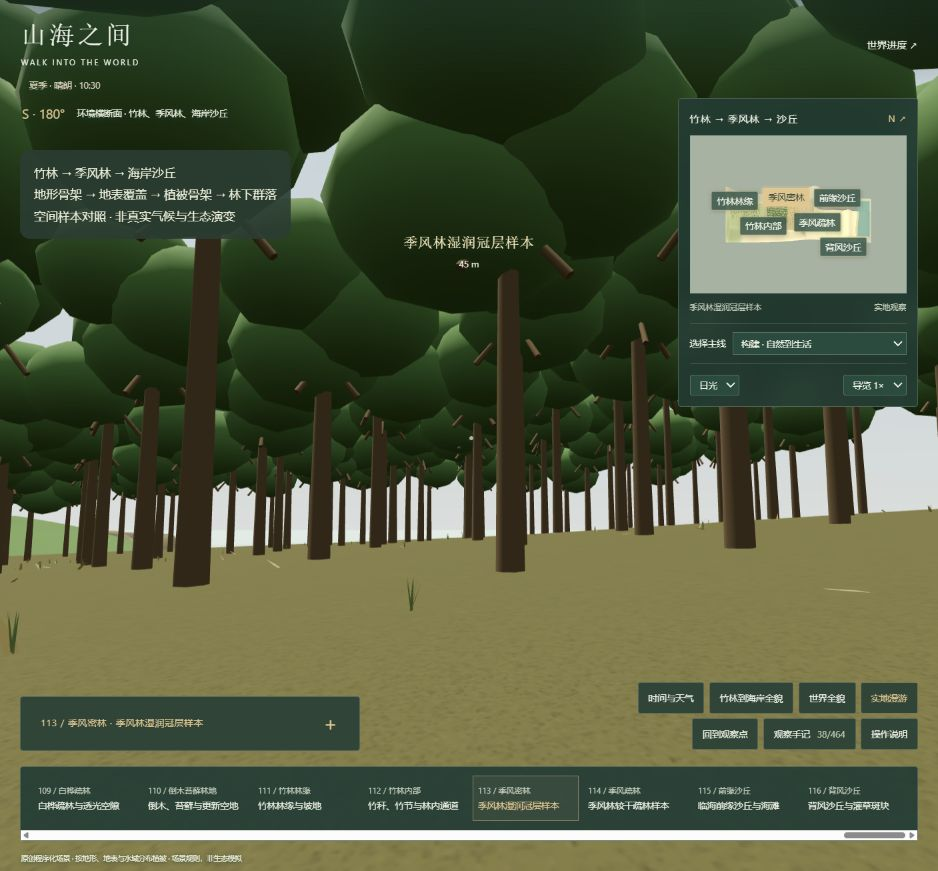

# 竹林、季风林与海岸沙丘六站

同一张3840×3120m大地图中新增一条从丘地走向海岸的横断面，范围x=100..1250、z=660..880。北缘避开原内陆湖岸，南侧保留原海上通道开口。六站之间沿实际连续地形步行；从原倒木林地到新竹林林缘是明确标注的教学镜头转场，不是跨区域步行道路。所有参数为原创创作尺度，不表示真实气候分带或物种分布。

[进入完整六站](http://127.0.0.1:52932/expedition.html#warm-1) · [竹林内部](http://127.0.0.1:52932/expedition.html#bamboo-2) · [季风林](http://127.0.0.1:52932/expedition.html#monsoon-1) · [海岸沙丘](http://127.0.0.1:52932/expedition.html#dunes-1)

## 实际效果与参考价值

| 场景 | 当前实际构建 | 可参考与扩展价值 |
| --- | --- | --- |
| 竹林林缘 | 连续丘坡、较疏竹丛与土底叶屑 | 通过覆盖率和边缘留白建立林外到林内的过渡 |
| 竹林内部 | 较密细秆、可辨节环、上部多层窄叶簇与低矮林下 | 竹林不能只替换树冠颜色；秆体、节奏、根部和竖向空间共同决定环境性格 |
| 季风密林 | 分叉树干、宽阔叠冠与较暗地表、蕨形林下 | 同一坡地通过树高、冠幅和密度转为乔木森林空间 |
| 季风较干疏林 | 低密度乔木、露出枝条、黄绿冠层和暖色落叶样覆盖 | 用疏密、色调、裸地与天空空隙表现环境差异；此处为空间对照，不是湿旱季时间模拟 |
| 临海前缘沙丘 | 实体前缘沙脊、低海滩、湿沙与零米海面，稀疏先锋草 | 地形必须先有脊、坡和滩，植被再依海岸位置稀疏落位 |
| 背风沙丘 | 第二道宽缓沙脊、低鞍部、较多低草与低灌 | 相同沙地可通过地形和覆盖率组织不同空间，后续可接风沙与植被固沙过程 |

共978根竹秆、7824道节环、2934组窄叶簇；季风密林143株、较干疏林48株。739处低草形态中，前缘38簇、背风侧311簇；另有36处背风低灌及824处叶屑。使用原创程序化几何和批量实例，不新增外部素材或依赖。

## 分层和路线

每站四层：地形骨架 → 地表与水岸覆盖 → 植被骨架 → 完整群落与林下。沙丘段第二层同时显示原世界0m海面，水面按实际床底裁切；前缘约16m、背风观察点约10.8m为当前压缩创作高程。两道沙脊之间有实际低鞍部，床底向海下降并接向已有外海。竹秆和乔木有实体阻挡，主线保留通行净空。

中文小地图使用同一高度场和植被数据；全局地图分别保留竹林、季风林、海岸沙丘三个入口。可从六站任一处开始导览，也可切换“竹林到海岸全貌”对照整个横断面。

现116站464处，旧110站440个观察ID与浏览记录键保留。水系专线14站42处不变。

## 仍未实现

没有真实竹种或耐盐植物鉴定、根茎扩张、竹秆弯曲、生长、自动落叶、旱季胁迫、真实降雨与生态演替。季风湿润/较干段为固定空间样本；原天气和季节表现仍可切换，新植被没有独立物候过程。海岸沙丘也不含风成搬运、颗粒输运、动态潮汐、浪涌、沙丘迁移或真实固沙过程。

## 验证

`node scripts/check-warm.mjs`检查20000个实际移动采样、10901个旧路线前缀、观察ID、竹秆与树干阻挡、节环与叶簇数量、根部支撑、沙脊/鞍部/湿滩/水下床底、海岸水面裁切、真实图层控制器及三种视口全貌镜头；[报告](assets/warm-check.json)。完整导航启动与22种模式另由`check-map-startup.mjs`覆盖。浏览器所选场景验收范围另记[verification.md](verification.md)。

## 内置浏览器实际画面

以上为构建`d01c2717857e`的实际内置浏览器截图，均为原创程序化场景，不是外部游戏截图。竹林四层过程分别保存为[layer 0](assets/warm-bamboo-layer-0.jpg)、[layer 1](assets/warm-bamboo-layer-1.jpg)、[layer 2](assets/warm-bamboo-layer-2.jpg)、[layer 3](assets/warm-bamboo-layer-3.jpg)。
