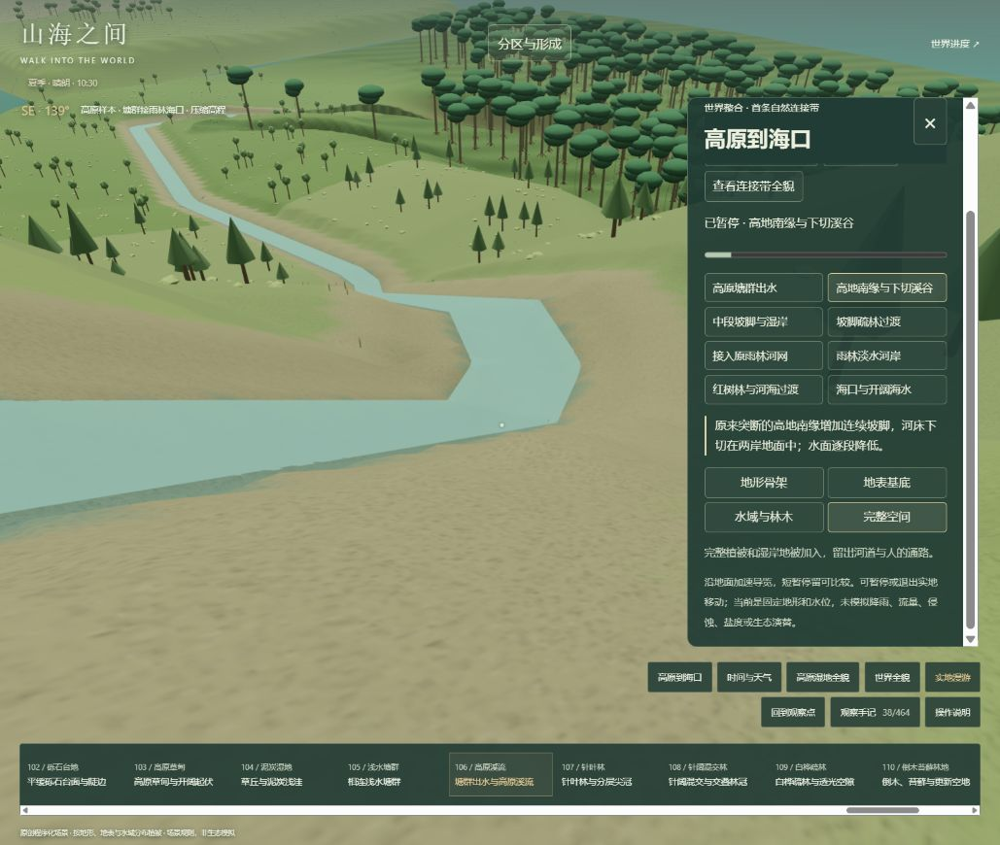
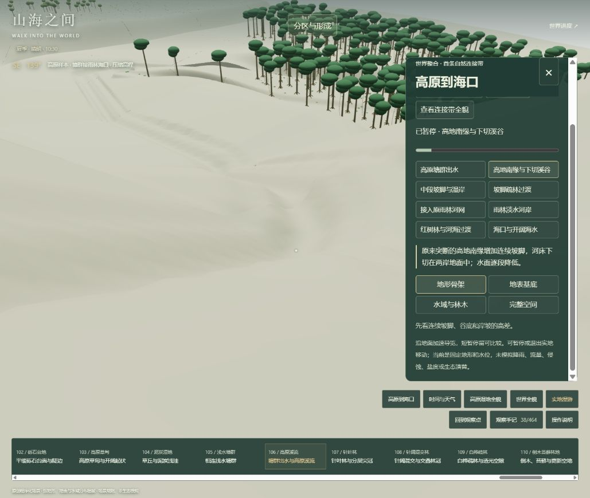
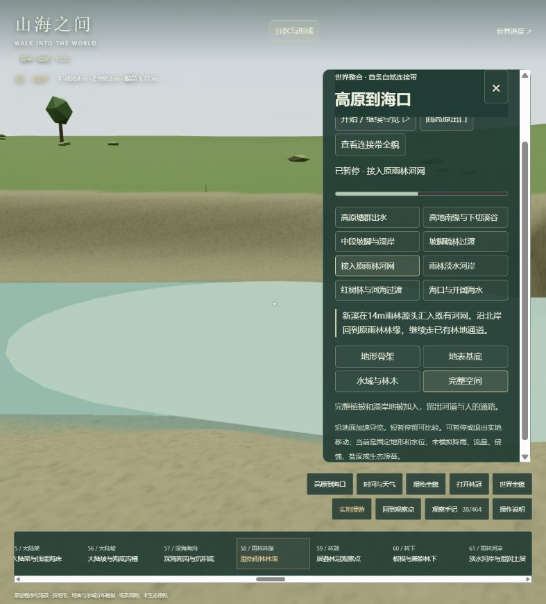
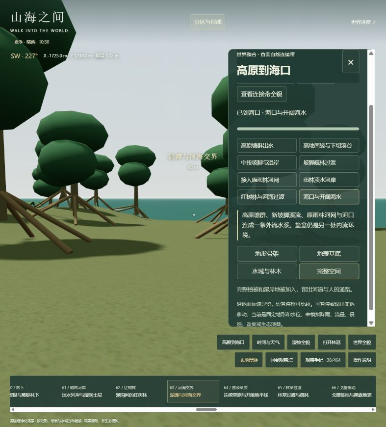

# 首条实际地理连接带：高原塘群到雨林海口

2026-11-17。原116站、464处观察ID和原主线路径继续保留。本轮在同一高度场里增加连续坡脚陆地、下切溪谷、干岸通路和植被过渡，把原高原塘群与原雨林河网接起来。新增八个连接带检查点，不计入原116站观察数量。

[进入连接带](http://127.0.0.1:52932/expedition.html?connection=1#build-106) · [原构建主线](http://127.0.0.1:52932/expedition.html#build-1) · [九区总图](http://127.0.0.1:52932/expedition.html?plan=1#build-1)

## 实际改动

原高原南缘与雨林之间曾落入海面以下，无法直接承接溪谷。本轮重新塑造这一局部陆地连接：用连续下降的坡脚连接两片旧区域，再在坡脚里切出低于水面的河床。它是创作地形编辑，不是地壳抬升、侵蚀或真实流域自动生成。

水路为：原232→230→228→222→220m塘群 → 约861m新溪谷220→14m → 原雨林河网14→0m → 原红树林与海口。原中央冰雪—河谷—湿地—海湾属于另一条外流水系，没有强行并到这条高原支流；盐湖盆地继续保持独立内流环境。

地面导览约1.95km，从原高原溪流站，经短步桥与左岸通路，再沿原雨林林地通路到海口。步桥跨过原出水槽，桥下床底和水面保留。雨林林冠站在本导览中走地面，原116站主线的林冠教学镜头仍保留。

| 检查点 | 现场应理解的关系 |
| --- | --- |
| 高原塘群出水 | 原塘洼出水、步桥、干岸与新溪的接点 |
| 高地南缘与下切溪谷 | 连续坡脚承接河道，床底低于两岸和水面 |
| 中段坡脚与湿岸 | 低谷、较高干岸、裸地与低灌分开 |
| 坡脚疏林过渡 | 低灌、针叶树形、阔叶树形与湿岸草的空间变化 |
| 接入原雨林河网 | 从14m汇接点看新溪与原河网相接，再进入原林地入口 |
| 雨林淡水河岸 | 沿原林地通路看淡水深槽与较高岸路 |
| 红树林与河海过渡 | 原支柱根、泥岸、潮沟和开水面 |
| 海口与开阔海水 | 下游与零米海面相接，回看完整外流链 |

## 地形如何承接上层元素

连接带共用同一个地形、水位和岸距查询，地表配色、植被落点与实际床底相对应。乔木避开水槽、过陡坡和参观路，湿岸草靠近河岸；树根高度来自最终高度场。新增过渡带使用低灌、针叶和阔叶树形，参数按创作高程和岸距划分，不对应真实纬度、雪线、物种区系或完整气候模型。

面板提供四层比较：地形骨架、地表基底、水域与林木、完整空间。雨林沿用原自身层级：第二层已有河网，第三层加入乔木。暂停、选点和连接带全貌帮助对照；沿地面加速导览是教学移动，不能当作人物真实步速或行走动画。

总图蓝线表示原中央主河，绿色实线表示已连接的高原—雨林—海口，橙色虚线保留扇面和岩层溪流的待接状态。方位分区用于查找，仍不是完整分水岭或气候带边界。

## 保留与尚缺范围

原116站的ID、主线路径与手记存储键保留；与前一构建248fce553059比较，11501个原主线路径采样最大位置差为0。旧场景附近按新连接带保留净空，一小部分雨林道具落点会被让出，不能说每一株树和每一块地面都原封不动。

目前只完成首条真实连接带。冲积扇、岩层溪流等尚待补上游与出口；泥炭微洼缺完整补给耦合；全图水汽温度、宽生态过渡、岩性构造、分水岭和收支仍需统一。没有动态降雨—径流、流量守恒、输沙冲淤、盐度输运、地下水或生态演替。

几何、通行、保留性与浏览器验收范围见[verification.md](verification.md)，形成前提的机构资料见[WORLD-LOGIC.md](WORLD-LOGIC.md)。

## 内置浏览器实景

以上为本机程序化世界截图，不是参考游戏原效果，也不代表真实自然过程模拟。
