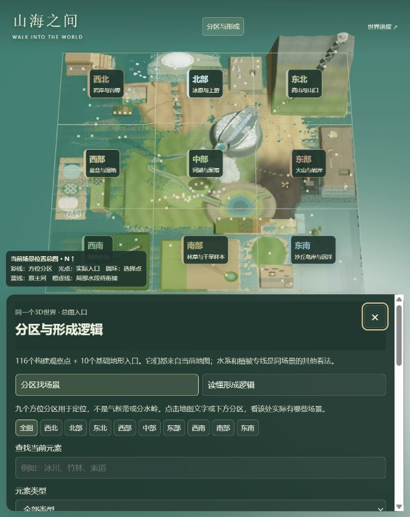
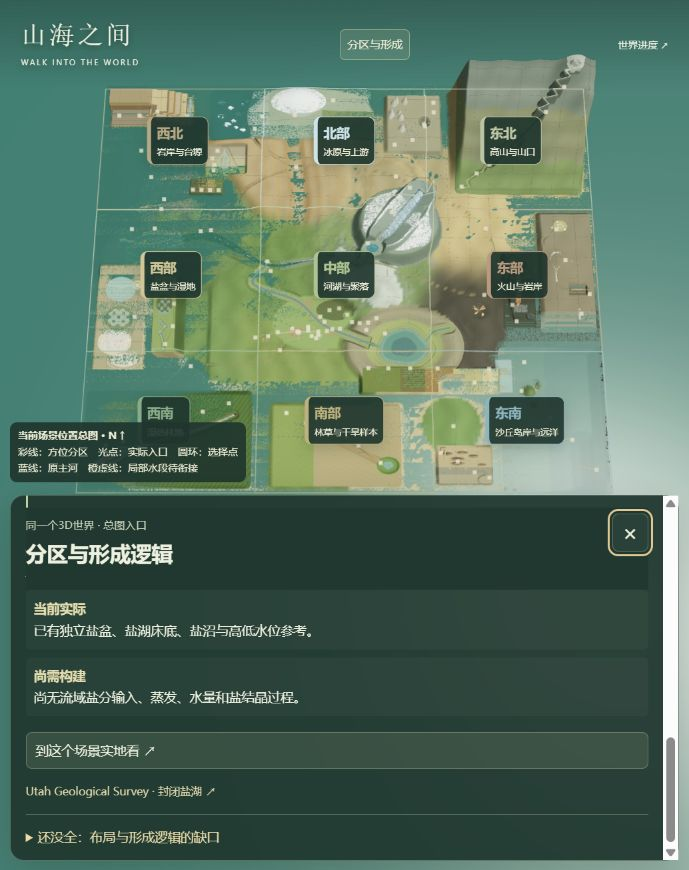

# 一个世界：实际布局与形成逻辑

最新区域衔接见[六段区域过渡](REGIONAL-GEOGRAPHY.md)。以下保留最初同图分区的设计记录。

当前不是“环境元素已全、自然关系也已完整”的成品世界。已有116个构建观察点、464处制作讲解及10个基础地形入口，共用同一个Three.js场景和高度场；这不等于126种互不重复的地貌，也不等于自然界所有环境。水系14站和植被专线是同场景的其他观察方式。

[打开同图分区](http://127.0.0.1:52932/expedition.html?plan=1#build-1) · [直接读形成主线](http://127.0.0.1:52932/expedition.html?plan=logic#build-1)

详见[首条实际地理连接带](WATERSHED-INTEGRATION.md)：本轮增加连续陆地与下切河床，没有重置旧116站。

本轮另见[北部双支流整合](NORTHERN-WATERSHED.md)。当前是多条几何连通水路，完整分水岭与水量收支仍需校核。

## 地图中怎么找

九个方位区按当前实际坐标整理，彩线覆盖同一地图；点击分区文字，按地形、水域、植被、地下、天空、生活和交通筛选，再进入实际场景。它是定位布局，不是气候带、板块或分水岭的科学划界；当前按原坐标整理，真实气候带与流域重排列为后续工作。

| 方位区 | 当前观察重点 |
| --- | --- |
| 西北 | 岩岸、岩层台塬、山口扇面与森林 |
| 北部 | 冰原苔原、上游高地与部分岩溶 |
| 东北 | 高山、高峰、山口与垂直交通 |
| 西部 | 盐盆、高原塘溪、低地湿地与海湾 |
| 中部 | 平原、盆地、河湖、聚落与生产生活 |
| 东部 | 火山、岩岸、海蚀洞和地热 |
| 西南 | 雨林、红树林与河海交界 |
| 南部 | 竹林与季风密林样本、草原、林草过渡、戈壁、干谷和绿洲 |
| 东南 | 季风疏林、风蚀、沙丘、岛岸、远洋及深海 |

总图蓝线使用原中央主河实际数据；绿色实线表示已接通的高原塘群—新增坡脚溪谷—原雨林河网—海口；北部扇面和岩层溪流现已补上游、出流谷地与汇口，并以蓝线接入原中央主河。它们不是新生成的水力流路，也没有用假连接线掩盖缺口。

## 形成顺序与制作顺序不同

四层开关“地形 → 地表 → 水域/植被骨架 → 完整空间”用于拆解制作。自然形成不能理解成先随意摆地形、再最后添加气候。需要从一开始同时交代构造岩性、热量与水汽、重力水流、物源和时间；侵蚀沉积不断改造地形，植被也会反过来影响截沙、地表覆盖和水土条件。

六章形成主线：

1. **基岩与高差**：岩性、构造与抬升提供背景，长期剥蚀再雕刻峰脊、峡谷、台塬。
2. **水汽与温度**：明确海陆、水汽来向、迎背风和温度条件；不把任意森林—荒漠相邻都称为雨影。
3. **集水区与出口**：来水沿地势汇流；外流河、内流盆地和地下水需要各自的出口及补给解释。
4. **侵蚀、搬运与沉积**：流水、冰川、风和重力的作用不同，需交代物源和能量变化。
5. **海岸与物源**：沙丘先需要沙源、输沙风及沉积空间，植被截沙又会影响沙丘形态。
6. **群落与生活**：水热、土壤、排水、盐湿和扰动限制植物；人类道路和场地再回应自然条件。

每处形成卡分开写“形成前提、形成链、当前实际、尚需构建”，并链接原始机构资料。典型例子：冰川要有多年积累与运动条件；盐湖要考虑封闭出口与盐分收支；典型岩溶要有可溶岩层和水；柱状节理与冷却收缩有关；海沟要放到相应板块背景讨论，不能仅因离岸更远就任意出现。

## 地理整合的实际缺口

- **气候尺度**：约3.8×3.1km的创作地图压缩了极地、湿热、温带与荒漠样本，尚未建立真实纬度、水汽和热量场。
- **过渡布局**：部分森林、荒漠和冰原邻接区缺宽过渡带或足够的地形、气候解释。
- **流域**：原主河连海，但高原塘群已接雨林海口，扇面与岩层溪流已补上游并接回原中央主河，泥炭浅洼仍缺补给耦合。
- **地质底图**：可溶岩、断裂、内流盆地、火山、海沟尚没有统一岩性和构造背景。
- **过程与内容**：降雨径流输沙、积雪融化、土壤生长尚未耦合；居民、更多室内、故事和玩法仍缺。

下一步按“确定目标尺度与自然分区 → 建立岩性/气候/流域约束 → 修正过渡和局部水网 → 深化过程”推进。当前已有完整入口整理、有来源的形成说明及首条实际高原—雨林连接带；整体物理连贯重排仍未完成，不能把彩色导航区当作完成证明。

## 形成说明的资料依据

全部为改写讲解，不复制第三方图片或代码。以下资料核对日期为2026-11-17。

- [NPS：山体形成和侵蚀](https://home.nps.gov/subjects/mountains/geology.htm)
- [WMO：迎风地形抬升与雨影](https://cloudatlas.wmo.int/en/orographic-influences-on-the-windward-side.html)
- [NPS：冰川形成与运动](https://www.nps.gov/glac/learn/nature/glacial-geology.htm)
- [WHOI：河流、河口与三角洲](https://www.whoi.edu/ocean-learning-hub/ocean-topics/how-the-ocean-works/coastal-science/rivers-estuaries-deltas/)
- [USDA NRCS：冲积扇沉积](https://directives.nrcs.usda.gov/sites/default/files2/1720626005/Chapter%205%20-%20Deposition%20of%20Sediment.pdf)
- [Utah Geological Survey：封闭盐湖](https://geology.utah.gov/popular/great-salt-lake/commonly-asked-questions/)
- [USGS：岩溶含水层](https://www.usgs.gov/mission-areas/water-resources/science/karst-aquifers)
- [NPS：风成地貌](https://www.nps.gov/subjects/geology/aeolian-landforms.htm)
- [NPS：柱状节理与冷却](https://www.nps.gov/subjects/volcanoes/columnar-jointing.htm)
- [NOAA：板块边界地貌](https://oceanexplorer.noaa.gov/ocean-fact/tectonic-features/)
- [EPA：湿地的水饱和条件](https://www.epa.gov/wetlands/what-wetland)
- [USGS：饱和、分解和泥炭](https://pubs.usgs.gov/sir/2009/5004/section6.html)

- [NSIDC：海冰与陆冰来源](https://nsidc.org/learn/parts-cryosphere/sea-ice/science-sea-ice)
- [NOAA SWPC：极光形成](https://www.spaceweather.gov/phenomena/aurora)
- [USGS：泉与地下补给](https://www.usgs.gov/water-science-school/science/springs-and-water-cycle?page=1)

## 内置浏览器验收画面

图为构建`248fce553059`的实际本机内置浏览器画面，不是第三方游戏截图。完整流程范围见[verification.md](verification.md)。
