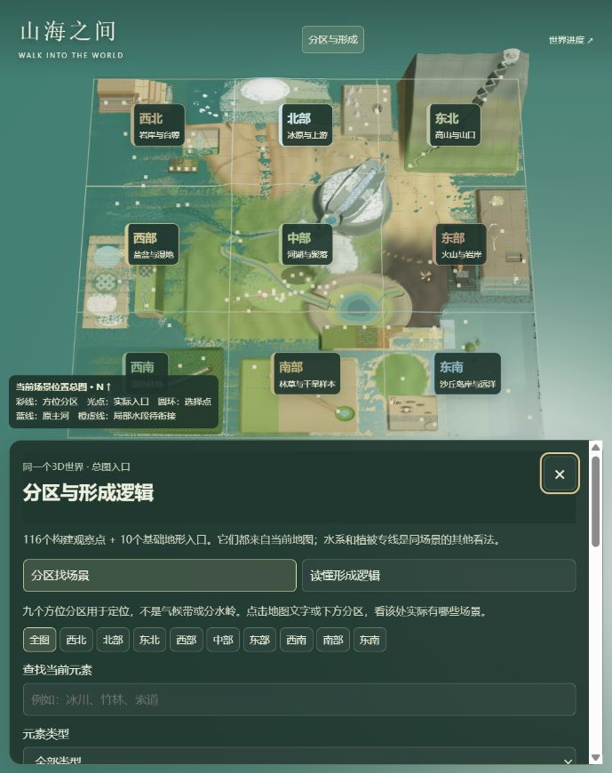
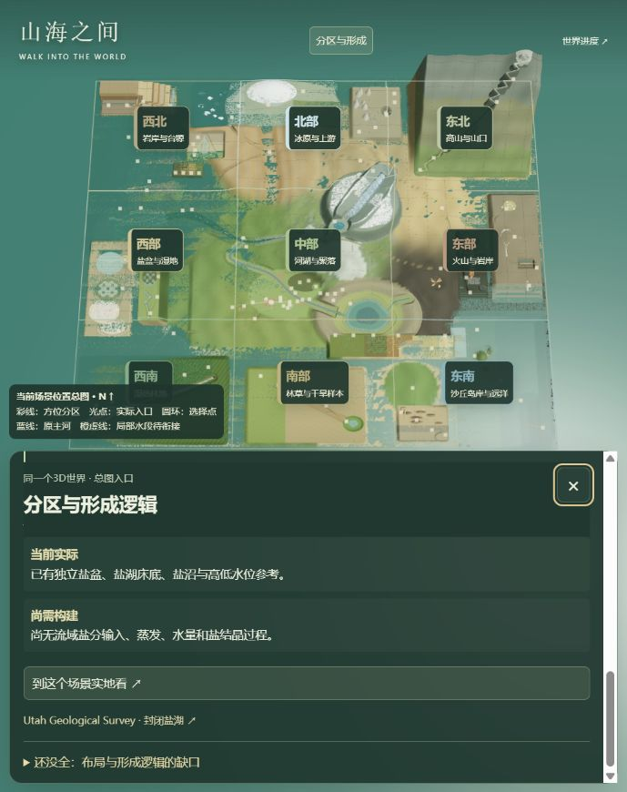

# 三条环境线 · 2026-11-19

构建 `5c313fd254a6` 在内置浏览器检查全图标记、三个观察线路、逐站移动、北境航拍播放与暂停、1 月和 7 月的风向、分水界开关及「流域收支」接续。迎风坡和背风坡的 7 月降雨指数分别为 4.7 和 1.3。戈壁和泉池处地表湿润指数分别为 24 和 82。新三线的高度、落点与边界检查通过，131 个模块语法通过。植被、分区、水量、泥沙、土壤、视角、进度和启动重点回归通过。[三线方法与实景](ENVIRONMENT-LINES.md) · [内置浏览器记录](assets/environment-lines-browser-check.json)

---

# 环境图谱与地图基座

构建 `e840014398db` 在内置浏览器核对现代图谱的 50 项记录、冰雪分类、仅看 3D 样本、关键词搜索、12 个史前剖面、太阳高度和昼长。由图谱内陆湖条目跳转后，地图在「流域收支」直接选中澄镜湖并显示当月水位。40 个现代地图入口的站点 ID 和全部图谱预览文件通过校验，原进度与分区检查通过。[图谱与范围](ENVIRONMENT-ATLAS.md) · [浏览器验收](assets/environment-atlas-browser-check.json)

---

# 土壤形成与植被过渡

构建 `20eee8970486` 在内置浏览器检查四段取样、三维剖面、河漫滩 1 月露出和 7 月受淹、河口咸淡指数、植被图层、全线、月份双向传递与原冲积扇入口。关闭对照恢复原站和常水状态。土壤检查覆盖四段土层和、湿润与盐度范围、砾石分选、耐盐分布、逐月颜色响应及植株坐标稳定。原泥沙、水量收支、植被、分区、进度、视角与启动检查通过。[形成逻辑与实景](SOIL.md) · [浏览器记录](assets/soil-browser-check.json) · [土层与植被检查](scripts/check-soil.mjs)

---

# 流水侵蚀与泥沙沉积

构建 `c5c223c3efdc` 在内置浏览器检查山口默认画面、后续四段的高低水量、三种图层、两次月份交接、播放与暂停按钮、原扇面观察站入口和关闭后的参考水位。前一构建另检查山口高低水量。年末退水后可与既有地貌对照湿地细泥层。全年两类泥沙收支的最大差额低于 2×10⁻¹³ 场景立方米。122 个源模块语法通过，原水量账本、北部水网、大地图、地图操作、扇面、全年风雨、分区与进度回归通过。[建模与截图](SEDIMENT.md) · [浏览器记录](assets/sediment-browser-check.json) · [模型和三维网格检查](scripts/check-sediment.mjs)

---

# 流域补给与水量收支

构建 `b7b6b19d7f84` 在内置浏览器对照中央主河、澄镜湖、苇泽湿地与西部盐湖的高低水位，实景确认苇泽湿地涨水覆盖低岸。前一构建检查全年风雨传递月份和地区、查看账本及退出后恢复原水位和天气。模型检查逐月闭合、下坡汇流、上下游交接、内流盆地封闭和水面裁切。详见[流域收支](WATERSHED-BALANCE.md)和[浏览器记录](assets/watershed-balance-browser-check.json)。

---

# 全年风雨

构建 `a3a9f1349671`。在 7,857 个实际高度采样点计算十二个月的水汽、降水相态、积雪、土壤和水系补给。对称山脊测试核对反向来风时迎背风互换，世界样点核对南部夏雨差、春季融水和各水系的季节响应。内置浏览器验收风向反转、降水地图、冲积扇参考水位、滑杆与播放暂停，退出后旧天气和水位恢复。未做真实降雨率、连续水动力或性能量化。详见[全年风雨](ANNUAL-CLIMATE.md)。

---

# 六段区域过渡

实际高度场加入六段山肩、鞍部、坡脚、陆地过渡和东部近岸架面。按海拔、南部迎背风、季风沿海低地与离水距离调整过渡区地表和植被。修正冲积扇上游占入浮冰湾的问题，并让北部支谷两侧的原道路接地连续。

最终构建 `196f2ccabd65` 在内置浏览器检查六段定位、解释、标记和缩放，旧分区仍显示126个入口。核对116处构建站平面坐标、464个观察ID、11501处原主线平面采样和16027处南部地形采样。2米网格检查盐湖和盐沼的连通低地留在盆内。112个模块通过语法检查。有关详细范围、实景和水热设定，见[区域过渡](REGIONAL-GEOGRAPHY.md)。

---

# 鼠标与地图缩放修复 · 2026-11-18

总览原先每帧固定相机，拖动输入会被覆盖，也未接入滚轮缩放。本轮保留原总览构图，再应用用户旋转、平移与缩放；地面镜头只改变视野，小地图按实际三维投影缩放并聚焦当前位置。

- [check-view-controls.mjs](scripts/check-view-controls.mjs)使用实际Three.js 0.180.0 OrbitControls与合成DOM事件：滚轮、左拖、右拖、双指捏合、方向键、输入框保护、逐帧姿态保持、复位、地面位置不变、小地图2×投影和聚焦均通过。[报告](assets/view-controls-check.json)。这不是原生鼠标或手机实测。
- 原世界分区、北部水网、高原连接带、进度与完整导航启动检查通过。[回归记录](assets/camera-regressions.json)。新增小地图事件绑定所需的DOM模拟方法已补齐，原几何和22种导航模式断言继续保留。
- 浏览器初始化曾因新增控制引用局部canvas变量失败，已改为直接查找实际画布；最终启动、交互与图片范围见[camera-browser-check.json](assets/camera-browser-check.json)。
- 本机资源逐字节与依赖校验见[camera-preview-check.json](assets/camera-preview-check.json)。没有变更地形、原站点、观察ID或手记存储键；也没有发布部署。

最终构建 `caf94635aad8` 在内置浏览器启动成功，＋/−、原生左拖、滚轮和复位均实测；右拖与触屏仍限合成事件检查。111个源模块语法、126个本机资源逐字节与469个相对导入检查通过；没有捕获最终版本的错误或警告，旧版本初始化错误单独保留记录。

具体操作见[CAMERA-CONTROLS.md](CAMERA-CONTROLS.md)。以下保留此前记录的当时范围。

---

# 北部双支流整合 · 2026-11-18

在原116站464处基础上，新增岩层与扇面上游、两条出流谷地及共同汇口；两侧绕过原高台森林，再接原中央主河到海湾。详见[NORTHERN-WATERSHED.md](NORTHERN-WATERSHED.md)。全图气候、岩性、分水岭与水量收支仍未统一。

- 新增五段实际水路约1.72km；两档参考水位共30010个中心采样，下游最大抬水0，实际床底最小中心深度约2.8m，48×48最低水文网格插值后最小露水高差约1.77m；46819个实际水面三角形与常水条件下的陆生植物根部检查通过。常水/涨水只改变水面，不重建地形；另对11502个全岸区地形点逐项比较，避免只校验河道中心。
- 原岸路跨越新支流的2000个移动采样通过。新增两条教学巡河线各10处检查点；与原高原地面线三条路线的完成、暂停、继续通过CPU检查。北部巡河使用独立观察模式，不触发海床观察；实际跟随控制器另有断言。638/1029/1280宽度的连接总览检查保证新水路在面板外。[主报告](assets/northern-watershed-check.json)。
- 与构建2cc37ea27a1f比较，原116个观察站三维位置逐项一致，464个观察ID保留；11501个原主线采样平面位置不变。局部新地形会改变途经路段的高度，本轮没有声称整条三维轨迹不变。[保留性报告](assets/northern-preservation-check.json)。
- 岩层、冲积扇、寒温带森林、世界分区、进度、高原连接带、大地图、海岸、内陆水域、交通等11组重点检查通过；完整导航构造与22种导航模式CPU检查也通过。[回归记录](assets/northern-regressions.json)。
- 110个JS模块语法检查通过。最终构建eb2fe23af90d的本机资源和相对导入校验见[northern-preview-check.json](assets/northern-preview-check.json)。没有发布部署。
- 内置浏览器的实际画面与交互范围见[northern-browser-check.json](assets/northern-browser-check.json)。本轮发现巡河状态复用旧海床提示，已分离观察标记并加实际控制器回归；巡河暂停保留镜头，关闭后返回原站点。完整116站浏览器行程、北部全程浏览器播放、真机和GPU性能仍未系统验证。

以下保留此前记录的当时范围。

---

# 首条实际地理连接带 · 2026-11-17

本轮保留原116站464处，实际增加高原塘群—连续坡脚—下切溪谷—原雨林河网—红树林—海口连接。仍是固定创作地形，不代表全图自然关系已完整。详见[WATERSHED-INTEGRATION.md](WATERSHED-INTEGRATION.md)。

- 新溪长度约861.31m，水面220→14m；之后沿原雨林河网14→0m。8001个中心水面采样单调下降，实际高度场最小中心深度1.5m，最低水文网格48×48插值后中心最小露水高差约0.94m。新增出水步桥保留原水槽，桥下水面净空超过3m。
- [check-watershed-link.mjs](scripts/check-watershed-link.mjs)检查新河床、水面网格、根部落地、湿岸植被、桥面支撑、24000个全线地面移动采样及实体道具净空、八个导览检查点、暂停继续与终点。三种宽度638/789/1280的总览投影检查保证检查点处在面板外；[报告](assets/watershed-link-check.json)。
- 原主线11501个位置采样与改动前构建248fce553059完全一致，464个观察ID逐项一致；[保留性记录](assets/watershed-preservation-check.json)。这不表示整个高度场或每一株树原封不动：新陆地与溪谷改变区域间地形，局部雨林道具为连接带让出净空。
- 高原、雨林、分区、进度、大地图、内陆水域七组最终重点回归通过；本轮另有原水系、完整导航启动、高山、生产、交通、森林、冰川、海岸、聚落、竹林季风林沙丘、天气检查通过。新增步桥允许在原出水槽上方通行，因此原高原检查增加“仅桥面处可过水”的明确预期；床底和原水面检查继续保留。[回归记录](assets/watershed-regressions.json)。
- 107个源模块语法检查通过。最终构建2cc37ea27a1f的120个本机资源逐字节一致，445个相对模块导入可解析；[HTTP记录](assets/watershed-preview-check.json)。只服务本机，没有发布部署。
- 浏览器实测构建66e4a51061b2的暂停、继续、分层、总览和实际接点；之后仅移除汇接处8个误入原河网的地被落点，以全水域落点断言和最终模块/HTTP检查复核，没有再作最终构建的完整GPU重载验收。
- 浏览器实景范围与图片见[验收记录](assets/watershed-browser-check.json)。没有进行完整116站浏览器行程、手机真机、帧率或低端GPU测试。
- 实景发现原雨林源头圆池共用顶点色材质却缺少color属性，显示黑色；已补齐属性并加回归检查，修正后实际水面可见。连接带总览做面板避让，终点视角朝向海面。启动和连续快速跳点曾发生浏览器控制超时，页面仍正常，分步读取后恢复；未将其记作性能通过。
- 扇面与岩层溪流、泥炭微洼补给、全图气候水热、岩性构造、分水岭和收支仍未统一；无降雨径流、侵蚀输沙、盐度、地下水或生态演替演算。

以下保留此前记录的当时范围。

---

# 单图分区与形成逻辑 · 2026-11-17

当前仍不是所有自然类型和关系均完整的世界。本轮把同一3D场景中的116个构建观察点、10个基础地形入口按九个方位区整理，增加19类形成说明、六章形成主线和15份机构资料链接；站点数仍为116站464处。41项清单：完成展示4、简化样本32、尚未制作5。

- [WORLD-LOGIC.md](WORLD-LOGIC.md)解释布局、成因和缺口。九区是导航分区，当前没有把它们当作真实气候带、流域或构造边界；整体自然地理重排仍未完成。
- [check-world-logic.mjs](scripts/check-world-logic.mjs)检查126个入口与实际源坐标一一相等、唯一归属、七类筛选、19类形成卡、六个章节场景，以及九区线框、原主河和八段局部水线、三种视口镜头与面板避让；[报告](assets/world-logic-check.json)。
- 原主河使用蓝线，后加塘溪、扇面分汊和岩层溪流用橙色虚线标为待接。形成说明区分冰川/海冰、普通天气/极光、泉水补给/静态绿洲，避免仅按形状套用成因。
- 世界分区、进度、完整导航启动、天气、竹林季风林沙丘、森林、高山、岩溶、内陆湖、海岸和聚落共11组检查通过；104个模块语法、151个地图ID及105个直接控制器ID引用核对。最终构建`248fce553059`的116个本机资源逐字节一致，428个相对导入可解析；[汇总](assets/world-logic-regressions.json)。
- 内置浏览器实测126入口与九区总图，竹林检索2项、盐湖检索4项，形成卡定位盐湖后进入对应实际场景，并从该站的形成入口回到说明；最终回到126入口的总图。[浏览器记录](assets/world-logic-browser-check.json)。
- 实景验收发现页眉继承`pointer-events:none`，导致新按钮可见但点击落向画布；已给新入口显式开启点击，并通过实际开关往返验收。每站形成按钮移到卡片标题栏，面板关闭按钮保持可见。启动阶段出现过浏览器读取超时，最终正常加载；未作首屏耗时与GPU性能的量化验收。
- 当前完成的是位置整理、检索和有来源的形成介绍；完整气候分带、宽过渡、岩性构造底图、局部水网统一及真实过程仍未实现。四层开关是制作拆解，不等于自然演化时间顺序。

以下保留此前验收记录的当时范围。

---

# 竹林、季风林与海岸沙丘六站 · 2026-11-17

同一连续丘坡接向海岸，新增竹林林缘、竹林内部、湿润季风密林、较干季风疏林、前缘沙丘和背风沙丘六站。当前116站464处，40项清单：完成展示4、简化样本31、尚未制作5。详见[WARM-WORLD.md](WARM-WORLD.md)。

- 978根实体竹秆、7824道节环、2934组叶簇；季风林143/48株对比树高冠幅和密度，38簇前缘草、311簇背风草和36处低灌依地面落位。20000个连续通行采样、实际阻挡、根部支撑、四层控制器和三种视口全貌镜头通过；[报告](assets/warm-check.json)。
- 回归发现最初 footprint 影响原湖岸和海上通道；已将北界收回到z=660，并为南侧原水道保留宽开口，保留原测试重新通过。最终沙脊、低鞍、湿滩和实际海床、水面裁切检查通过。
- 与保留的上一版核心源码对比10901个旧路线采样，最大变化约1.6e-10m；旧110站440个观察ID和存储键保留。原有29组回归及完整导航构造22种模式通过；[汇总](assets/warm-regressions.json)。
- 101个JS模块语法、149个唯一地图ID、104个直接控制器ID引用核对通过。最终构建`d01c2717857e`：112个本机页面、样式、模块与运行库逐字节一致，418个相对导入可解析；根索引31项目同步检查通过。
- 内置浏览器实际进入六站，116个主线控件出现、无启动错误；竹林内部四层按钮均实际点击，并保存地形、覆盖、植被骨架、完整群落画面。[浏览器记录](assets/warm-browser-check.json) · [竹林](assets/warm-bamboo-inner.jpg) · [季风密林](assets/warm-monsoon-dense.jpg) · [前缘沙丘](assets/warm-dune-front.jpg) · [背风沙丘](assets/warm-dune-back.jpg)。
- 本次仅验证新增六站所选画面和竹林四层操作，未作完整116站行程、全部天气或GPU性能验收。湿润/较干季风林是空间样本，没有真实物候、生长、降雨过程、风沙输运或沙丘迁移。

以下保留此前验收记录的当时范围。

---

# 寒温带森林群落四站 · 2026-11-17

针叶林、针阔混交林、白桦疏林与倒木苔藓林地接入原大地图；当前110站440处，37项清单：完成展示4、简化样本28、尚未制作5。详见[BOREAL-WORLD.md](BOREAL-WORLD.md)。

- 211株乔木、九根倒木、1349处林下地被形态、675处落叶和34株幼树；实际地面支撑、树干倒木阻挡、连续干地路线与四层控制器检查通过。12000个实际移动采样，三种视口全貌镜头检查通过；[报告](assets/boreal-check.json)。
- 与上一版`2ab28f00f7dc`比较10501个旧路线采样，最大变化约1.2e-10m；旧106站424个观察ID与存储键保留。完整导航构造及21种模式、原有28组环境/水系/聚落等CPU回归通过；[汇总](assets/boreal-regressions.json)。
- 98个JS模块语法、147个唯一地图元素ID、102个直接控制器ID引用核对通过。最终构建`7c6788b7dd01`：109个本机页面、样式、模块与运行库逐字节一致，404个相对模块导入可解析；根索引31项目同步通过。
- 内置浏览器实际进入四个场景，110站控件出现、无启动错误。混交林已点击基底/完整两层并看到讲解变化；针叶林初次实景后调整图例位置，最终版图例不再覆盖小地图。[浏览器记录](assets/boreal-browser-check.json) · [混交林实景](assets/boreal-mixed.jpg) · [白桦疏林](assets/boreal-birch.jpg) · [倒木林地](assets/boreal-deadwood.jpg)。
- 这次只验证新增四站的所选画面与部分图层操作；完整110站行程、全部天气与GPU性能仍未系统验收。固定群落没有真实气候分带、生长、分解或生态演替，新树木也尚无独立物候响应。

以下保留此前验收记录的当时范围。

---

# 大地图启动修复与高原湿地 · 2026-11-17

修复小地图构造中的 `tergeoHeight` 与 `terdryHeight` 未定义变量，均改为已经导入的 `terrainHeight`；程序错误不再统一提示成浏览器不支持WebGL。此前几何与原型方法检查没有执行完整导航构造，未覆盖本错误，本轮补齐该缺口。

- 已在内置浏览器实际进入修复后的雅丹地图，启动遮罩和错误页消失，场景、导航与主线控件正常出现；这只代表启动实测，不代表所有场景和GPU性能均已验收。
- 新增 `scripts/check-map-startup.mjs`：执行完整导航构造及20种导航模式，真实Three.js几何不替换，仅以CPU渲染器与DOM绘图替身隔离GPU；[报告](assets/map-startup-check.json)通过。
- 同时接入高原草甸、泥炭样草丘浅洼、塘群与溪流四站，当前106站424处，保留旧102站408个观察ID及存储键。36项清单：完成展示4、简化样本27、尚未制作5。
- `scripts/check-upland.mjs`：18000个干岸移动采样、4004个水道采样，槽心至少约1.4m深；五处塘洼、四段通道、干湿斑块与水面裁切通过。7867簇低草、1931簇莎草形态、538处垫状形态依实际地面放置。
- 10101个旧路线采样与上轮实际构建对比最大变化约1.5e-10m；494处旧区域颜色对比保持一致。地表配色单次调用复用同一点高程，减少重复采样；路线无障碍标签与结束文案改用当前站数。
- 95个JS模块语法、145个唯一地图元素ID和141个控制器/UI引用核对；旧风蚀、火山、冲积、岩层、盐地、岩溶、洞穴、地质、天空、干旱、湿热、远洋、极地、森林、冰雪、海岸、高山、聚落、生产运输、天气和水系回归通过。
- 当前高程220—244m为压缩创作参数，暂无泥炭累积、碳循环、地下补给、冻融和真实物种演替。详见[UPLAND-WORLD.md](UPLAND-WORLD.md)与[CPU报告](assets/upland-check.json)。

- 最终构建 `2ab28f00f7dc`：106个本机页面、样式、脚本与运行库逐字节一致，391个相对模块导入可解析；根索引30项目同步检查通过。
- 已在内置浏览器进入最终版本高原草甸第103站，实际地形、植被、中文小地图与106站主线出现，无启动错误遮罩；[启动修复实景](assets/startup-fixed-upland.jpg)。本次只验证启动与所选场景，其他场景的逐站画面、GPU性能验收仍未完成。

以下保留此前验收记录的当时范围。

---

# 风蚀雅丹、开放通槽、石漠与砾石台地 · 2026-11-17

南部干旱区新增四站，当前102站408处观察；旧98站392个ID与存储键保留。35项清单：完成展示4、简化样本26、尚未制作5。

- `node scripts/check-yardang.mjs`通过：18000个实际移动采样，其中4621个位于通槽；三角化地表射线确认实际侧壁、开放顶部和东侧出口。
- 六组残丘写入原高度场，约39m砾台具有真实高差；267块棱角石、814块小砾石和41株低灌避开陡面及行走净空。
- 四层控制器、中文小地图和三种视口全貌相机检查通过。风向箭头为静态造型参考；本组没有新增湖池或河流，不模拟风蚀、积沙或砂粒输运。
- 最终构建 `f5ecceb30cf6`：103个本机页面、样式、脚本与运行库逐字节一致，377个相对模块导入可解析；根索引28项目同步检查通过。
- 与上轮实际构建比较9701个旧路线采样，最大变化约1.5e-10m。旧火山、冲积、岩层、盐地、岩溶、洞穴、地质、天空、干旱、湿热、远洋、极地、森林、冰雪、海岸、高山、聚落、生产运输、天气和水系回归通过。
- 92个JS模块语法、143个唯一地图元素ID与139个控制器/UI引用核对通过。观察站数不代表完整游戏或全部自然环境已经完成。
- 按用户选择，浏览器实景、GPU和性能验收继续暂缓，无新增截图。详见[YARDANG-WORLD.md](YARDANG-WORLD.md)与[CPU报告](assets/yardang-check.json)。

以下保留此前验收记录的当时范围。

---

# 火口、熔岩流槽、玄武岩与柱状节理 · 2026-11-17

原火山区东侧新增四站，当前98站392处观察；原主火口和旧94站376个ID、存储键保留。34项清单：完成展示4、简化样本25、尚未制作5。

- `node scripts/check-volcanic.mjs`通过：18000个实际移动采样、1001个熔流高程与床底采样，槽心最小高差2m，发光面按实际地形裁切。
- 火口90m亮面下有约82m床底，流槽降至40m；79根六边形柱岩有实际顶面、侧壁、基底与阻挡，柱群实例化绘制；372块玄武岩碎块与8株低灌避开观察路径及活动表面。
- 四层控制器、中文小地图、减少动态冻结辉光/流向示意、三种视口全貌相机检查通过；熔岩与河流海水数据分开。
- 最终构建 `c9d6a2e9572d`：100个本机页面、样式、脚本与运行库逐字节一致，364个相对模块导入可解析；根索引26项目同步检查通过。
- 与上轮实际构建对比9301个原路线采样，最大位置变化约1.2e-10m。旧冲积扇、岩层、盐地、岩溶、洞穴、地质、天空、干旱、湿热、远洋、极地、森林、冰雪、海岸、高山、聚落、生产运输、天气与水系回归通过。
- 89个JS模块语法、141个唯一地图元素ID与137个控制器/UI引用核对通过。当前为熔岩表现和固定冷却岩体，暂无喷发、热传导、黏性流体、凝固过程、伤害或攀爬。
- 按用户选择，实景、GPU与性能验收继续暂缓，无新增截图。详见[VOLCANIC-WORLD.md](VOLCANIC-WORLD.md)和[CPU报告](assets/volcanic-check.json)。

以下保留此前验收记录的当时范围。

---

# 冲积扇、辫流、沙砾洲与洪泛地 · 2026-11-17

北部内陆新增四站，当前94站376处观察；旧90站360个ID与浏览记录键保留。33项清单：完成展示4、简化样本24、尚未制作5。

- `node scripts/check-fan.mjs`通过：常水/涨水两档各15000个实际移动采样、6006个分汊采样（槽心最浅约1.8m）、洲地露出与水岸裁切检查。
- 同一床底、924块砾石、532簇低草与8株低灌保持原位；涨水抬高1.1m，水面面积由约6802㎡扩大到13768㎡。当前为手动参考，不是洪水演算。
- 四层控制器、实际水位按钮、小地图状态同步与三种视口全貌相机检查通过；岸缘细分与裁切使用真实地面，两档水面几何缓存供场景复用。
- 最终构建 `b0a483ef382a`：97个本机页面、样式、脚本与运行库逐字节一致，351个相对模块导入可解析；根索引26项目同步检查通过。
- 与上轮实际构建对比8901个原路线采样，最大变化约1.1e-10m；旧岩层、盐地、岩溶、洞穴、地质、天空、干旱、湿热、远洋、极地、森林、冰雪、海岸、高山、聚落、生产运输、天气、水系与观察数据回归通过。
- 86个JS模块语法、139个唯一地图元素ID和135个控制器/UI引用核对通过。局部水段尚未接回原主河；暂无降雨、泥沙输运、冲淤或自动季节水循环。
- 按用户选择，实景、GPU与性能验收继续暂缓，无新增截图。详见[ALLUVIAL-WORLD.md](ALLUVIAL-WORLD.md)与[CPU报告](assets/fan-check.json)。

以下保留此前验收记录的当时范围。

---

# 岩层、矿脉、台塬与阶地 · 2026-11-17

西北四站接入同一地图，当前90站360处观察；旧86站344个ID与存储键保留。当前32项清单：完成展示4、简化样本23、尚未制作5。

- `node scripts/check-strata.mjs`通过：18000个实际移动采样、1001个水段采样（中心最小3m深、无逆向抬水）、199处水面射线与15处贴岩矿脉视线检查。
- 岩壁35m壁脚、108m顶面及86/62/38m台面有实际高程，缓坡连接至26m低岸；三条矿脉曲面贴合三角化岩壁，27簇晶体与5块近景样本有体积。
- 623簇低草、32株低灌避开陡面、深水和观察路径。四层控制器、中文小地图定位与三种视口全貌相机检查通过。
- 最终构建 `fb56a3174afa`：94个本机页面、样式、脚本与运行库逐字节一致，336个相对模块导入可解析；根索引25项目同步检查通过。
- 与上轮实际构建对比8501个旧路线采样，最大变化约1.2e-10m。旧盐地、岩溶、洞穴、地质、天空、草原干旱、湿热、远洋、极地、森林、冰雪、海岸、高山、聚落、生产运输、天气、水系及进度回归通过。
- 83个JS模块语法、136个唯一地图元素ID、132个控制器/UI引用核对通过。局部溪流尚未接回原主河，矿脉不代表真实矿种、品位或采矿能力。
- 浏览器实景、GPU与性能验收按用户选择继续暂缓，无新增截图。详见[STRATA-WORLD.md](STRATA-WORLD.md)与[CPU报告](assets/strata-check.json)。

以下保留此前验收记录的当时范围。

---

# 内流盐地环境 · 2026-11-17

盐湖、盐沼、盐壳滩地和干涸湖盆四站接入西部同一大地图，当前86站344处观察；原82站328个观察ID、存储键与路线保留。31项清单：完成展示4、简化样本22、尚未制作5。

- `node scripts/check-salt.mjs`通过：高低两档各15000个实际移动采样，湖心深度4m/2m、湖床不变、水面按微地形裁切；高水位盐沼面积约14317㎡，低水位样本露出，干盆保持干燥。
- 305簇低草、89株灌丛避开水体、盐壳核心和观察通路；1026段盐壳裂纹配合凸起棱脊，干盆旧岸阶地有实际高程。
- 实际四层控制器、水位按钮、小地图状态同步与三种视口全貌相机检查通过。80个JS模块语法、134个唯一地图元素ID及130个控制器/UI引用核对。
- 最终构建 `93db6f7c632e`：91个本机页面、样式、脚本与运行库逐字节一致，322个相对模块引用可解析；根索引24项目同步。
- 与上轮实际构建比较8101个原路线采样，最大位置变化约8e-11m；保持原海湾视线与水系。旧洞穴、岩溶、地质、天空、干旱、湿热、远洋、极地、森林、冰雪、海岸、高山、聚落、生产运输、天气与水系检查通过。
- 两档水位为手动参考，尚无蒸发、地下补给、水量循环、盐分输运或盐结晶过程。浏览器实景和GPU性能验收继续按用户选择暂缓；无新增实景截图。

详见 [SALT-WORLD.md](SALT-WORLD.md) 与 [CPU报告](assets/salt-check.json)。以下保留此前验收记录的当时范围。

---

# 岩溶与垂直地下环境 · 2026-11-17

峰林、石林、天坑、竖井、多层洞穴、地下河六站接入北部同一地图，当前82站328处观察。保留旧76站304个观察ID、7501个原路线采样和原浏览记录键。当前30项清单：完成展示4、简化样本21、尚未制作5。

- `node scripts/check-karst.mjs`：27540个步行采样、9540个地下采样、2458个升降采样，954段实际地表/洞壁/洞顶遮挡射线检查通过。
- 上下层高度独立，平台与乘客同步，暂停保留位置；小地图不改变平台物理状态；中央竖井没有0m海面或多层地板封堵。
- 四层控制器、上下层剖视与地表裁切恢复、减少动态和三种视口的实际剖视相机检查通过。
- 最终构建 `0b21fa6cd462`：88个本机页面、样式、脚本与运行库逐字节一致，307个相对模块导入可解析；根索引24项目同步检查通过。
- 77个JS模块语法、131个唯一地图元素ID与127个控制器/UI引用检查通过；旧地质、天空、干旱、湿热、远洋、极地、森林、洞穴、冰雪、海岸、高山、聚落、生产、运输、天气、水系和进度回归通过。
- 使用本项目已有Three.js 0.180.0，无新增依赖；源码采用原子写入并保存本轮D盘检查点。F盘空间不足时，对字节一致的项目运行库副本使用硬链接，并压缩本项目运行库；没有清理其他目录。
- 按用户选择只提供内置浏览器入口，实景、GPU与性能验收继续暂缓，没有新实景截图。详见 [KARST-WORLD.md](KARST-WORLD.md) 和 [CPU报告](assets/karst-check.json)。

以下为此前验收记录，保留当时站数与范围。

---

# 地质与地下环境 · 2026-11-17

东部海蚀洞、岩桥、分支洞网与火山地热四站接入同一地图，当前76站304处；旧72站和288个观察ID保留。29项清单：完成展示4、简化样本20、尚未制作5。环境过程和更多类型仍需补充，人物故事继续后置。

- 海洞保留干路、实体洞顶与连海侧槽，侧槽水面0m、低处床底−1.8m；热泉独立水位55m、床底52m。
- 120m创作跨度岩桥具有实际桥顶、拱腹与厚度，中心桥顶46.8m、拱腹32m、沟底8m；主线实际经过桥面，桥下暂为观察空间。
- 干洞网7条连线组成入口、尽端支洞与一个回环；以空腔并集生成边界，交汇处无封闭隔墙。洞口移除相交地表三角面，覆盖岩体仍保留，上方行走不会误入洞内。
- 7101个旧路线位置、26880个实际移动采样（地下12524、桥面1855）、洞口裁切与恢复、空腔壁面射线、桥面几何/支撑一致、水深与阻挡、实际四层控制器和3种视口比例的剖视/侧看相机检查通过。
- 地热3个气口共240个蒸汽点，依附实际地表；减少动态冻结蒸汽，地下教学补光仅在新洞体中启用。当前没有热循环、真实侵蚀、潮汐、压力或伤害。
- 既有地下、森林、水域、冰雪、极地、远洋、湿热、草原、天空、聚落、高山与生产交通CPU回归通过。73个JS模块语法、128个唯一地图ID和124个UI引用有效。
- 最终构建 `939ff04d1336`：84个localhost页面、样式、脚本与运行库和dist逐字节一致，288个相对模块导入可解析；登记表与根README同步。

磁盘空间波动曾截断项目README与生成版large-map.js：README从本次对话历史完整重放31次编辑恢复（含既有章节），生成版由源文件重新构建。构建现采用临时文件写完后原子替换，低于16MiB可用空间时提前停止；模拟fsync和replace失败证明旧文件保持完整，成功替换及相同文件跳过也已检查。恢复快照在本次可写可视化目录，未清理其他项目、应用缓存或ReflectFlow数据。

继续按用户选择仅提供内置浏览器入口，GPU实景与设备性能验收暂缓，没有新增或冒充截图。详见[GEOLOGY-WORLD.md](GEOLOGY-WORLD.md)、[CPU报告](assets/geology-check.json)与[资源核对](assets/geology-preview-check.json)。

---

# 天空与特殊天气 · 2026-11-17

四站复用现有草原、疏林、戈壁与绿洲，新增云层变化、雷暴闪电、沙尘与夜空。当前72站288处，原68站与272个观察ID保留；28项清单为完成展示4、简化样本19、尚未制作5。

- 两个云层高度带、低频折线电光和短暂补光、900个近景尘粒、520个程序化星带点，雷暴与沙尘已进入真实天气参数、选择器和更新流程。
- 6701个旧路线位置与20000个实际地面移动采样通过；四站视线及3种视口比例下远处闪电在默认观看方向内的实际相机投影通过。
- 闪电约每12秒一次单脉冲；关闭闪电、减少动态、室内/地下/水下及俯视剖视遮蔽检查通过。沙尘无雨湿，星点与月光受云尘遮蔽。
- 实际分层控制器固定地形与水面；静默预设不取消主线导览，恢复入口保留原天气、季节、时刻、时钟播放和速度，并暂停导览。个人观察键未更改。
- 天气、草原、湿热、海洋、极地、洞穴、森林、冰雪、高山、聚落、生产与交通及基础路线CPU回归通过。原海床条件分带边界作数值归整，消除多次路线缩放导致的约0.22m边界误差；海岸测试改用实际当前站点数，避免旧固定52站把海岸采样错映到索道段。
- 最终构建 `535e4c245c30`：69个JS模块语法、125个唯一地图ID、121个UI引用有效；80个localhost页面、样式、脚本与运行库和dist逐字节一致，269个相对模块导入可解析；登记表与根README同步。

继续按用户选择仅提供内置浏览器入口，实景、GPU着色器编译与设备性能验收暂缓，无新增截图。云层、闪电、尘粒和星带均为表现层，未模拟体积云、真实气象、天文坐标、雷击伤害或声音。详见[SKY-WEATHER.md](SKY-WEATHER.md)、[CPU报告](assets/sky-check.json)和[资源核对](assets/sky-preview-check.json)。

---

# 草原、戈壁与绿洲 · 2026-11-17

南部同一大地图追加连续草原、林草过渡、戈壁砾地、干谷与绿洲五站，当前68站272处观察；旧63站和252个观察ID保留。27项清单：完成展示4、简化样本18、尚未制作5，下一步环境优先天空天气。

- 正式高度场区分低起伏草原、疏林缓丘、戈壁、下切干谷与池盆，泉池水位12m、中心床底8m。干谷保持无常流水，池心禁止地面步行进入。
- 1965个草丛、2093块实际砾石、280个矮灌及38株过渡/绿洲冠树，按干湿与距水位置分布，通路保持净空。
- 6201个旧路线位置、五站高程和视线、12000个实际步行及12000个转场采样通过；水深、干谷、素材落点、分布梯度、实际分层控制器及3种视口比例的干湿全貌相机检查通过。
- 森林、湿热、洞穴、冰川、海洋、极地、高山、聚落、生产、交通、天气与基础路线CPU回归通过。67个JS模块语法、121个唯一地图ID与117个UI引用有效，登记表和根README同步。
- 最终构建 `10da724e135b`：35个localhost资源与dist逐字节一致，263个相对模块导入可解析。

本轮磁盘写入中断已恢复：从已有构建恢复完整控制器，仅将本项目已逐字节验证相同的生成版three.core.js与源码运行库建立硬链接，并让构建跳过相同文件复制；源文件及预览运行库均有效。未处理其他项目或ReflectFlow路径。

按用户选择仅提供内置浏览器入口，实景与GPU性能验收暂缓，无新增截图。干湿和静态泉池为创作参数，没有地下补给、水量平衡或真实气候生态模拟。详见[DRYLAND-WORLD.md](DRYLAND-WORLD.md)、[CPU报告](assets/dryland-check.json)与[资源核对](assets/dryland-preview-check.json)。

---

# 雨林与红树林 · 2026-11-17

西南同一大地图追加林缘、林冠、林下、淡水河岸、红树林与河海交界六站。当前63站252处；原57站与228个观察ID保留，26项清单为已完成展示4、简化样本17、尚未制作5。

- 正式高度场新增高林地、泥岸与三条连通河道；河心水位从14m下降到0m，两条分汊端点与主河一致，海口共用海平面。501个纵向水位与三条水带内部顶点/真实床底关系检查通过。
- 714株雨林乔木、86株红树林、1141个林下实例；3372段板根与支柱根贴实际地面，1666段垂藤承接高处空间。树干与根系退让通路，6000个实际地面移动采样通过。
- 六站视线、24000个新路线采样、5601个旧路线位置、原观察ID、实际四层控制器、冠层开合状态及3种视口比例的湿热全貌相机检查通过。林冠为距地26m教学镜头，不登记为步行平台。
- 既有森林、洞穴、内陆水域、冰川、极地、远洋、聚落、高山、生产、交通、天气与基础路线CPU回归通过。共64个JS模块语法、119个唯一地图元素ID、115个UI引用有效。
- 最终构建 `92b51f18f316`：32个本机HTTP资源与dist逐字节一致，248个相对模块导入可解析，登记表与根README检查通过。

按用户选择只提供内置浏览器入口，实景与GPU性能验收继续暂缓，无新增截图。湿润盐湿为创作参数、潮位固定，未模拟真实物种生态、盐度输运、潮汐或分区气候。详见[TROPICAL-WORLD.md](TROPICAL-WORLD.md)、[CPU报告](assets/tropical-check.json)与[资源核对](assets/tropical-preview-check.json)。

---

# 远洋与深海 · 2026-11-17

同一大地图东南侧追加外海、群岛、大陆架、大陆坡与深海海沟五站；当前57站228处观察，旧52站全部路线位置和208个观察ID保留。统一清单25项：已完成展示4、简化样本16、尚未制作5；下一步环境补全转到雨林与红树林。

- 海面统一0m，五站床底分别约−28.8m、−10.0m、−67.3m、−161.0m、−370.5m；三座岛体露出水面并保留水下基座。深度是紧凑地图创作尺度。
- 正式视图复用TerrainTiles地形；独立海洋小地图共用同一高度函数，直接显示五种地形文字、水深颜色与连续主线；海洋剖视移开同一海面并保留观察位置。
- 832个专用实例按深度与坡面布置；深处无光合植物。深水浮动教学镜头、补光、雾距、移动边界和真实分层控制器检查通过。
- 24000个新路线采样、5101个旧路线位置、五站视线和3种视口比例下的实际剖视相机检查通过；旧林地保持3397个实例，通路采样保持原密度。
- 既有森林、洞穴、冰川、海岸、内陆水系、极地、高山、聚落、生产、交通、天气及基础路线CPU检查通过；完整56段导览更新函数共9016帧通过。
- 最终构建 `26e56cae2945`：61个JS模块语法、116个唯一地图ID、112个UI引用检查；29个本机HTTP资源与dist逐字节一致，232个相对模块导入可解析。

按用户选择只提供内置浏览器入口，实景与GPU性能验收继续暂缓，没有新增实景截图。以上检查不证明最终像素效果、自然深海可见度、真实地质生态、航行或潜水。详见[OCEAN-WORLD.md](OCEAN-WORLD.md)、[CPU报告](assets/ocean-check.json)和[本机资源核对](assets/ocean-preview-check.json)。

---

# 极地环境与极光 · 2026-11-17

当前52站208处，新增极地海岸、海冰冰山、冰盖、苔原和极光夜景五站，旧188个ID保留。24项清单共已完成展示4、简化样本15、尚未制作5；补全顺序改为环境优先，原室内/人物/内容计划后置保留。

- 新增97个CPU网格、3座冰山、7块海冰、中心厚42m冰盖、420个矮植被及中心深2m融水池；冰体水下顶点与床底净空最小约5.26m。
- 五站实际楼面与视线、12000个极地主线和20000个连接线步行采样通过，北部岩床与冰盖步行高度分别检查。
- 极光昼夜、云雾、位置与遮蔽条件、减少动态、原天气保留检查通过；对应实际ShaderMaterial和实际夜景控制函数。新增着色器尚未GPU实景验收。
- 主线整数分段作浮点边界归整，避免索道端点偶然落到相邻段；原生产、交通、森林、洞穴、冰川、海岸、高山与天气检查继续通过。
- 继续依用户选择，仅提供内置浏览器入口，实景与性能验收暂缓，无新增实景截图。

最终核对：58个JS模块语法、114个唯一地图元素ID、94个控制器/UI引用、dist相对导入与3种视口比例的极地全貌相机检查通过；26个本机HTTP资源与最终构建逐字节一致。该核对不包含GPU渲染。

结果见[polar-check.json](assets/polar-check.json)，范围与后续环境计划见[POLAR-WORLD.md](POLAR-WORLD.md)。以下为历史记录，不代表新增极地画面已经验收。

---

# 交通运输与公共设施 · 2026-11-17

当前47站188处，增加道路、桥梁、码头、转运场、公共取水与检修休憩六站，旧164个观察ID保留。22项清单共已完成展示4、简化样本13、尚未制作5；前两步已接入简化展示，下一步深化室内与物件用途。

- 新场景129个网格；14400个道路与主线步行采样、1002个栈台支撑点、4004个船底角点检查通过。船底距床底最小约2.03m。
- 联运正常72秒共2880帧；8份货物和公共水储备逐帧核对，暂停/续播/重置、桥头等待与重开、已上桥车辆继续驶离、手动取水与检修放行检查通过。
- 实际updateTransport控制器向原ProductionFlow只交接一次8份渔获；从仓储继续，4份留仓，4份加工并供家庭使用，没有重复生成货物。
- 原生产、洞穴、森林、冰川、海岸、聚落、高山和天气检查通过。继续沿用用户只提供内置浏览器入口的选择，实景与GPU性能验收暂缓；没有新增实景截图。

最终预览核对：23个本机HTTP资源与最终构建逐字节一致，新增画面仍未实景验收。

最终源码检查：55个JS模块语法、111个唯一地图元素ID、91个控制器/UI引用及dist相对导入通过；交通全貌在3种视口比例下包含六站、上游集货点与原粮仓。

具体范围见[TRANSPORT-SERVICES.md](TRANSPORT-SERVICES.md)，结果见[transport-check.json](assets/transport-check.json)。以下保留历史记录，不代表新增区域已经完成画面验收。

---

# 生产生活链 · 2026-11-17

当前41站164处，增加资源林地、农田、渔场、仓储、市场、作坊和住宅七站，旧136个观察ID保持；进度清单22项：已完成展示4、简化样本12、尚未制作6。生产生活链由计划改为简化展示，长期经济与居民需求仍未实现。

- 生产场景137个网格（作物单独使用360实例）、实际楼面/门洞、渔场栈台、货架、餐桌与家具阻挡检查通过。
- 主线与运输通路18000个步行采样、粮仓与住宅4000个门洞往返采样通过；货车停在交接位置，不进入桌椅。
- 三条55秒批次逐帧核对原料/成品数量，共6600帧；暂停、续播、重播、重置、大时间步不重复出入库、面板事件和实际跟随控制器检查通过。
- 修顺旧源头岸路在参数边界约11m的位置跳变；水面、水深与旧观察站点保持。返程长连接段的连续性用更小参数步检查，不把路径参数速度当成实际步行速度。
- 继续遵照用户选择，仅提供内置浏览器入口，新增场景实景与GPU性能验收暂缓；没有新增或冒充实景截图。

最终构建核对：50个JS模块语法、95个唯一地图元素ID、75个控制器/UI引用和dist相对模块引用通过；18个本机HTTP资源与构建逐字节一致，生产全貌相机在3种视口比例下可包含七站；根索引21项目检查通过。原有洞穴、森林、冰川、海岸、聚落、天气、大地图和植被检查均通过。

结果见[production-check.json](assets/production-check.json)，范围与方法见[PRODUCTION-LIFE.md](PRODUCTION-LIFE.md)。下方保留历史验证，不代表当前新增区域已经完成画面验收。

---

# 高山、主峰与索道 · 2026-11-17

本轮在东北山地增加山脚村落、盘山路、峡谷吊桥、索道上下站、山脊与主峰七站。当前34站136处，保留原27站108个观察ID及路线位置。

- `check-mountain.mjs`：七站支撑与默认视线、388个网格的有限几何、四层开关、12000个山路步行采样、16000个聚落连接线步行采样、索道双向共1280个导览帧、暂停同步及手动到站退出通过。
- 吊桥中段实际床底净空最小约32.85m；车厢在离站5%至95%区间，全底面相对实际最低48分段地形三角面的净空最小约3.95m。上下站高差280m，峰顶步行地面737.94m。
- 清单扩为22项，已完成展示4、简化样本11、尚未制作7；新增高山、索道均为简化样本。总览、大地图弹窗和生成文档使用同一清单。
- 新区域未完成浏览器实景验收：内置浏览器控制工具中途不可用，备用Edge控制被自动审批拒绝（未批准使用Microsoft Edge）。没有新增GPU截图，不把CPU结果写成已完成画面实测。

最终检查：45个JS模块语法、82个唯一地图元素ID、61个控制器DOM引用、dist相对模块引用及14个本机HTTP资源逐字节核对通过；根索引21项目检查通过。旧森林3397实例保留；当前全图固定植被17607实例。用户选择只提供内置浏览器入口、实景验收暂缓。

具体方法与限制见[MOUNTAIN-WORLD.md](MOUNTAIN-WORLD.md)，CPU结果见[mountain-check.json](assets/mountain-check.json)。以下保留前轮记录，前轮数字与截图不代表当前新高山场景的验收。

---

# 统一总览、世界进度与补全顺序 · 2026-11-17

本轮把 `index.html` 与 `journey.html` 统一为当前进度总览，`expedition.html` 保留完整3D地图；旧十境演示另存 `legacy-journey.html`，原讲解脚本与观察记录键保留。

| 检查 | 范围与实际结果 |
| --- | --- |
| 同一清单与口径 | 20项：已完成展示4、简化样本9、尚未制作7；总览、大地图进度弹窗和生成的PROGRESS.md共用数据；没有游戏完成百分比 |
| 与实际路线一致 | `check-progress.mjs`核对27站108处构建、14站42处水系与实际路线模块一致；已有条目跳对应观察点，未做条目只跳补全计划 |
| 筛选与计划 | 状态/层次/关键词筛选与空结果恢复检查；六步计划有依赖和验收目标，没有把计划登记为已开工 |
| 入口与存档 | index与journey为相同HTML；早期演示保留原标题标记、旧JS与旧手记键；旧stop链接在总览提示打开对应存档 |
| 回归与语法 | 新清单检查、村落几何/门洞/路线、天气状态/对象与原学习内容检查通过；42个JS模块语法检查通过 |
| 实际浏览器 | 总览20卡片/4-9-7计数，未制作筛选7项，关键词“室内”返回对应计划，空结果0项与清除恢复20项；生活与内容层次5项；六步计划锚点实际跳转 |
| 实际入口往返 | 从聚落条目进入村路24站，打开地图进度看到同一4-9-7清单，关闭不改变场景与16/108记录；完整总览携带from=build-24，实际点击继续后回到24站 |
| 存档与截图 | 原十境存档实际加载，仍显示30/30记录；保存3张原生视口截图，最终页面未捕获error/warn；旧区域画面与手机并未因此全部验收 |
| 最终本地入口 | 12个HTTP资源与构建逐字节一致，根路径与journey为相同总览；3D和存档为独立入口，相对模块引用完整 |

CPU与源码结果：[progress-check.json](assets/progress-check.json)。本轮浏览器验证另记于[progress-browser-check.json](assets/progress-browser-check.json)，不把源码检查等同于实际点击。网页状态不会改写个人观察手记；查看地图进度暂停导览，进入完整总览可携带原观察站点返回。

历史各场景的全面画面、全部天气组合、真机性能与完整27站浏览器行程仍按原验收边界保留；本轮没有扩充居民、交通、生产或任务系统。

---

# 村落、城镇与可进入室内 · 2026-11-17

Windows、Node.js22.15.0、Three.js0.180.0。构建路线追加道路、街区、建筑和室内，当前27站108处；水系14站42处保持。**本轮已恢复使用内置浏览器做实际场景与部分交互检查**，下方历史章节中的“工具不可用”为当时条件，不代表当前状态。

| 检查 | 实际结果 |
| --- | --- |
| 聚落与几何 | 新增10栋建筑、道路/巷道/广场、菜圃和跨河木桥，工坊内部重点布置；802个网格的顶点、楼面支撑和屋顶检查通过 |
| 自然连接 | 原海床沿原海岸与水岸返回，再过新增出湖河木桥进村；桥面29.99米、水位28.59米、床底净高约3.8米；没有改动河床、水位或地形 |
| 路线与记录 | 新连接/聚落路线20,002点采样通过；旧23站路径按相同空间参数逐点保留，旧92个观察ID保留，新增16个后共108个；手记内容数量正确 |
| 门洞与碰撞 | 2240点手动门洞往返通过；真实墙段、门洞、内部通道和屋顶射线检查通过，家具与隔墙限制通行 |
| 层次与剖视 | 四步分别控制道路、街区、建筑与生活内容；剖视正确隐藏并恢复工坊前墙/屋顶；昼夜街灯和室内灯参数检查通过 |
| 实际桌面画面 | 内置浏览器实际查看工坊门口、街区、室内和剖视；最终构建加载期间未捕获控制台error/warn，保存原生视口JPEG，未用生成图代替 |
| 实际交互 | 键盘从工坊街面穿门进入、返回街面；室内剖视开关与夜景预设实际执行；新增四站2×自动导览抵达室内结束，真实浏览进度16/108；最终构建刷新后仍保留16/108 |
| 旧系统回归 | 海岸、冰雪、地下、森林、内陆湖、天气、植被、水系、地貌与学习十组检查通过；全线12,001点及4186帧实际导览更新函数检查通过；森林3397、海岸1183个实例保持，原植物系统为聚落与桥头让位后17,657个 |
| 构建与资源 | 40个JS模块语法、静态构建通过；16个HTTP响应与最终dist逐字节一致，引用模块与DOM ID无缺失，总库21项索引同步；为ES模块与CSS加入同一构建版本参数，解决浏览器沿用旧模块的情况 |

CPU来源：[settlement-check.json](assets/settlement-check.json)、[check-settlement.mjs](scripts/check-settlement.mjs)。浏览器来源：[settlement-browser-check.json](assets/settlement-browser-check.json)和[素材记录](assets/SOURCES.md)；HTTP来源：[settlement-preview-check.json](assets/settlement-preview-check.json)。源码检查与实际浏览器验证分开记录。新连接段较长，统一主线参数下1e−7步长的最大空间变化约0.01846米；微步阈值按演示行程尺度调整为0.025米，仍用于排除跨岸位置跳跃。

待进一步验证：完整27站的真实浏览器自动行程、所有天气/季节/夜景组合、导出文件实际下载、手机视口与真机性能。当前没有多层楼梯、开关门动画、家具操作、居民AI、交通、经济或任务系统。人物、作物与市场物件是静态形态；十栋建筑中只有工坊重点完成家具与内部分区。

---

# 天气、昼夜与季节 · 2026-11-17

Windows、Node.js22.15.0、Three.js0.180.0。本轮为原地图叠加时间层，空间路线仍为23站92处/14站42处。以下为实际CPU与源码检查；浏览器检查工具不可用，没有GPU着色器编译、渲染截图或页面点击验收。后文为历史阶段记录。

| 检查 | 实际结果 |
| --- | --- |
| 连续昼夜与参数 | `check-weather.mjs`通过，1441个时刻采样，直接光强0–3.2，相邻一分钟最大变化约0.04364；跨午夜太阳方向一致，时刻循环与暂停有效 |
| 同景六段 | 六段各8秒共48秒；暂停不推进，完成恢复开始前的时刻/天气/季节，手动改参数正确中断；UI事件适配器检查通过，不是原生浏览器点击 |
| 实际场景对象 | 使用真实Three.js材料与几何检查月光、月面、420星点、雨线/雪点各700位置、湿润与四季参数、36组植物材质及水面粗糙度变化 |
| 表面与水域 | 湖底暴露遮罩全为0，露地为1；冬季薄冰只附在内陆湖/冰湖水域组内，海水不盖冰；水位、地形与植物实例矩阵在对照前后逐项一致 |
| 遮蔽与剖视 | 洞内、水下、世界全貌和剖视隐藏户外降水；骨架与条件分区阶段关闭湿润/薄雪覆盖；LOD新网格继续带有天气材质挂接 |
| 着色器源码 | 在固定版本Three.js真实standard/depth模板上检查地表、阔叶、常绿、水生与影子五种分支；冬季稀疏同时写入颜色与影子片元；未运行GPU编译或像素验收 |
| 主线衔接 | 实际导览更新函数在选定六站空间讲解后切入时序段，取消勾选则直接继续；原92个空间观察ID不变，时序学习内容附入导出源码 |
| 旧系统回归 | 海岸、冰雪、地下、森林、内陆湖、水系、地貌、植被、旧学习九组检查通过；全图原植被17,978个、森林3397个及海岸专用1183个保持 |
| 语法 | 37个JavaScript模块语法检查通过 |
| 构建与入口 | 静态构建通过；16个本机HTTP响应与最终dist逐字节一致，模块依赖与控制器/UI引用ID有效，两个入口HTML一致；19项总库索引同步。已请求内置浏览器打开时间面板，返回queued，未读取画面 |

预览记录：[weather-preview-check.json](assets/weather-preview-check.json)。

来源：[weather-check.json](assets/weather-check.json)、[check-weather.mjs](scripts/check-weather.mjs)、[TIME-WEATHER.md](TIME-WEATHER.md)。UI适配器只验证状态与事件处理，不声称真实DOM、鼠标或触屏验证。浏览记录不因加入天气而补写完成；时间状态与时序进入记录仅保存在当前页面内存，刷新恢复初始设定。

待浏览器复验：材质与影子程序实际编译、四季颜色及薄雪遮罩、雨雪密度、夜景可读性、水面薄冰和波纹、面板遮挡与手机布局、完整主线驻足/暂停/继续、手记下载和控制台。当前没有真实气象、季节生长、降水积累、雪厚、冰面承重、洪水或海浪动力模拟。

---

# 复杂海岸与水下环境 · 2026-11-17

Windows、Node.js22.15.0、Three.js0.180.0。本轮沿原海湾追加礁岸、潮间带、浅海与海床。以下来自实际CPU几何、射线、路径和控制器检查；浏览器检查工具不可用，尚无新增渲染截图、实际页面交互或GPU性能验收。后文保留各阶段历史数据，最新数据以本节和JSON结果为准。

| 检查 | 实际结果 |
| --- | --- |
| 连续岸线与真实海床 | 同一高度场新增岬角、礁体、滩台、陆架与深床，统一0米海面；浅海/海床观察点床底约−8.13/−24.57米，实际眼高约−6.41/−22.85米 |
| 潮池与水位参考 | 潮池实际凹地低于海面，岩圈两侧露地；−0.65/+0.65米参考线逐点匹配真实地形等高线，海面并未动态变化 |
| 上层元素 | 海岸专用1183个固定实例：海草569、藻形228、贝壳形246、岩块140；确定性、深度/坡度/底质条件、根部高程及真实实例矩阵检查通过 |
| 连接与通行 | 海湾沿既有栈道返回岸上再到礁岸；连接/海岸两段8,002点有正确支撑且无海岸岩块占路，4,800点沿床手动往返通过；观察区边界限制生效 |
| 视点与导览 | 四站实际48段地形网格射线通过；构建/水系海岸各四段共1,288帧实际导览更新函数保持水下床底高度；全构建路线另有12,001点支撑、连续性检查与3,542帧导览检查 |
| 分层、剖视与相机 | 实际控制器作用于场景对象，构建四步/水系三步正确；剖视隐藏海面并启用深度颜色，返回恢复当前水域层；实际相机函数按眼睛入水、深度和水面可见性切换雾与光照 |
| 路线与记录兼容 | 构建23站92处、水系14站42处，原76/30个ID保留；旧十站水系坐标/路径不变，原森林、地下和冰雪索引保留，未预写浏览进度 |
| 旧系统回归 | 原主河18处、旧学习30处、地貌与道路、内陆湖、森林、洞穴、冰雪、植被八组检查通过；森林3397实例不变；原植物系统17,978个、23种形态，海岸专用实例另计 |
| 构建、依赖与入口 | 34个JS模块语法及静态构建通过；16个本机HTTP响应与当前dist逐字节一致，相对模块与控制器DOM引用无缺失，两个主入口HTML一致；19项总库索引同步。已请求内置浏览器打开`#marine-1`，工具返回queued，未读取画面 |

预览检查：[marine-preview-check.json](assets/marine-preview-check.json)。

新增检查：[check-marine.mjs](scripts/check-marine.mjs)，结果[marine-check.json](assets/marine-check.json)。旧系统结果：[glacial-check.json](assets/glacial-check.json)、[cave-check.json](assets/cave-check.json)、[forest-check.json](assets/forest-check.json)、[inland-check.json](assets/inland-check.json)、[vegetation-distribution-check.json](assets/vegetation-distribution-check.json)。

待浏览器复验：四个海岸站的实际颜色、光影和水下可读性；海岸小地图文字与水深颜色、全图定位、剖视点击和恢复、完整自动导览、手记持久化与下载、手机交互及控制台。海草深度、底质、潮位和蓝雾均为创作参数；未实现潮汐动力、浪涌、游泳/浮力、呼吸、水下任务或真实海洋生态。

---

# 冰川与冰雪环境 · 2026-11-16

本节对应雪山、冰川、冰湖和融水溪流，Windows、Node.js 22.15.0、Three.js 0.180.0。浏览器检查工具仍不可用；以下结果来自实际CPU几何、射线、水位、路径和控制器检查，不是浏览器画面验收。没有新增冰雪截图，旧图不能作为本节证据。

| 检查 | 实际结果 |
| --- | --- |
| 冰体与地形 | `check-glacial.mjs`通过：实体冰川包含顶、底、侧面与末端；非出水口中心冰底与谷地高程差为0；沟槽实际改变顶面，中心最薄约6.56米 |
| 雪面覆盖与步行 | 独立雪面10,072个三角面，119个使用中顶点检查雪深与步行表面一致；雪面不覆盖冰体、水域和较陡位置；不是只给山体换白色 |
| 冰湖与融水 | 冰湖244米、中心盆底234米、最大深10米；入湖窄溪约66米，出湖融水约119米，接原212米源头池；每段1201点水位不升，入湖/入池前已与目标水位一致 |
| 实际渲染网格 | 按水岸最低48段/160米地形三角网采样，窄溪/融水中心最小可见深度约1.18/1.20米；冰川、雪面、湖面、溪流顶点和索引检查通过 |
| 默认视线与通行 | 四站地形视线及对实际冰体/雪面/水面几何的射线检查通过；冰体、深湖不可普通步行；冰雪/水系路线各5001个采样点可站立，冰缘岩块没有占用导览线 |
| 地表与冰雪留白 | 固定植被不落进冰体，积雪处不布置地表草木，融水不配置原温湿水岸的水生组合；全世界植被种类仍为23种 |
| 构建与水系分层 | 实际控制器函数作用于生成场景对象，验证构建四步逐步显示雪面、水域、细节；十站水系中冰雪三步按雪冰形态、融水、完整层递进；十站观看点坐标有限，原六站平台按旧索引对应 |
| 内容与记录 | 构建19站76处，保留原60个ID；水系10站30处，保留原18个ID；完整Markdown章节与唯一性检查通过，未虚构写入完成进度 |
| 旧系统回归 | 原地貌、道路坡度、桥面、主河/支汊、水位、内陆地貌、森林与地下检查通过；地下往返和全线导览更新函数继续通过，森林3397实例不变 |
| 最终构建与入口 | 31个JS模块语法、旧30处学习内容与静态构建通过；恢复仅监听127.0.0.1:52932的本地服务，12个入口/模块/运行时响应与当前构建逐字节一致，无缺失相对模块；已请求内置浏览器打开`#ice-1`，未读取实际画面 |
| 分布与索引 | 最新固定植被17,929个、23种形态，近景草丛另计；总库19项登记与README同步，保留其他项目 |

来源：[glacial-check.json](assets/glacial-check.json)、[inland-check.json](assets/inland-check.json)、[forest-check.json](assets/forest-check.json)、[cave-check.json](assets/cave-check.json)、[植被分布](assets/vegetation-distribution-check.json)。冰体、雪深、水位与形态都是美术参数，不代表冰川流动、裂隙破裂、动态融化、降雪、结冰、气候或水文模拟。室外骨架仍为高度场，冰体和雪面由独立网格补充。

待浏览器复验：冰雪四站的最终画面、颜色与光影、主线和十站水系的完整自动行程、地图文字与全貌、笔记保存/下载、手机交互和控制台。CPU数据与控制器检查不能替代实际点击或渲染画面；尚无GPU或真机性能基准。

---

# 洞穴与地下空间 · 2026-11-16

本节覆盖新增洞口、洞道、洞厅、地下水域及地上/地下连接。Windows、Node.js 22.15.0、Three.js 0.180.0，本地127.0.0.1:52932。浏览器检查工具仍不可用；以下是实际CPU几何、射线、移动与控制逻辑检查，不是浏览器画面验收。旧截图继续保留原来源，不能作为新增洞穴证据。

| 检查 | 实际结果 |
| --- | --- |
| 连续空腔 | `check-cave.mjs`通过：约220米的连续截面生成洞底、左右洞壁、拱顶与封闭末端；检查实际Three.js顶点、索引及有限坐标 |
| 真实洞口 | 使用与入口地形分块相同的128段/160米网格，常规状态移除140个与空腔相交的地表三角面；保留洞顶以上的地表 |
| 地上/地下分层 | 洞厅脚下约30.08米，同水平位置地表约99.51米；同一水平位置分别验证在地面行走和地下行走，不会自动抬回山顶 |
| 净空与覆土 | 干地导览采样最小净空约7.35米；进入山体后，洞顶上方最小地表覆盖约24.11米 |
| 地下水盆 | 水位27.8米、盆底最低22.8米、最大深度5米；水面下有实际凹地，深水与侧壁会阻止地下步行 |
| 往返与视线 | 洞口进入至水岸并原路退出，共3200次移动更新通过；四处默认视点对实际洞体和裁剪后地表作几何射线检查，目标未被洞底、洞顶、侧壁或地表遮住 |
| 全线与自动移动 | 12001处全线采样有对应地上/地下支撑，含2860处地下采样；直接执行实际导览更新函数14段、2254帧计算，地下相机位置与地下状态一致，未抬回地表。不是实际浏览器自动行程 |
| 四步与细节 | 实际控制器函数作用于生成场景对象，检查素色骨架、岩层、水域和完整层；水面从第三步出现，22组钟乳/石笋在完整层出现，灯具模型在完整层出现，基础照明保留 |
| 剖视恢复 | 临时移开对应覆土地表、洞顶和近侧洞壁；常规开口索引可准确恢复；桌面/窄屏剖视相机对四站的几何射线不被前景地形遮住 |
| 内容与记录 | 15站、60个唯一观察ID，原44个ID保留；完整Markdown为60节，未写入虚构的60/60浏览进度 |
| 旧系统回归 | 内陆地貌、水系、大地图、森林与植物分布检查通过；森林3397实例不变；全图固定植被18,089个，23种形态，近景草丛另计 |
| 构建与入口 | 28个JS模块语法及原30处学习内容检查通过；静态构建通过，11个入口/模块/运行时HTTP响应与当前构建逐字节一致，无缺失相对模块导入；已请求内置浏览器打开`#cave-1`，未读取实际画面 |
| 总库索引 | 当前18个项目的登记表与README同步，只更新0012条目，保留其他项目 |

来源：[cave-check.json](assets/cave-check.json)、[forest-check.json](assets/forest-check.json)、[inland-check.json](assets/inland-check.json)、[vegetation-distribution-check.json](assets/vegetation-distribution-check.json)。地形裁剪与地下空间是展示原型，不是通用布尔建模、体素编辑或游戏级三维导航/物理。水位、洞体和灯光均为创作参数。

待浏览器复验：新增地下四站实际构图、灯光与材质、地下导航文字和切层、剖视按钮、完整15站行程、手记持久化/下载、手机交互与控制台。未新增洞穴截图，没有真实地下水流、地质成因、角色动画、潜水或任务验证，也没有GPU性能基准。

---

# 森林内部与十一站主线 · 2026-11-16

本节验证本库原创程序化森林，Windows、Node.js 22.15.0、Three.js 0.180.0。浏览器检查工具仍不可用，以下结果来自CPU侧真实几何、确定性分布和实际控制器函数，不等同于渲染画面或浏览器交互验收。后面的旧截图不能作为新增森林证据。

| 检查 | 实际结果 |
| --- | --- |
| 连续森林 | `check-forest.mjs`生成并检查实际Three.js实例几何：林地区域3397个植物实例，乔木337、林下928、地被2132；不是四个独立场景样本 |
| 四种空间 | 林缘、密林、林下、林窗处于同一林地，站点附近冠幅投影覆盖估算约4%、94%、91%、0%；密林和林下20米内各有19株乔木，林窗中央无乔木并为冠幅留空 |
| 顶部与净空 | 从实际实例矩阵还原两种新树形的模板包围盒，叶冠底部约13.2米、顶部约20.6米，确认不是使用分布名称代替高冠几何；实例另有缩放 |
| 近景与附着 | 蕨草、低灌、苔垫、草花按阴处/开口规则生成；6根倒木的两端读取各自地面高程，避免水平悬空；陆生根部附着实际高度场 |
| 通道 | 森林段4001处实际路径采样检查地面支撑、建筑边界和已生成的树干/倒木阻挡，未出现占据导览通道的阻挡；主线整体另做6001处支撑检查 |
| 分层控制 | 从实际控制器提取`setLayer`，对生成的场景对象检查四步显隐：基底无乔灌地被/倒木，随后乔木、林下与倒木、完整地被依次出现；离开森林到湖泊后恢复原水域/地形分层。此项不证明网页按钮已实际点击 |
| 主线与记录 | 11站、44个唯一观察点，新增16处森林讲解；原28个观察ID保留；完整Markdown包含44节。确定性重生成的林地实例逐项一致；未把44/44写进用户浏览记录 |
| 植被回归 | 全世界固定实例18,225个，23种形态；乔木2,431、林下3,563、地被9,746、水生2,485；原六站群落、浮叶/根生、条件边界与确定性检查通过 |
| 地形与水系回归 | `check-inland.mjs`、`check-large-world.mjs`、`check-water-system.mjs`通过，原平原起伏、湖盆14米水深、入出水位、主河支汊、桥面及旧地貌边界保留 |
| 语法 | 24个JS模块语法检查通过；本轮新增三个森林模块，没有增加第三方依赖 |
| 构建与入口 | 静态构建通过；本地服务十个HTML/模块/运行时响应与本次构建逐字节一致，所有相对模块导入均存在；已请求内置浏览器打开`#forest-1`入口，未读取页面画面 |
| 索引与旧学习 | 总库17项登记与README同步，原30处学习内容检查通过 |

来源：[forest-check.json](assets/forest-check.json)、[inland-check.json](assets/inland-check.json)、[vegetation-distribution-check.json](assets/vegetation-distribution-check.json)。冠幅覆盖为20×20米范围81点的水平投影估算，不能当作真实生态冠层或光照测量。环境补光随几何覆盖连续调整，属于美术参数；方向光阴影来自实际树形。

待浏览器复验：四场景实际构图、树冠围合与阴影观感、逐层按钮、11站完整自动行程、手记保存/下载、增加标签后的手机布局和控制台。尚无真机或GPU性能基准，也没有新增真实森林生长、生态、任务或游戏级导航。

---

# 平原、盆地与内陆湖构建 · 2026-11-16

本节对应新增七站四层主线，Windows、Node.js、Python、Three.js 0.180.0，沿用本地127.0.0.1:52932。检查依据实际模块数据与生成的Three.js几何；本轮没有浏览器实景与交互验收，后面的前轮截图和浏览器记录不能替代本节的画面验证。

| 检查 | 实际结果 |
| --- | --- |
| 平原和盆地 | `check-inland.mjs`通过：平原内部有效采样高差约1.50米；盆地指定山缘约100.90米，高于32米湖面；外围、盆底和湖盆属于同一高度场 |
| 内陆湖 | 湖心床底18米，湖面32米，深14米；湖心不可步行，180个内岸采样保持水面覆盖 |
| 入出水路 | 入湖溪约228米、出湖河约1284米；各801点水位单调不升、床底在水面下；入湖溪进入湖范围前已降到32米；出湖河终点与原主河木桥处位置及25米水位匹配 |
| 实际网格 | 导入实际Three.js湖面与溪河几何，检查有限顶点、合法索引；用水岸最低48段/160米地形三角网采样，入湖溪/出湖河中心最小可见深度约1.21/2.00米，未被地形三角面覆盖 |
| 站点与路线 | 七处观察点均有地面或桥面支撑，眼高1.72米，地形视线检查通过；6001处路线采样有支撑，微小参数步进未发现横跳；末段沿现有木桥接回原下游岸线 |
| 植物与通道 | 新三站130米内实际都有乔木、林下、地被，湖岸有水生植物；湖区淡水、深水留白；固定植物为新导览通道留空，岩块生成也排除该通道 |
| 植被回归 | `check-vegetation.mjs`通过：14,990个固定实例，21种形态；乔木2,142、林下2,659、地被7,704、水生2,485，近景草丛另计；原六站群落、根生/浮叶附着、分布约束与确定性通过 |
| 原世界回归 | `check-large-world.mjs`、`check-water-system.mjs`、`check-learning.mjs`通过：原十站、主河、支汊、桥/栈道、海峡与火口边界、道路坡度和30条学习内容保留 |
| 新学习内容 | 七站×四层共28个唯一观察点，完整Markdown生成检查通过；构建使用独立存储键，原三条主线键未变；不代表已经浏览28/28 |
| 代码 | 21个JS模块语法检查通过，两个大地图HTML入口保持相同 |
| 构建与本地服务 | 静态构建通过；恢复仅监听127.0.0.1:52932的本地服务，九个入口/模块/运行时HTTP响应与本次构建逐字节一致，无缺失的相对模块导入；已请求内置浏览器打开构建入口，未读取画面 |
| 总库索引 | `projects.py render`与`check`通过，当前17个项目的登记表和README同步；只更新0012条目，保留其他项目 |

检查数据：[inland-check.json](assets/inland-check.json)、[vegetation-distribution-check.json](assets/vegetation-distribution-check.json)。地形视线检查只覆盖高度场，不证明树冠、栏杆与全部道具都无遮挡；路线支撑采样不等同于游戏导航、刚体物理或全程步行验收。

尚待浏览器复验：新增区域实际构图、湖岸接缝与植被观感、七站完整自动行程、四层按钮和手记持久化/下载、增加标签后的手机布局及控制台。专用浏览器检查工具当前不可用，桌面控制规则也禁止操控Codex宿主界面；本轮没有伪造或借用前轮截图作通过证据。

---

# 地形文字导航与环境盘点 · 2026-11-16

- 小地图将数字圆点改为地形和环境文字。水系/植被路线显示六处主线环境，并补充其余基础地貌，共13处文字标签；地形路线显示十类地貌。重复的河谷、湿地、高山区域合并定位。
- 使用矩形文字框避让与地形锚点引线；布局在视口和路线变化时计算，当前位置与朝向继续更新。大地图的六处全貌标签也改为环境文字。
- 内置浏览器实际检查：桌面与390×844手机的13处文字没有数字标签、重叠和越界，手机页面宽390；见`assets/map-text-check.json`及真实上下文截图。
- 实际点击“沙丘”后，切到地形路线并抵达流沙驿站，原手记30/30；手机点击“湿地”后保持植被路线并抵达苇泽湿地，手记18/18。
- 最终页面控制台警告/错误0，已清除临时视口并保留页面。局部截图接口未返回图像，改用已捕获的完整浏览器截图及相同DOM边界裁切，保留原上下文图。
- 地貌与环境缺项依据本项目实现盘点，详见`ENVIRONMENT-COVERAGE.md`；新增文档中的待补项没有登记成已实现，也没有在本轮生成新地形或天气系统。

---

# 植被上层元素验证 · 2026-11-16

本轮对象是本机大地图的植被规则、实际几何和六站学习流程。Windows、Codex内置浏览器、Three.js 0.180.0，复用127.0.0.1:52932，未公开部署。

| 检查 | 实际结果 |
| --- | --- |
| 固定分布与形态 | `check-vegetation.mjs`通过：10,115个固定实例、21种形态，乔木2,118、灌木/林下2,627、地被3,748、水生1,622。近景草丛另计；全部形态在实际分布中出现 |
| 条件与附着 | 检查整套固定实例的海拔/坡度边界、道路/建筑/桥/栈道/观察点让位；陆生植物不会落入主河深槽；浮叶使用水位、根生使用床底或地形；盐湿草与淡水浮叶使用不同条件 |
| 群落与稳定性 | 六站130米内有相应形态，高处含短草/矮灌，河谷含桦形/阔叶，湿地含挺水/浮叶，河口含盐湿草与矮灌，海湾岸带含风塑松；重生成前100个实例逐项一致 |
| 水系及地形回归 | 原`check-water-system.mjs`和`check-large-world.mjs`通过；水系连通、河床、跌水、桥面支撑、原区域与道路关系保留 |
| 六站实际画面 | 按UI逐站进入源头、溪岸、河谷、湿地、河口、海湾陆岸并捕获实景；另留存干旱区域的植被对照。海湾植被观察点位于陆岸，水系路线仍使用原入海平台 |
| 三步实际构建 | 湿地依次选择生长条件、林灌层次、完整群落，实际显示条件色/留白、岸上树群及林下层、地被与挺水浮叶；相机根据构建对象转向，三图来自同一观景位置 |
| 四层对照 | 实际关闭水生层后浅水植物消失，水面仍存在；再分别关乔木、灌木、地被，四按钮状态均为false；恢复完整群落后四层重新显示，见`vegetation-layer-check.json`及同视角水生开关截图 |
| 环境统计 | 面板按当前实际位置统计130米内的固定实例；修正了地形路线误套水系站点索引的问题。干旱对照实测乔木0、灌木28、地被0、水生0，见`vegetation-dry-check.json` |
| 完整自动主线 | 从源头点击2×，实际自动完成六站至海湾终章，植被手记18/18，终章为“先有生长条件，再有完整群落。”；没有程序补填已读，见`vegetation-tour-check.json` |
| 持久化及原记录 | 植被18/18刷新后仍保留；切回水系显示原18/18，地形显示原30/30；三套key分别保存 |
| 实际导出 | 网页按钮实际下载植被Markdown，逐字比对全部18条内容和已浏览标记通过，见`vegetation-notes-export-check.json`，文件5030字节 |
| 手机与导航 | 390×844视口，文档宽390；实际通过小地图进入湿地，触屏移动改变坐标，四层面板可展开关闭；修正邻近地图编号重叠，用引线对应真实锚点。见`vegetation-mobile-check.json`与实景截图 |
| 最终界面 | 最后一次刷新植被记录仍18/18，控制台警告/错误0；页面保留在植被主线源头的整图视角，临时视口已清除 |
| 代码 | 18个JS模块语法检查及原30处学习内容检查通过。植被层与原水岸临时植被合并为同一套规则，避免两套生成重复叠加 |

这些检查证明本轮参数下的分布约束、实际渲染与学习流程，不证明真实物种生态、季节生长、自然演替、动态风场或游戏级导航。尚无真机与低端GPU基准。相机主线为快速展示；固定实例数不同于当前可见数。

---

# 连续水系补全验证 · 2026-11-16

本轮对象为主入口的实际大地图，Windows、Codex内置浏览器、Three.js 0.180.0，沿用127.0.0.1:52932。旧的地形总览`journey.html`仍保留前轮模型，不包含本轮水系。

| 检查 | 实际结果 |
| --- | --- |
| 水路高程与河床 | `check-water-system.mjs`通过；主河约1875米、源头212米、入海0米、8米跌水；1600段采样未见逆向抬升，中心最小水深约1.2米；支汊中心低于对应水面 |
| 连通与支汊 | 主河连续连接，河口两支汊分别检查120段；分汊中部与主河之间实际保留露地，海湾归入统一海面 |
| 步行支撑 | 六站观察点、221个下游栈道采样、跨河桥面有对应支撑；五处河内采样会阻挡基础步行；不代表整个岸路已完成游戏导航/物理验收 |
| 地形路线回归 | `check-large-world.mjs`通过：十站区域间距、28处建筑让位、道路约27%演示坡度上限、火口视线、原码头支撑仍通过；实际切回地形主线显示10站和原30/30记录 |
| 六站实景 | 逐站审看源头、跌水、木桥河谷、芦苇湿地、分汊河口、海湾；修正近岸岩石挡视线、跌水重叠面和地形穿水帘，河口观察台适当抬高，海面补流纹 |
| 完整自动主线 | 从源头点击2×导览，实际观察到9/18时沿岸前往湿地，最终抵达海湾终章18/18；没有程序补填已读，见`assets/water-tour-check.json` |
| 持久化与原记录 | 重新加载保持水系18/18；切到地形路线显示原30/30；两套记录独立 |
| 分层 | 湿地实际选择河床、水面岸线、生态使用，按钮与解释同步；河床层隐藏水面与附属物，留存实际分层截图 |
| 实际下载 | 浏览器按钮实际下载水系Markdown，逐字对比18条完整内容与已浏览标记；见`assets/water-notes-export-check.json` |
| 全貌与回访 | 同一场景切换高位相机，六处标签可见；点击源头标签实际回到岸边，没有切换到另一套模型 |
| 最终检查 | 15个JS模块语法、水系语义、原大地图回归与静态构建通过；最终重载控制台警告/错误0；总库15项索引与README一致 |
| 手机 | 390×844视口，触屏向右移动改变实际坐标，保留6站及18条记录；见`assets/water-mobile-check.json`与实际截图。临时视口在结束前清除 |

主线为沿岸快速相机导览；水位、宽深、沉积滩和流纹为创作参数。未测试真实流量、侵蚀、潮汐、季节变化、低端GPU或真机；没有完整游泳、船只操控、任务和生态AI。

---

# 第三轮：地面大地图与三维导航

日期：2026-11-16。Windows、Codex内置浏览器、Three.js 0.180.0，继续使用127.0.0.1:52932。默认入口现在为expedition，原journey总览保留。

| 检查 | 实际结果 |
| --- | --- |
| 大尺度语义 | `check-large-world.mjs`通过：3840×3120演示范围，地区间最小距离约527.84米；建筑半宽保留在近人尺度；眼高1.72米 |
| 道路连续性 | 路线连接10站；道路纵向坡度不超过0.27；连续线段投影高度插值通过回归检查，避免离散采样造成跳步与路面穿插 |
| 建筑让位 | 28个建筑场地均为主路留出至少12米中心距离；移动建筑位置后重算场地高度 |
| 地面与边界 | 海峡不可步行，码头有支撑高度，熔岩区域不可进入；火口路线最近距离约105.19米，避开约52.2米半径的熔岩区域 |
| 观看落点 | 各站点眼高保持在地形上方；火口视线高于中间地形；审图发现溪谷与雪岭被坡面遮挡，加入默认观看点的地形视线检查后通过 |
| 键盘移动 | 实际连续按W后，位置从X-1120.8变为X-1120.0，Z约658.1，状态为实地漫游 |
| 拖动转向 | 实际拖动后朝向从约87°变为120°，导航方向指示同步使用相同朝向 |
| 自动主线 | 大地图首轮选择2×并开始，实际抵达第10站灯塔，观察记录30/30；保存large-world-complete.jpg。之后对火口绕行与观看点作定向修正 |
| 十站场景 | 实际通过公共导航逐一进入10站，记录章节、坐标和界面状态，图片与清单保存在assets/large-scenes/ |
| 解析后继续 | 实际打开解析并切到骨架层，按钮显示继续；恢复后显示暂停且模式为主线驻足。修正解析退出后的继续状态与操作说明开关状态 |
| 手机移动 | 390×844，页面宽390；三维小地图约131.33×109.67；方向按钮实际将X从-1120.8变为-1121.6、Z从658.1变为658.2，保存真实截图并清除临时视口覆盖 |
| 手记导出 | 新大地图手记实际下载成功，完整UTF-8正文与30处已浏览的生成结果逐字一致，检查记录见assets/large-notes-export-check.json |
| 总览往返 | 从地面场景实际进入journey.html，再通过返回链接回到新的地面大地图 |
| 渲染错误 | 最终入口无错误面板，控制台警告/错误为0，画面停在港口地面视角 |

本节是本机展示与基础漫游验证，不是商用游戏碰撞、完整导航或性能验收。漫游速度与导览速度为演示参数；景观为程序化美术，非真实地理或照片级复原。地形精度切换仍可能出现短暂过渡，尚未进行真机与低端GPU性能测试。

---

## 前轮记录

# 第二轮补全：观察点、细节与手记

日期：2026-11-16。仍为本机内置浏览器、Three.js 0.180.0、同一连续世界。以下覆盖新能力，后文保留前一轮记录。

| 检查 | 实际结果 |
| --- | --- |
| 30处教学内容 | `check-learning.mjs`检查30个唯一观察点、有限坐标、完整观察提示与参考方法；包含全部10站、30段参考价值 |
| 物理落点 | 海岸骨架点约0.298接近统一海面；海岸/岛屿地表点约3.89接近沙草分界；雪线点接近35。测试曾发现雪线点偏高，调整定位后通过 |
| 三维点选 | 实际点击原野第二个三维编号，讲解变为草地与耕作痕迹，世界第二层同步选中；再恢复场景观察 |
| 手动记录 | 港口场景观察手动记入后1/30，按钮变为已记入手记；刷新仍为1/30 |
| 实际导出 | 通过网页按钮实际下载Markdown，程序逐字核对其内容与当时一条已浏览记录一致，含30段完整观察及参考价值 |
| 自动记录 | 初轮前五站累计15条；对后五站用用户可选快览2×定向验收，实际日志15次自动观察记录与4次自动换站，最终累计30/30；详见assets/world-v2-tour-check.json |
| 手记总览 | 实际打开10张站点卡，已记录点数30；到访与观察计数分开，避免将跳站等同于全部阅读 |
| 光照比较 | 同一港口镜头实际切换暮色与日光，留存两张截图；控制台无警告/错误 |
| 场景增强 | 实际审看港口货车、房屋与货物、原野风车与植被；近景发现农田与房屋重叠后，将农田移到西侧独立坡面并同步观察点、植被/岩块让位范围。相同镜头截图验证第二层土垄与第三层作物。测试补充农田观察点避开农舍的距离约束 |
| 手机手记 | 390×844视口，文档宽390，弹窗宽354，卡片单列约301.33px，共10张；Escape可关闭。重新交互后复拍稳定的实际手机截图，清除了临时视口覆盖 |
| 手记回访与首页 | 手记第一张卡实际返回潮汐港；站内首页链接通过hash路由重载回序章；记录仍为30/30 |
| 最终检查 | 新版入口未显示错误面板，控制台警告与错误为0；八个模块语法检查通过，实际浏览器导出文件再次逐字比对通过 |

实际导出核对使用本轮浏览器生成的已知测试文件，没有读取其他下载文件。自动记录是浏览经过的标记，不是用户学习效果评价。首次行程的未覆盖点不被自动补成已读；定向续测实际经过后才记入。

---

## 前一轮连续世界验证

# 连续世界与十站主线验证

日期：2026-11-16。沿用同一本机环境、Three.js 0.180.0和127.0.0.1:52932。此节对应新的默认入口，后文保留独立图谱的初版记录。

| 检查 | 实际结果 |
| --- | --- |
| 连续地形语义 | `node scripts/check-world.mjs`通过；640×520统一高度场、区域权重归一、采样有限且确定，半单位邻点最大高差约1.764，未发现样本拼块式高度跳变 |
| 水与地貌 | 湿地采样含39水下点和216露地点；远岛中心露出，130/130处水道在海面以下；火口中心低于熔岩、环脊高于熔岩；雪岭显著高于丘陵 |
| 自动完整主线 | 点击开始后，实际观察自动从第1站推进至第2、第3、第7站，最后自动进入终章，目的地计数10/10，回到整个世界全景；途中观察到地表与元素阶段切换 |
| 相机与世界 | 近景可看到其他区域仍在背景中；全景、站点镜头和地标近景作用于同一场景；源码生成一个地面网格，地区切换不重建世界 |
| 暂停继续 | 按钮由暂停游览变为继续游览，再变为暂停游览；自动行程随后可继续推进 |
| 地图与节点 | 地图跳至风蚀高台，下一站为流沙驿站，上一站返回风蚀高台；底部节点同样可跳转；手动选择后处于暂停状态 |
| 层次联动 | 世界骨架按钮同步当前讲解为01，地表讲解同步世界第二层，元素恢复第三层；作用范围是整个世界 |
| 终点与深链接 | 地图跳转归航灯塔，按钮为完成旅程；刷新#stop-10恢复同一站；完成进入终章。跳过其他站点时，终章仅说明抵达终点 |
| 自由观察界面 | 地名开关、地图展开收起、讲解展开收起、世界全景和靠近地标均实际操作 |
| 手机布局 | 390×844，文档宽390/高844，无页面溢出；讲解与地图可收起，底部路线横向滚动；选择第10站后当前节点正确、滚动位置约306.67；保存实际图后清除临时视口覆盖 |
| 旧图谱 | 实际进入atlas.html，验证页面保留；修复窄窗口下返回链接隐藏后，实际通过可见链接返回连续世界 |
| 代码与构建 | 六个模块语法检查、连续世界语义检查与静态构建通过；旧图谱检查继续保留 |
| 控制台 | 完整自动主线结束时警告与错误为0；最终回到序章后再次检查仍为0 |

本次仅作浏览器展示和交互验收，未测帧率基准、低端GPU或真机。道路、旅人位置与镜头运动不证明物理通行、导航或任务逻辑。界面计数是会话状态，不会持久保存；深链接恢复目的地，不恢复历史浏览记录。

实际新图见assets/world-overview.jpg、world-intro.jpg、world-island.jpg、world-mobile.jpg。旧的terrain-atlas等图片仍是独立样本图，不能当作连续世界截图。

---

## 独立图谱初版记录（保留）

# 实际验证记录

日期：2026-11-16。Windows、Python、Node.js、Codex内置浏览器；本地127.0.0.1:52932；Three.js固定0.180.0。验证对象是本库原创网页，不是上游库所有能力或参考游戏。

| 检查 | 实际结果 |
| --- | --- |
| JS语法 | `npm --prefix web run check`通过四个模块 |
| 地形语义 | `node scripts/check.mjs`通过：十类高度/坡度有限且可重复，岛心露出/外缘入海，火口低于环脊且熔岩可见，高山覆盖雪线，换地表保持骨架，高差比例一致 |
| 构建 | `python -X utf8 scripts/build.py`通过，校验版本并记录运行时哈希 |
| 10种环境 | 逐项UI切换并保存实际截图，有不同地形骨架 |
| 9种地表 | 同溪谷、相机、高差、第二层逐项切换并截图 |
| 三层 | 每层有实际图；自动演示观察到从第一层开始并自动结束于第三层，按钮恢复 |
| 分层开关 | 关闭树木显示树木0/地被500；恢复显示62/500 |
| 起伏与密度 | 起伏1.30×；密度0.50×后树木31/地被250，重新分布可用；测试后恢复默认 |
| 视角与网格 | 全景、俯视、近看地表、近看元素、网格、自动环看实际操作，6张元素近景 |
| 地表检查 | 俯视点击草地显示高度5.0、坡度约26° |
| 放置撤回 | 放小屋后手动1、撤回可用；撤回后0、按钮禁用 |
| 图谱联动 | 雪地卡片进入溪谷积雪第二层；灯塔卡片进入海岸近景第三层；火山卡片进入火山 |
| 深链接 | `#volcano`刷新保持火山 |
| 手机布局 | 390×844浏览器视口，文档宽375≤390，无页面水平溢出；列表横向滚动；修正窄屏构图后截图；临时视口已清除 |
| 图片 | 28张真实画布图、4张图谱；审图后调整灯塔取景和溪谷小屋相机 |

最终重载后28张图库图片全部完成加载，控制台警告与错误为0；桌面文档宽1265≤1280。没有帧率基准、低端GPU或真机性能测试。

这些检查证明本次参数下的预期几何关系和UI联动，不能证明所有分布没有穿插、路径可通行，也不等同于完整游戏或地理生成工具。

未验证/未实现：真实地理数据、洞穴体积地形、物理、寻路、雕刻、存档导出、昼夜天气、音效、完整角色动画、多人与任务。
