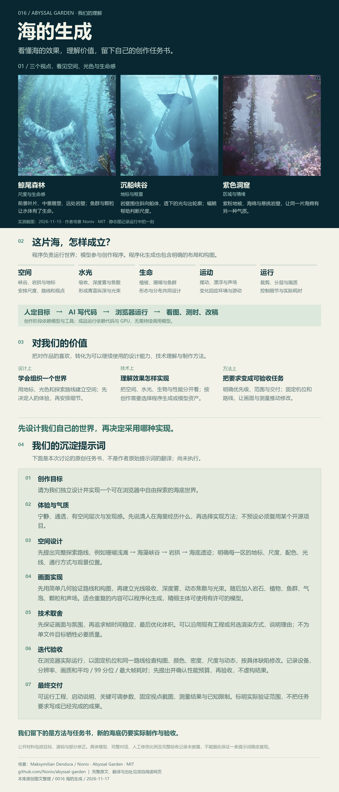

# 0016 · 海的生成 · 海底世界与提示词手记

研究 Abyssal Garden 可运行、可读源码的程序化海底与验收任务书，沉淀我们独立创作海底世界的七项提示词。

- **[打开阅读网页](web/index.html)**，或双击 **[start.cmd](start.cmd)** 使用普通浏览器打开。
- **[一张图看懂效果、价值与沉淀提示词](assets/understanding-summary.png)** · [我们的原创任务书](OUR_SEA_BRIEF.md) · [可复制文本](assets/our-sea-brief.txt)。
- 原始来源：[Noniv / Abyssal Garden](https://github.com/Noniv/abyssal-garden)；[作者实时海底](https://noniv.github.io/abyssal-garden/)。
- 本页使用 HTML、CSS、JavaScript 和本地图片，无运行依赖或安装步骤；外部出处与作者演示需联网。
- 整理日期：2026-11-16；原始截图记录：2026-11-15。
- 本轮发布的是图文研究总结，没有新建实时海底世界；公开部署的真实结果见 [publication.md](publication.md)。

## 它解决什么问题

把这次讨论整理成一条可阅读的路径：先看实际海底效果，再解释空间、光照、植被、运动与性能，接着阅读完整提示词，最后区分作者公开的信息与我们的独立创作建议。

先前本地 0004 项目保留运行和源码调研；本页同时归档相同的海底截图、来源与版本信息，公开内容不依赖其他本地研究目录。

## 为什么关注

这次讨论的核心问题不是“怎样最快复制作品”，而是“漂亮的海底由什么组成，AI 在哪里起作用，我们如何自己设计”。网页因此把复用代码作为设计之后的选择，保留独立实现的讨论。

## 研究结论

1. **画面与空间。** 鲸尾、沉船、洞窟三张实测图片配上空间、光色与动态观察；可切换并打开完整大图。
2. **机制与代码。** 五个实现层分别链接到固定版本源码，说明每层负责什么，以及可以借鉴的设计方法。
3. **模型的分工。** 人提出要求，模型与 Agent 编写和检查程序，浏览器执行程序化规则与渲染；运行成品无需调用模型。
4. **完整提示词。** 原始英文与完整中文翻译切换阅读，提供复制按钮与独立文本文件；英文经过上游 Git blob 校验。
5. **公开信息与理解。** 作者公开了任务书、最终源码和部分修正；模型名称、完整对话、人工比例及完整验收记录未交代。我们提出的制作顺序另行标注为建议。

## 关键机制

- [web/index.html](web/index.html)：完整内容与双语提示词，支持 JavaScript 不可用时阅读正文。
- [web/styles.css](web/styles.css)：海蓝与纸色的图文排版，桌面、平板、手机布局与打印样式，尊重减少动态效果偏好。
- [web/app.js](web/app.js)：三视点切换、五层机制切换、图片对话框、双语与复制、章节导航。
- 图片、文本、许可都在本项目 [assets/](assets/) 内，不依赖其他项目的图片相对路径。
- [scripts/check.py](scripts/check.py)：检查全文一致性、英文 Git blob、图片与原记录一致、文件存在及子路径。
- [scripts/build.py](scripts/build.py)：用 Python 标准库导出独立 `dist/`，把资源路径改为同包相对路径。

## 运行与验证

源码参考提交：`a596354eff400d458bc2aeb9bdf5e0a9734b2bcf`。英文 prompt 的 Git blob 为 `c23587a9f624bd4c98c830dbe69b2f6bb7f2122c`。

本轮完成 Windows 内置浏览器本地 HTTP 验收：三张视点图文切换、大图开启/关闭、五层机制文字与源码链接切换、中英文提示词切换、键盘左右切换、总结问答展开。默认桌面窗口与 390×844 手机视口检查，均未发现横向溢出；控制台 warn/error 返回空列表。

复制按钮在中英文切换后均得到浏览器 API 成功响应并显示提示；内置浏览器的剪贴板连接器回读为空，因此没有把系统剪贴板内容一致性列为独立验证通过项。提供独立文本文件入口便于查看与手工复制。直接 `file://` 导航受内置浏览器协议策略限制，本轮视觉与交互验收使用本机 HTTP；普通浏览器双击入口未另行自动验收。

复查和导出（仓库根目录执行）：

```powershell
python projects/0016-abyssal-world-notes/scripts/check.py
node --check projects/0016-abyssal-world-notes/web/app.js
python projects/0016-abyssal-world-notes/scripts/build.py
python projects/0016-abyssal-world-notes/scripts/check.py --dist
python scripts/projects.py check
```

`dist/index.html` 和配套本地资源可单独携带，构建产物不提交。所有公开部署路径应保持 `/20261115_codex_project/demos/0016-abyssal-world-notes/`；本轮按用户明确授权接入统一 Pages 白名单，保留既有公开项目；真实上线结果单独记录。

具体检查记录与文件哈希见 [verification.json](verification.json)。原海底世界的性能与完整基准结论仍以 0004 的验证范围为准；阅读页运行成功不代表重新实现了海底。

## 图片与演示



2026-11-17 本库原创图文汇总，2400×5595。海底插图来自先前实际运行截图，场景作者 Noniv；原创沉淀提示词尚未执行，不等于作者原文或新作品成果。[可编辑 SVG](assets/understanding-summary.svg)。

2026-11-16 [原网页首页截图](assets/overview.jpg)保留。网页为本库整理，嵌入的海底场景属于 Noniv。

[完整网页长图](assets/page-full.jpg) · [图文阅读区](assets/gallery-reading.jpg) · [提示词阅读区](assets/prompt-reading.jpg) · [手机预览](assets/mobile-preview.jpg)。

## 后续计划

- [x] 新建独立子项目，保留原始研究记录
- [x] 完整收录中英文提示词并核对来源
- [x] 用实测图片与代码解释整理讨论结论
- [x] 完成主要阅读交互、响应式与导出验证
- [x] 2026-11-17 制作一图总结，沉淀可直接使用的原创创作任务书（尚未执行）
- [ ] 只有明确要求创作时，再开展独立海底世界实现
- [x] 按本轮明确授权接入统一站点构建与部署；上线验收见 publication.md

## 来源与许可

原项目：[Noniv/abyssal-garden](https://github.com/Noniv/abyssal-garden)，MIT，Copyright (c) 2026 Maksymilian Dendura。保留 [上游许可](assets/UPSTREAM-LICENSE.txt)。

三张海底图片沿用本库先前实际运行截图；英文提示词来自固定上游文件，中文为完整翻译。来源、版本与阅读边界见 [assets/SOURCES.md](assets/SOURCES.md)。没有复制完整上游工程、依赖、Git 历史或第三方运行程序。
