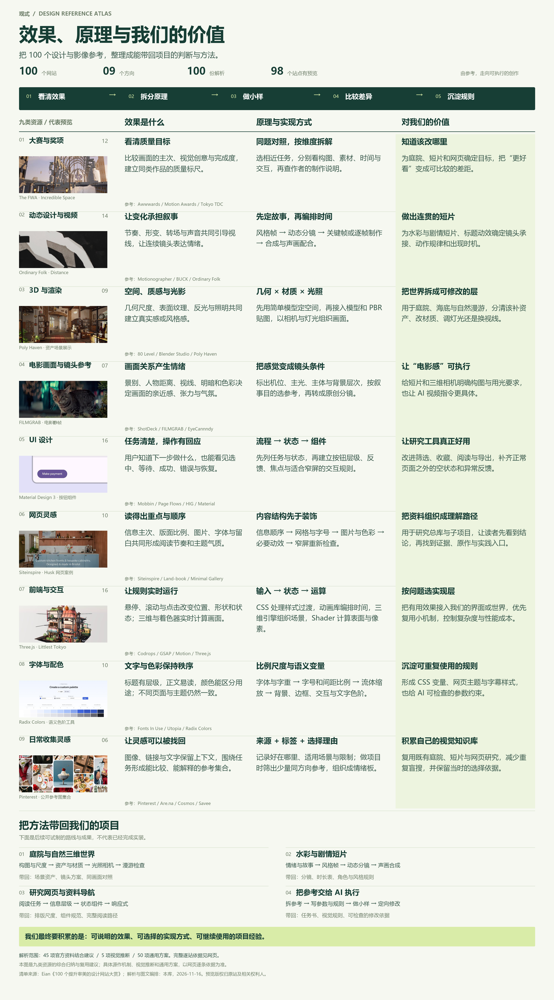
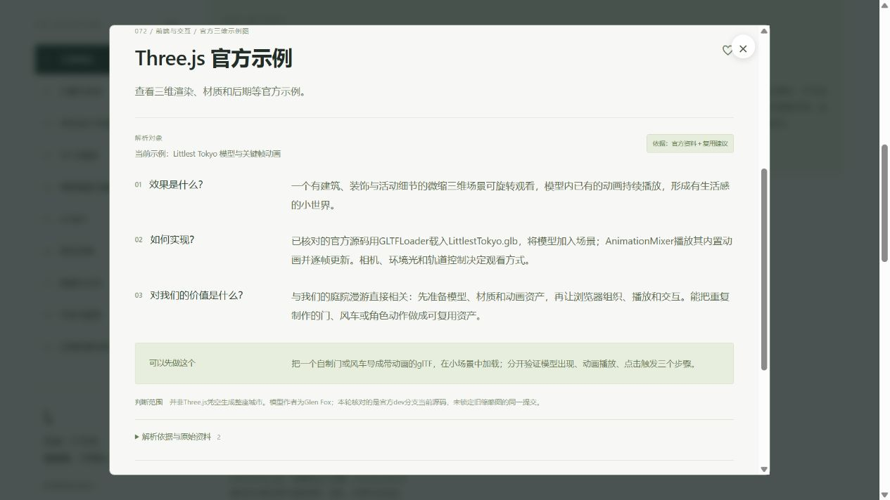
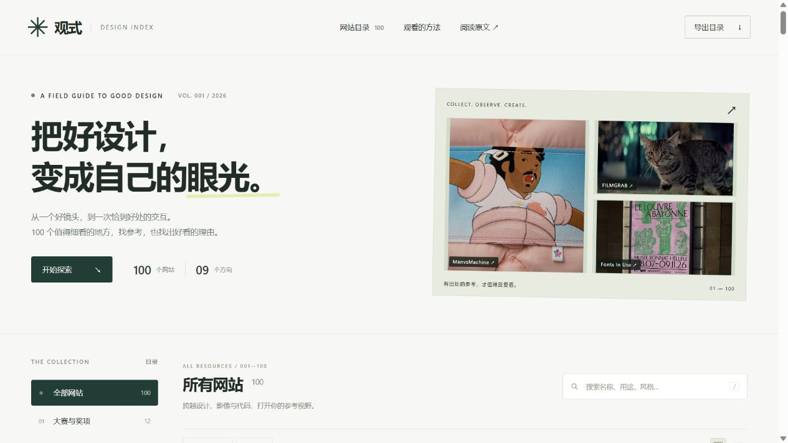

# 0017 · 观式 · 100 个设计与影像网站

将 Eian 的《100 个提升审美的设计网站大赏》整理为可搜索、分类和收藏的本地网页。保留全部原文编号与链接，为每站补充用途、观察重点、预览来源和官方示例入口，并逐项解析效果、实现方式与对我们项目的价值。

- 原文：[100 个提升审美的设计网站大赏](https://x.com/EianLu/status/2121219503988113557)，Eian，2026-11-13。
- 分享来源：[推荐帖](https://x.com/EianLu/status/2121430416808894617)。
- 整理与验证：2026-11-16，北京时间；状态以根目录 `projects.json` 为准。
- 网页源码：[web/index.html](web/index.html)；本地启动：[start.cmd](start.cmd)。本轮接入统一GitHub Pages发布，实际地址与验收见[publication.md](publication.md)；公开验证后再登记`demo_url`。
- 离线阅读：运行 `python scripts/build.py`，然后双击生成的 `dist/index.html`。目录、预览图、样式与脚本全部内嵌，无需服务或网络；外链示例仍需联网。



[高清 PNG](assets/effects-principles-value-overview-v1.png) · [可编辑 SVG](assets/effects-principles-value-overview-v1.svg) · [逐图来源](assets/overview-sources.json)

总览图将100个网站归纳为九类，用真实代表预览对照「效果是什么、原理与实现方式、对我们的价值」，底部给出庭院三维、短片、研究网页与AI执行四条应用路线。它是类别综合归纳，不在一张图里重复100站全文；具体技术与依据仍在网页逐条解析中。



[卡片解析实景](assets/analysis-cards.jpg) · [手机解析实景](assets/analysis-mobile.jpg)



## 它解决什么问题

100 个网址放在长文章里不容易反查。此网页让人先按创作任务选方向，再查看每站能做什么、打开后看哪里，以及预览图对应的官方入口。预览图在本地保存，正常阅读不请求外部图片服务。

## 我们的理解与价值

奖项提供质量标尺，素材与电影库提供输入和镜头参考，规范帮助组织界面任务与状态，前端和三维工具实现变化。我们先分清各自的作用，再把具体效果写成构图、光线、字级、时长或反馈条件。通过「看清效果→拆分原理→做小样→比较差异→沉淀规则」，留下下一次可以继续使用的经验。

对庭院与自然世界，带回空间、资产、光照和相机方案；对水彩与剧情短片，带回风格帧、分镜和节奏；对研究网页，带回阅读路径、排版与状态组件；交给AI时，形成参数、保持项、可变项和验收依据。四条路线是后续复用建议，本轮没有改动其他项目。完整说明见[understanding.md](understanding.md)。

## 目录范围

| 原文编号 | 类别 | 数量 |
| --- | --- | ---: |
| 001—012 | 大赛与奖项 | 12 |
| 013—026 | 动态设计与视频 | 14 |
| 027—035 | 3D 与渲染 | 9 |
| 036—042 | 电影画面与镜头参考 | 7 |
| 043—058 | UI 设计 | 16 |
| 059—068 | 网页灵感 | 10 |
| 069—084 | 前端与交互 | 16 |
| 085—094 | 字体与配色 | 10 |
| 095—100 | 日常收集灵感 | 6 |
| **合计** | **保留全部原文条目** | **100** |

## 效果、实现与价值解析

本轮按用户要求补入100份独立解析，默认在卡片上显示三问摘要：

1. **效果是什么**：针对当前例图、具体作品或平台能力，说明看见了什么、产生什么体验。
2. **如何实现**：解释输入、结构、规则和输出之间的关系；能取得官方源码或幕后说明的注明依据，缺少源作过程的只写可复用路线。
3. **对我们的价值**：联系庭院与自然三维世界、水彩或剧情短片、研究导航网页等任务，说明能带回什么具体决定。

点「看解析」可读完整说明、判断范围、原始资料和一个小练习。每类另有解读，页面下方有四条实际项目应用路线；这些路线是后续建议，不代表已经在其他项目中实装。

重要区别包括：London Film School当前条目是提名；Ordinary Folk《Distance》是逐帧手绘空间叙事；Three.js当前例子加载既有glTF模型并播放内置动画；Poly Haven提供资产输入；电影静帧库帮助镜头决策。避免把不同资源都理解为一键生产工具。

## 网页使用

- 搜索名称、域名、用途、标签和观察点，支持多个关键词同时匹配。
- 按类别筛选、切换网格或列表；「有图预览」可过滤暂缺图片的站点。
- 点击图片或「看解析」放大，阅读效果、实现、价值、练习、依据与范围，以及图片来源和示例链接。
- 「效果解析」可切换卡片摘要与精简目录；搜索涵盖解析中的技术和项目用途。
- 「一图总览」展开九类效果、原理和项目价值图；「保存高清图」保存3200×5768的PNG。离线单文件同样包含这张图。
- 点击心形收藏。收藏仅保存在当前浏览器，不上传，刷新后保留。
- 「导出目录」将当前筛选结果导出为 Markdown，包含原文来源、官网、示例链接及完整解析与依据；筛选收藏后可导出个人清单。
- 支持分类、搜索、收藏、视图的 URL 片段，`/` 聚焦搜索，`Esc` 关闭详情。
- 窄屏分类横向滚动，页面不横向溢出；尊重系统减少动态效果设置。

## 研究结论与边界

原作者提供站点清单和分组；本站用途、观察重点为独立摘要。当前价格与访问条件会变化，付费说明沿用原文标记，不能据此认定未标记站点全部免费。

预览分为真实内容图、官方宣传或页面预览、第三方页面截图等，卡片与详情保留各自类型。页面截图不是该站制作的单件作品；有些站点只能取得官方分享图。优先链接到能确定对应的作品或示例，未取得具体作品时保留官方作品库或工具入口，不杜撰作品名。验证页、拦截页和加载占位不计为可用预览。

采集仅访问公开页面和公开小图，没有登录、绕过验证或下载大型视频。所有站点都有预览状态及原入口，图片缺失不阻止查看用途和打开站点。最终覆盖率、缺图与验证详情见 [verification.md](verification.md)；逐图原址、日期、HTTP 状态与哈希见 [assets/preview-sources.json](assets/preview-sources.json)。

## 运行与验证

使用 Python 3.10+，前端不安装依赖，不需要构建框架。

```powershell
cd projects/0017-design-reference-atlas
python scripts/check.py
python scripts/serve.py --port 52927
```

打开 `http://127.0.0.1:52927/web/`。端口被占用时换端口，不结束不明进程；Ctrl+C 停止本服务。

可选离线导出：`python scripts/build.py`。`dist/index.html` 是可重建的本地交付物，不提交构建产物。维护图片的脚本独立运行，使用 Python 和 Pillow，参数说明见 `python scripts/collect_previews.py --help`；这不是正常打开网页的依赖。

公开导出使用 `python scripts/build.py --publication`，生成分文件静态网页、98张被引用预览、总览原图及来源；`python scripts/check_publication.py`检查路径、100份解析、图片哈希和20MiB预算。CI仅使用Python标准库，不重绘总览图，不依赖本机字体。统一站点入口含仓库子路径，保留原有公开项目。

修改总览文案后运行 `python scripts/render_overview.py`，从本地真实预览生成PNG、SVG及来源清单；需Pillow和Windows微软雅黑字体。它会检查文字列宽、行高和画布边界。生成后再运行离线构建。

## 关键文件

| 文件 | 用途 |
| --- | --- |
| [web/data/catalog.json](web/data/catalog.json) | 100 条网站、九类、用途、原始链接、观察建议与原文示例入口 |
| [web/data/analysis-001-035.json](web/data/analysis-001-035.json)、[036—068](web/data/analysis-036-068.json)、[069—100](web/data/analysis-069-100.json) | 100份效果、实现、价值、练习和证据范围 |
| [web/data/reading-guide.json](web/data/reading-guide.json) | 九类及总览解读、四条项目应用路线 |
| [web/data/overview.json](web/data/overview.json) | 一图总览的九类三问摘要与四条应用路线 |
| [understanding.md](understanding.md) | 资源角色、五步理解方法、四类项目产物与证据边界 |
| [publication.md](publication.md) | 公开发布授权、范围、提交及实际验收 |
| [scripts/check_publication.py](scripts/check_publication.py) | 公开路径、总览原图、预览、解析覆盖与发布体积检查 |
| [scripts/render_overview.py](scripts/render_overview.py) | 生成高清PNG、可编辑SVG与逐图来源，检查文字边界 |
| [assets/overview-sources.json](assets/overview-sources.json) | 总览图九张代表预览的出处、原图哈希及成图哈希 |
| [scripts/analysis_data.py](scripts/analysis_data.py) | 解析覆盖率、独立内容及来源字段检查 |
| [web/data/previews.json](web/data/previews.json) | 最终预览状态、图片路径、示例链接和来源 |
| [web/data/content-notes.md](web/data/content-notes.md) | 内容整理原则与原文核对范围 |
| [web/app.js](web/app.js)、[web/styles.css](web/styles.css) | 原生网页交互与响应式布局 |
| [scripts/check.py](scripts/check.py) | 编号、分类、链接、图片路径与 SHA-256 校验 |
| [scripts/build.py](scripts/build.py) | 校验后生成单文件离线网页 |
| [assets/preview-sources.json](assets/preview-sources.json) | 最终逐图归因、采集记录和许可边界 |

## 图片与演示

概览、目录和手机截图均来自本轮内置浏览器实际运行，非设计稿：[首页](assets/overview.jpg)、[目录](assets/collection.jpg)、[手机分类](assets/mobile.jpg)。它们验证本网页布局，不代表逐个站点的交互已实测。

一图总览是本库原创图文编排，嵌入九张有来源的代表预览；[网页中的总览图](assets/overview-web.jpg)为实际运行截图，两者性质不同。

## 来源与许可

未复制上游源码或完整文章。站名、品牌和原站作品版权归各权利人。缩略图用于研究导览，逐图保留原始来源和类型；本轮用户授权公开发布研究网页，不改变第三方素材的权利，也不提供独立素材包或商业使用授权。未逐项取得所有图片的额外再分发许可；需要复用时返回原站核对条件。详见 [THIRD_PARTY_NOTICES.md](THIRD_PARTY_NOTICES.md)。
