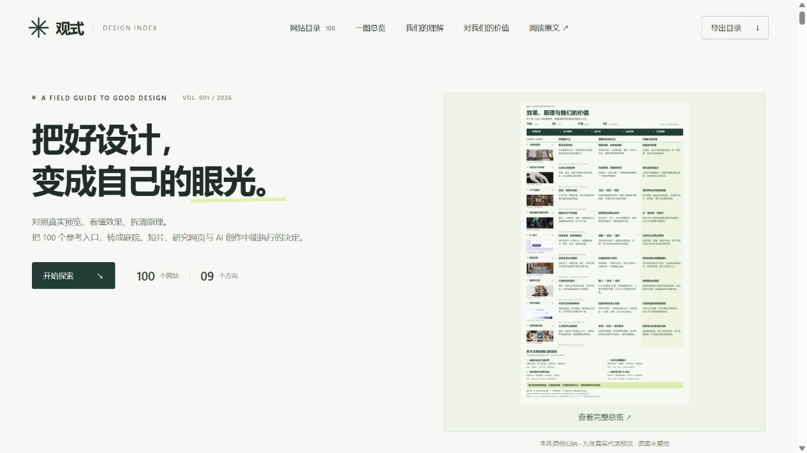

# 观式 · 100个设计与影像网站公开发布

2026-11-17用户明确授权整理理解、部署网页并提交远端，要求摘要清楚，引导图使用本轮生成的总览图。

## 内容与引导

研究保留Eian原文100站、九类划分及原始编号，提供100份效果、实现原理、项目价值与小练习解析，以及98站真实预览。首页先展示生成的总览图，再说明资源分工、五步理解方法和四类项目用途，随后可搜索、筛选、收藏、读详情和导出。

我们的理解是把参考变成可执行的决定：奖项提供质量标尺，图库提供素材或镜头输入，规范形成状态和视觉规则，前端与三维实现变化。庭院、短片、研究网页和AI创作分别可以沉淀场景方案、分镜、组件规则和带验收条件的任务书。四条路线是后续建议，未跨项目实装。

引导图沿用`assets/effects-principles-value-overview-v1.png`原文件，3200×5768，SHA-256为`10e54cb14a276bd24e7fbbcbc4c6e0f29e160b13e29cd0888e00cfb267dfe525`。首页、总导航及原图链接都使用这一文件，不重新绘制、不改变像素。

## 发布范围与构建

- 沿用统一GitHub Pages artifact，仅增加`0017-design-reference-atlas`，保留既有公开项目。
- 公开导出使用`scripts/build.py --publication`，静态HTML/CSS/JavaScript与JSON，98张被引用的小图、PNG/SVG总览和来源清单；不复制采集候选、依赖目录、私人资料、完整影片或第三方完整工程。
- `scripts/check_publication.py`核对相对路径、页面锚点、100份解析、98张预览哈希、总览原图身份与尺寸，以及20MiB体积预算。CI不运行制图脚本或安装图像字体。
- 原始网页、来源链接与缩略图权利仍归原权利人；公开研究不扩展素材许可。45项官方资料结合建议、5项视觉推断、50项通用实现方案分别注明范围。
- F盘空间已满，本轮在获准D盘目录从远端最新主分支建立独立发布副本；只提交本项目及必要总库文件，其他聊天的未提交内容保留。

## 公开入口与实际验收

已发布：[观式 · 100个设计与影像网站](https://yydshly.github.io/20261115_codex_project/demos/0017-design-reference-atlas/)。完整公网核验时间：2026-11-17 18:07（Asia/Shanghai）。实际验证通过后登记表填写公开地址。

- [发布PR #14](https://github.com/yydshly/20261115_codex_project/pull/14)经完整站点构建和登记检查通过后合并；源代码发布合并提交为[e19f55b603f62e76c22824e7d00f3261b292b429](https://github.com/yydshly/20261115_codex_project/commit/e19f55b603f62e76c22824e7d00f3261b292b429)。
- [GitHub Pages运行44061400441](https://github.com/yydshly/20261115_codex_project/actions/runs/44061400441)的build与deploy均成功。
- 112份项目资源全部HTTP 200，内容与检查过的静态导出一致；文本统一LF后比较，PNG/JPEG/SVG按原始字节比较。总览PNG的SHA-256与生成原件完全一致。
- 总导航的项目摘要、三段价值说明和引导图路径与登记表一致；点击引导图打开同一完整PNG。11个原有公开入口仍全部HTTP 200。
- 正式网页内置浏览器确认100张卡片、3200×5768原图、首页与展开图共用原件；关键词搜索能命中Three.js，完整详情可读三问、练习和原始资料。桌面无水平溢出，控制台warn/error为零。此前本地导出已验证390×844窄屏及实际Markdown下载。
- 逐项资源、哈希与核验时间见[online-verification.json](online-verification.json)；可复用核验脚本为`scripts/verify_online.py`，需联网。首次检查中SVG的Git行尾变化已纠正，原始可编辑SVG按字节入库，PNG始终未变。

