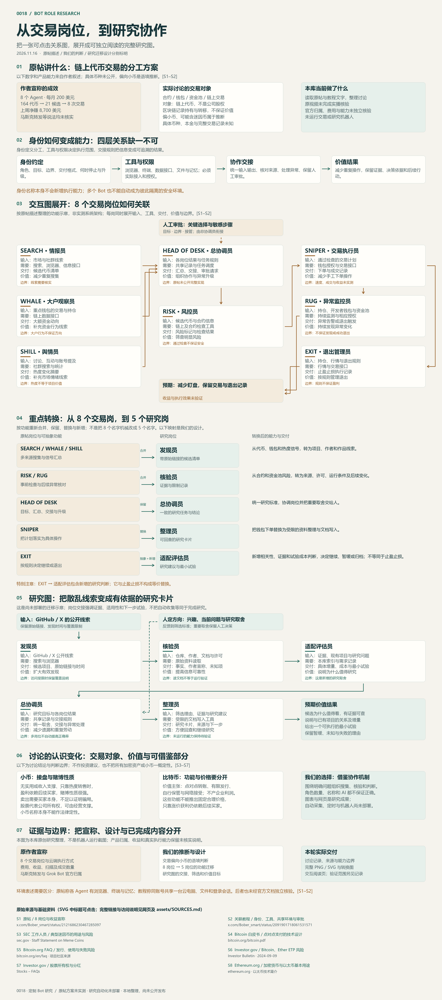

# 0018 · 定制 Bot · 分工、能力与研究迁移

从一条八岗位自动炒币帖出发，用完整信息图、交互关系图与讨论记录，解释身份、工具权限和协作交付，再展示八个交易岗位到五个研究岗位的功能迁移。

我们的收集与研究能力已经具备。值得借鉴的是把目标、证据、工具权限、交接和交付组织清楚；这些工作可以由单个任务顺序完成，无须为图中的岗位名再造一套常驻 Bot。

- 在线网页：[图片与讨论总览](https://yydshly.github.io/20261115_codex_project/demos/0018-bot-role-research/) · [独立交互关系图](https://yydshly.github.io/20261115_codex_project/demos/0018-bot-role-research/graph.html)
- 完整信息图：[高清 PNG](assets/bot-role-overview.png) · [可放大 SVG](assets/bot-role-overview.svg)
- 重点转换图：[PNG](assets/role-conversion.png) · [SVG](assets/role-conversion.svg)
- 讨论记录：[DISCUSSION.md](DISCUSSION.md) · 验证范围：[verification.md](verification.md) · 发布记录：[publication.md](publication.md)
- 原始来源：[@Bober_smart 原帖](https://x.com/Bober_smart/status/2121686230467285097) · [关联教程](https://x.com/Bober_smart/status/2091901718061531571)
- 整理更新：2026-11-17，Asia/Shanghai；完整图制作于 2026-11-16
- 研究状态：以根目录 `projects.json` 为准；网页已公开并验收，发布证据见 [publication.md](publication.md)；研究机器人仍未部署

## 它解决什么问题

当一个方案把 AI 包装成多个“员工”时，如何分清岗位名称、实际工具能力、交接关系和价值结果？本项目用完整图片与可点击关系图，把分散的讨论整理为可回查的研究资料。

网页以图片为主入口，同时保留交互图中的两种场景、岗位说明、前后讨论和原始来源。图片是本库制作的研究示意，不是交易系统或采集系统的实际运行截图。

## 为什么关注

原帖强调八个 Agent 与收益，却容易让读者忽略交易对象、执行条件和证据。讨论逐步转向三个具体问题：它交易什么，盈利逻辑是否依赖后来买家，以及除了交易场景，还有什么可以借鉴。

对我们的价值在于改善已有研究流程：明确为什么适合当前问题，留下原始证据，设计一次最小试验，并把结论积累为可回查的记录。热度和采集数量不足以证明研究价值或研究已经完成。

## 研究结论

1. **原作者声明**：八个岗位负责搜索、风险检查、下单、大户监控、异常监控、退出、舆情和总协调。每月 200 美元、一周净赚 8,700 美元、马斯克转发等均为作者自述，本研究没有独立核实。
2. **我们的判断**：根据合约、钱包、流动性池和链上交易等用词，原帖针对加密货币链上代币。主要面向小币、可能包含迷因币是推断；原帖没有交代具体币种、本金或完整交易记录。
3. **概念澄清**：缺少实际用途、收入或资产支撑、主要靠热度转售的小币，交易行为可能带有很强的赌博性质；“小币”本身不足以证明赌博或骗局。比特币的转账、发行规则和网络接受度是其价值主张，不证明任一市场价格必然合理。
4. **可迁移方法**：身份定义职责和交付，实际行动依赖工具、权限、共享记录、交接和审批。我们已有收集研究能力，需要组织好这些环节；更多岗位名或 Agent 数量不足以证明效果更好。
5. **有用的交付**：适配理由、原始证据、最小试验和可回查积累，决定线索能否转化为研究。自动采集是过程中的一环，不代表研究完成。
6. **研究设计**：八个交易岗位按功能合并、替换和补充成五个研究岗位。这是职责示意，可由单任务顺序完成；研究机器人、自动搜集入库和定时任务仍未部署。

## 关键机制

### 从身份到交付

`角色、目标、边界、交付标准 → 实际接入的工具与权限 → 岗位交接和人工审批 → 可追溯结果`

教程称，同一账号中的 Bot 共享一台持久化云端电脑及文件、浏览器会话和登录状态，每个 Bot 有自己的屏幕。这与原帖“自己的虚拟浏览器、终端和记忆”的表述需要区分；不能据此认定各岗位具有隔离的环境。该产品的官方归属和架构尚未通过独立官方材料核实。

### 八岗位如何转换为五岗位

| 原帖岗位 | 研究岗位 | 转换方式及新的交付 |
| --- | --- | --- |
| SEARCH、WHALE、SHILL | 发现员 | 合并多路信号搜集，改为项目与作者线索，交付候选清单和原始链接 |
| RISK、RUG | 核验员 | 合并交易前检查与持续观察的思路，改查来源、许可、运行条件和后续变化 |
| HEAD OF DESK | 总协调员 | 保留目标、分工、结果汇总、任务交接和审批请求 |
| SNIPER | 整理员 | 把执行环节迁为受限的文档整理与写入，交付研究卡片和来源记录 |
| EXIT | 适配评估员 | 从按规则取舍得到启发，新增“值得研究、暂缓、归档”的判断，并提出最小试验 |

这是按研究目的重新设计的功能映射。尤其 EXIT 到适配评估员属于新增的研究取舍，不能当作两个岗位能力等价或一对一改名。

五个岗位用于说明责任和交接，不规定要运行五个独立模型、进程或常驻机器人。只要能完整交付证据、判断、试验入口和记录，一个任务也能依次完成这些环节。

主要资料与页面：

| 文件 | 内容 |
| --- | --- |
| [research.json](research.json) | 角色、转换关系、讨论和来源的结构化研究记录 |
| [web/index.html](web/index.html) | 图片优先的完整阅读入口 |
| [web/graph.html](web/graph.html) | 原交互关系图的独立导出 |
| [DISCUSSION.md](DISCUSSION.md) | 具体问题、推理边界及认识修正 |
| [assets/SOURCES.md](assets/SOURCES.md) | 图片性质、出处和引用边界 |
| [verification.md](verification.md) | 本地网页、图片及交互的检查证据与限制 |
| [publication.md](publication.md) | 公开发布地址、提交和最终验收状态 |

## 运行与验证

本地 Windows 环境，Python 3.10 或更新版本。网页为静态文件，不需要账户、钱包或付费 API。

在本项目目录执行：

```powershell
python scripts/build.py
python scripts/serve.py --port 52928
```

浏览器打开 `http://127.0.0.1:52928/web/`。若端口占用，换一个端口；使用 Ctrl+C 停止自己启动的服务。

- 本轮资料版本：2026-11-17 更新的讨论整理，完整图制作于 2026-11-16；上游为公开帖文和教程，没有绑定上游源码提交。
- 网页构建与交互结果：以 [verification.md](verification.md) 为准。
- 范围：阅读页、图片、转换关系和可点击图的呈现；不把这些检查当作原帖交易能力的验证。
- 未验证：收益、马斯克转发、Grok Bot 官方归属及完整产品能力、自动交易、自动采集入库和定时运行。
- 原帖附带视频当时显示无法播放，本轮没有完成视频内容核验。

## 图片与演示

[](web/index.html)

完整图片同时提供 [PNG](assets/bot-role-overview.png) 与 [SVG](assets/bot-role-overview.svg)，重点转换另有 [PNG](assets/role-conversion.png) 与 [SVG](assets/role-conversion.svg)。图片为本库原创研究整理，来源与许可边界见 [assets/SOURCES.md](assets/SOURCES.md)。

网页已公开并完成关键交互验收，地址与证据见 [publication.md](publication.md)。发布和索引登记按[部署约定](../../docs/deployment.md)处理；网页上线不表示图中的交易或研究机器人已经部署。

## 后续计划

- 根据阅读反馈修正岗位说明与图中的连接，保留来源和不确定项。
- 如继续研究产品能力，先核验官方身份、文档与工具权限，再安排限定范围的试验。
- 按实际研究任务使用这些职责和交付标准，先检验能否减少重复、提高证据质量；自动采集与定时系统仍未部署。

## 来源与许可

本库原创文字、关系示意和网页整理；原帖和教程以摘要与链接引用，不复制第三方全文、软件或媒体。Bitcoin、SEC 工作人员说明和 Investor.gov 资料用于概念核对，不代表其认可原帖或本研究方案。完整来源和图片说明见 [assets/SOURCES.md](assets/SOURCES.md)。
