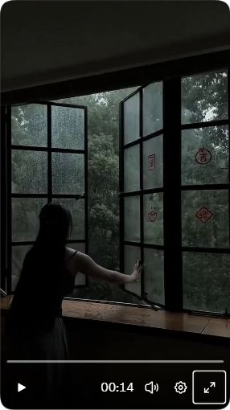

# 从原始风的参考，到我们的创作思路

以对话开始时用户提供的X链接及其分析为主线；《多停一会儿》仅是后续验证材料。

更新：2026-11-17

## 原始参考

[@purelivn · my favorite weather](https://x.com/purelivn/status/2121568067402514672)

本次在内置浏览器复看开窗与约3秒门边人物画面，并读取播放器约14秒的时长。保存的是0秒附近的画面区域截图，不是完整原片下载，也不是完整逐镜时间轴。未听审原片声音。

@purelivn是引用的发帖账号，未核实其是否为视频制作者；画面权利归原作者及相关权利人。截图作为研究评论中的有限画面引用，完整视频通过原帖观看，不另授素材使用许可。

### 开窗与门边，是身体进入天气的入口

**可核对的内容**：开场可见人物打开窗、面向室外；约3秒的画面中，人物站在打开的门边，室内与户外同时进入观看。

**我们的解读**：一个很小的行动，就能把观众从室内带向外部。人物在这里提供一个可以跟随的感官位置，天气也因这次接近而有了观看的方向。

**带到创作中**：先设计人与自然如何相遇，再安排后续景物；人物可以只做很少的事。

这里是可见画面的观察与我们的解读，不据此补写人物身世或原作者的完整创作意图。

### 室内外的关系，让环境可以被进入

**可核对的内容**：人物背影、窗框与门框组织了朝外的视线。室内较暗，窗外植被较亮；门边片段还可见地板反光与一盏暖色地灯。

**我们的解读**：框景、明暗与材料把“里面”和“外面”放在同一个身体经验里。我们感兴趣的是一个人怎样接近这场天气，以及视线怎样被带到外部空间。

**带到创作中**：创作时一并考虑观看位置、边界、远近、湿润材质与光线，而不只列出人物和风景两个主体。

明暗和暖灯不是情绪的固定配方；不能只复制这些外观，就认定能复现相同感受。

### 真正被观看的，是天气怎样进入世界

**可核对的内容**：原参考把人物与窗外的植物、湿润的玻璃和地面放在同一场景中；用户在讨论中明确指出“这里把风拍出来了”。

**我们的解读**：这使我们的关注从“给人物配一种环境情绪”，转向自然本身怎样变得可感。风的力量、方向和节奏，需要由事物的响应显现。

**带到创作中**：衣角、草叶、树冠与水面的先后响应，是我们后续提出的方法示例；选择它们，是为了让观众感到同一阵风经过空间。

衣角—草叶—树冠—水面不是本次核对得到的原片逐镜目录，不能把创作示例写成原作事实。

### 一句偏爱，已经给天气一个价值方向

**可核对的内容**：原帖文字是“my favorite weather”。

**我们的解读**：这句话明确表达了发布者对天气的偏爱。它也帮助我们理解：同一种阴云、风或雨，可以被一个人亲近和喜欢，不必固定解释为悲伤或压抑。

**带到创作中**：人物的偏爱、注意或选择，让观众理解这场自然为什么值得体验。价值引导可以很轻，不必另加复杂剧情。

帖文表达的偏爱可核对；视频中人物的全部心理、原始声音设计与制作流程仍不能据此确定。

## 我们确认的理解

### 风是体验对象，人是情绪与价值的入口

> 虽然在拍风，但是人是情绪主题，是价值引导所在

这两层关系同时存在：画面可以认真展开风经过的整个自然场景；人与风的关系，则让观众知道如何接近、为什么停留，以及带着什么感受观看。

不能因环境成为观看主体，就把人物的情绪作用一并拿掉；也不必为了证明人物重要而增加表演时长。

### 人物变小，情绪关系仍可以贯穿场景

> 人作为入口，引导体验风，最终就是风的整个场景

注意力可以从一个人移向衣料、草木、水面，最后进入整个空间。这个过程改变的是画幅与观看范围，最初由人物建立的偏爱与价值仍能保留下来。

人物可以留在边缘或暂时出画。拉远本身只是摄影手段，需要有值得持续体验的自然变化来承接。

### 把风写在事物里，也写在人对它的回应里

> 你要说风 你就不能只说风

主题可以是风，表达要落在它对实体的作用上：什么被推动、怎样摆动、从哪里传向哪里，人物怎样察觉、亲近或回应。观众通过这些关系进入体验，而不只得到一个天气标签。

安排相互支持的变化和空间关系，避免把风、树叶、衣袖等名词机械并列。它们需要共同让一次具体的自然体验成立。

### 入口可以是主动的偏爱，也可以是被触及后的回应

> 人物作为情绪和价值的入口

一个人本来就喜欢迎风、愿意站在屋檐下看雨，也能建立入口；因一阵风或一处新芽而停步，是另一种安排。原来的方法没有规定必须先离开、再被留下。

后续“关门时停手”的提案是一种待验证的修法，不应替代原有理解，也不应变成每次创作都要照搬的新公式。

## 它给我们的价值

### 理解参考的价值

从具体画面、人与天气的关系里理解作品，发现为什么愿意继续看；不把一种天气、颜色或慢镜头直接当作情绪结论。

### 形成创作方法的价值

把“喜欢这种感觉”转为可讨论的关系：谁在体验、自然怎样显现、注意怎样移动、整个场景怎样承接。

### 迁移到新主题的价值

保留人物入口与自然展开的关系，重新寻找雨、雪、雾或春自己的依据；换题材时不必照搬同一人物、门窗、阴天或镜头数量。

### 指导制作和返修的价值

把意图落实为行动、物体响应、观看距离、节奏、声音目标与验收问题。样片用于检查这些选择有没有传达意图，不能替代理解本身。

## 从链接到创作：九次关键讨论

引文为用户原话；解释与创作影响为本次复核归纳。

### 01 · 先问：这个效果给我们的价值是什么？

最初的问题，尚非结论

> 这里给我的价值是什么？ 人物情绪搭配环境，构建一系列的情绪？

**这一步的理解**：最初提出的是一个理解候选：是否能通过人物情绪与环境的搭配来组织系列感受。它需要继续被原作的实际效果校准，不能直接当成最后的方法。

**对创作的影响**：先弄清作品主要让我们体验什么，再决定人物、环境与情绪分别承担什么作用。

### 02 · 第一次修正：这里把天气、把风拍出来了

用户对参考效果的修正

> 我觉得这里并不是情绪  而是单纯的把天气拍出来，人只是这个过程中的点缀和情绪，这里把风拍出来了

**这一步的理解**：关注点从情绪搭配移向自然体验。这里的“点缀”是这一阶段的说法；随后用户进一步明确了人物作为情绪主题与价值引导的作用。不能只保留前半句，就把人物解释为无关。

**对创作的影响**：自然要拥有真实的观看内容和变化，而不只是人物情绪的布景。

### 03 · 进一步明确：拍的是风，人仍是情绪主题

用户最终明确的核心关系

> 对  这里这个故事实际上就是人作为入口，引导体验风，最终就是风的整个场景。  虽然在拍风，但是人是情绪主题，是价值引导所在

**这一步的理解**：这一步把体验对象与情绪/价值入口放到同一个结构中：人引导观看，风及其整个场景承接体验。人物占据的画幅与其情绪重要性不必同步变化。

**对创作的影响**：从人到自然的展开，应延续人物建立的感受；它既不等于纯粹赏景，也不要求另外编写一条强烈的人物情绪转折。

### 04 · 把关系沉淀为可复用的方法

用户明确要求写入情绪艺术指导

> 把这个思路整理进情绪艺术指导技能里：人作为情绪和价值的入口，引导观众体验风，最终展开整个自然场景，也可以延伸到雨、雪、雾。

**这一步的理解**：沉淀的是一组可迁移的表达关系：人物入口、感官与注意、自然变化、完整场景、延续的感受。每种天气仍要寻找自身的表现依据。

**对创作的影响**：同一方法可以支持系列创作，但不是要求每一集使用相同演员、动作、构图或结尾。

### 05 · 语言原则：你要说风，就不能只说风

用户提炼并追问的原则

> 你要说风 你就不能只说风   这里实际上是这种意思吗？

**这一步的理解**：我们据此把抽象主题落到事物变化和人的回应上。风的作用、方向、节奏与覆盖范围，要通过可看见的关系被体验出来。

**对创作的影响**：少写孤立的气氛标签，多写什么发生了变化、这个人怎样与变化发生关系。

### 06 · 从天气延伸到季节：我们要写春

用户要求补入原则并扩展主题

> 把“你要写风，就不能只写风”这个原则也补进情绪艺术指导技能：通过风作用于事物的变化和人的回应，让观众进入体验，也可以延伸到其他自然主题。  还有增加一个扩展   比如 我们要写春

**这一步的理解**：风雨雪雾可以通过即时作用显现；春还涉及一段时间里的物候、身体与日常生活的变化。迁移的是关系，不是把季节硬套成一场天气或几秒钟的快速生长。

**对创作的影响**：选定地域与春的阶段，组织相互支持的细节，让春怎样来到世界和人的生活中变得可感。

### 07 · 创作要求：从人的感受进入，再展开万物

用户对春日短片的具体要求

> 用这个思路写一个“春”的短片方案，先从人的感受进入，再通过万物的变化展开整个春日场景。

**这一步的理解**：明确了观看的入口与展开方向，但没有规定春必须等同于希望、暖色或治愈。人物与这个春日的具体关系，仍需要由本次方案给出。

**对创作的影响**：《多停一会儿》选择“外面还有一点凉，但已经愿意多待一会儿”作为一次创作意图；这是助手方案，不是原帖说明或已达成效果。

### 08 · 制作样片，验证这个结构实际是否有效

用户授权先做一版效果试验

> 按这个方案先生成一版《多停一会儿》，看看从人物感受进入、再展开整个春日场景的实际效果。

**这一步的理解**：试片的作用是暴露表达的具体问题。人物感受、自然变化和完整场景是否真正连起来，需要看结果；制作完成不能反过来证明原先的理解已经实现。

**对创作的影响**：保留意图、实际指令、原件、剪辑和反馈，用样片对照创作思路。

### 09 · 实际反馈：看起来没有太大感觉

用户对60秒版本的观看反馈

> 看起来没有太大感觉啊

**这一步的理解**：复盘要回到原参考与原有理解：自然的作用是否足够可感，人物的偏爱是否被表达，场景是否承接了这个入口。不能只把它归结为镜头不够短，或把一个新的触发动作当作唯一答案。

**对创作的影响**：30秒重剪先检验节奏；自然触及人的关系仍需进一步验证。影片继续作为研究样本，原始分析仍是本页主线。

## 从理解到创作选择

### 人物承载情绪与价值入口

观众需要理解这片自然与一个人有怎样的关系。

**可作的选择**：可以用偏爱、注意、停留、主动迎风或感官回应建立关系。

**本次试片**：本片选择衣领、伸手与抬头；实际动作偏展示，未充分传达预期感受。

### 通过事物的变化把主题拍具体

看不见的风、季节的变化，需要依附于实际物体与行动。

**可作的选择**：风用衣料、草木和水面响应；春同时考虑新芽、地面、光与身体的变化。

**本次试片**：本片拍到嫩叶、湿土、新草和水流，但自然变化的存在感仍不足。

### 注意力可以移动，情绪关系继续保留

从人物转向环境，应让观众带着前面的感受进入更大的空间。

**可作的选择**：用视线、动作、运动方向、观看位置或声音目标承接，不固定一种转场。

**本次试片**：本片六镜顺序可读，用户仍未感到明显触动，说明顺序本身不够。

### 让整个场景获得自己的观看时间

环境应有可持续观看的细节、节奏与关系。

**可作的选择**：需要扩大时扩大，需要停留时停留；人物不必按规定退出。

**本次试片**：本片结尾仍缓慢后退，停驻感没有达到原案；这是一个执行偏差，不是对拉远手法的普遍否定。

## 写春的四个层次

### 植物与土地

旧枝与新芽、枯叶与新草、湿润土壤、透光的薄叶。

用相互支持的物候让春显现；不靠突然开满花或在几秒内生长。

### 光、空气与声音目标

日光落在窗台和皮肤上，衣料回应空气，近远鸟鸣与水声形成空间。

把季节写成可感的环境关系；声音在这里是设计目标，原片与本次试片均未完成听审。

### 身体与日常生活

手愿意离开袖口，衣着、步速、停留位置或日常路线发生变化。

春进入人的生活。可以亲近、珍惜或迟疑，不预先固定一种情绪。

### 完整春日场景

从门边或枝头的一处变化，展开到院落、小径、河岸和草木之间的关系。

景物彼此有关，人的感受仍在。它们不应成为与人物无关的春天符号清单。

## 参考、试片与差距

### 进入天气的空间关系

**参考与原理解**：原参考的开窗和门边姿态，明确连接室内与外界。

**实际试片**：试片转为伸手、托叶、散步和坐下，动作较完整，自然触发与偏爱不够清楚。

**得到的提醒**：先判断人与自然的关系是否可读，再决定是否补一个触发动作；主动的偏爱也可以是入口。

### 自然自身的存在感

**参考与原理解**：讨论中被强调的效果，是“把风拍出来”，让天气成为被体验的内容。

**实际试片**：湿土与浅沟让空间有联系，却占去19秒；风与春的新生变化较弱。

**得到的提醒**：细节需要共同服务一次具体体验，地理连接和景物齐全不能替代自然的可感变化。

### 观看节奏与完整场景

**参考与原理解**：我们希望人物把观看带到整个天气场景，保留最初建立的情绪价值。

**实际试片**：相近的缓慢节奏与持续后退延长了画面，但用户没有获得预期感受。

**得到的提醒**：重剪只能检验时长分配，不能补足素材里不存在的关系；更短也不自动等于更有效。

## 研究边界

- 原帖的可见画面、发布文字、用户对作品的判断、我们的解读与创作建议分别标注。
- 没有取得原作者完整创作总纲、原始提示词或制作记录，不把我们的流程写成原作的制作方法。
- 原参考截图不是《多停一会儿》的画面，两版试片也不是原作复现成功的证明。
- “关门时停手”等返修方向是待验证假设，不取代用户已经明确的人物情绪主题与价值引导。
- 其他天气示例未生成验证；首版感受偏弱，30秒重剪仍待用户反馈；声音均未完成听审。
