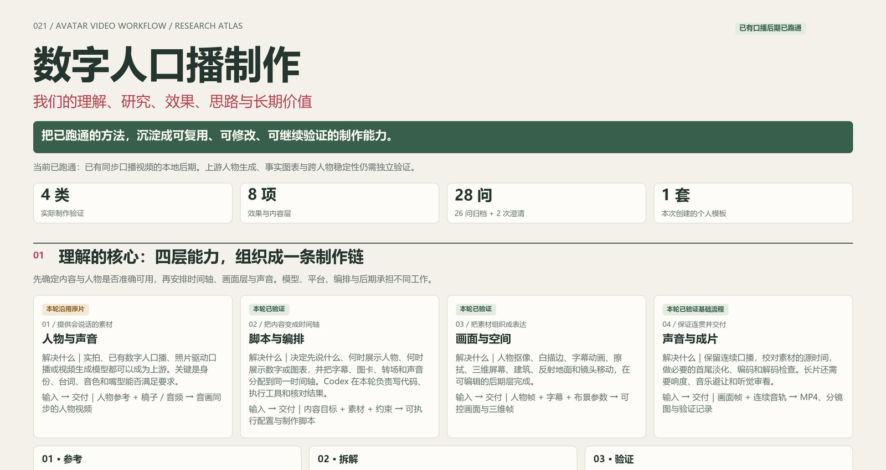
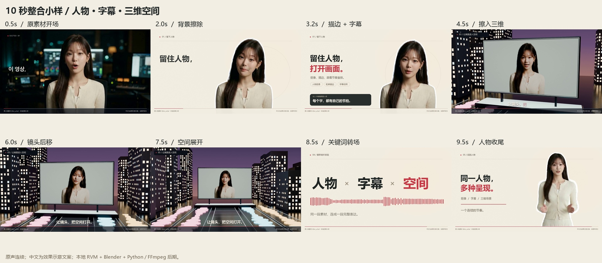

# 0021 · 数字人口播制作 · 能力、样片与复用工作流

从模型与平台的分工出发，用真实样片、完整研究图和可复用后期模板，整理人物、内容、剪辑与三维的制作方法及价值。

- 原始来源：[参考来源](https://x.com/AndyL5cc/status/2121553136615596139)
- 研究状态：以根目录 `projects.json` 为准
- 本地网页：`http://127.0.0.1:52961/20261115_codex_project/demos/0021-avatar-video-workflow/index.html`
- 在线网页：[数字人口播研究档案](https://yydshly.github.io/20261115_codex_project/demos/0021-avatar-video-workflow/index.html)
- 发布方式：沿用 GitHub Pages；2026-11-17 公网验收通过，见 [publication.md](publication.md) 与 [逐资源验收记录](live-verification.json)

## 它解决什么问题

把这轮关于数字人视频的讨论和实际制作保存在一个可回看的项目中：分清视频模型、数字人平台、代码编排与后期渲染，观看真实样片，理解人物与内容的分配，并从配置继续制作。

网页分为六部分：总览、效果实录、制作方法、选型与价值、复用模板、讨论与证据。包含 26 个讨论问题、8 项效果与内容层、6 条选型路线、8 个制作步骤、6 项具体价值、5 组实测记录和 13 个外部来源。

## 为什么关注

起点是用户提供的 X 视频：人物、抠像、文字和三维镜头组合成完整表达。我们关心的不只是“用了哪个模型”，而是怎样保持准确内容、连续声音与可修改的画面，以及哪些部分值得沉淀为自己的可重复流程。

## 理解、效果与价值一图总览

[](assets/avatar-research-overview-v1.png)

- [完整高清 PNG · 3200×26588](assets/avatar-research-overview-v1.png)
- [可放大矢量 SVG · 来源可点击](assets/avatar-research-overview-v1.svg)
- [可修订文字总纲](overview-summary.json) / [制图程序](scripts/make_overview.py) / [尺寸、哈希与来源记录](assets/overview-manifest.json)

2026-11-17 将本轮理解、真实效果、制作流程、人物与图表分配、平台选型、模板机制、六项价值和后续路线排入一张完整长图。包括原 26 个归档问题，以及“模板是什么”和“最大价值是否就是复用”的两次最新澄清，共 28 问。中文由程序排版、样片取自实际输出；没有新生成的人物或模型绘字，已做与待验证分别标注。

## 研究结论

1. 已有同步口播可以通过 RVM、Python 合成、Blender 和 FFmpeg 自动做成带抠像、描边、字幕、擦拭与三维镜头的短片。原作者的完整工程未公开，本轮是独立实现。
2. 已制作 5 秒平面小样、5 秒三维小样、10 秒整合版和 6 秒模板验证片。模板保留配置、分开的抠像与三维缓存、排版预检与结果检查。
3. 只改文案的运行实际复用了抠像与三维缓存；修改文字不会改变输入视频的声音和嘴型。
4. 三维场景里的人物仍是二维贴图，装饰波形不是事实图表。真实数据图表、照片开口、新口播生成、自动混音和不同人物稳定性都尚未由本轮验证。
5. 2026-11-17 复核发现：Gemini Developer API 中的 Veo 3.1 Preview 型号已列为 2026-10-22 下线；Google Cloud GA 型号属于另一个入口。网页记录当前官方来源，不沿用旧 Preview 示例和报价。

详细归纳见 [DISCUSSION.md](DISCUSSION.md)；网页讨论页还提供检索、主题筛选和原始证据链接。

## 关键机制

- 上游提供同步人物视频；内容与声音时间轴决定人物、字幕、图表和场景的安排。
- 后期按同一源时间生成透明人物帧、字幕层和三维屏幕贴图，避免拼接旧小样造成台词重复。
- 模板代码快照在 [template/avatar-motion-template](template/avatar-motion-template/SKILL.md)，不依赖旧聊天里的 `.blend`。本机个人技能已安装在 `D:/codex/home/skills/avatar-motion-template`。
- 网页是纯静态 HTML / CSS / JavaScript，Python 标准库生成；没有前端框架、收费接口或浏览器内视频渲染服务。

## 运行与验证

- 制作环境：Windows / Python 3.10.11 / ONNX Runtime 1.23.2 / Blender 5.2.2 LTS / RTX 4070 Laptop / OptiX / FFmpeg n6.1.3。
- 网页环境：Python 3.10+，构建和本地服务只使用标准库。
- 视频验证：5 秒 120 帧、10 秒 240 帧、6 秒 180 帧；完整解码与音画时长检查通过。整合片音轨相关性 0.999891，模板片 0.999889，均为 8 kHz 比较下 0 采样偏移。
- 这些检查不替代准确台词、听感、审美和跨人物质量验收。

在仓库根目录运行：

```powershell
python -X utf8 projects/0021-avatar-video-workflow/scripts/build.py --site-preview
python -X utf8 projects/0021-avatar-video-workflow/scripts/serve.py --port 52961
```

素材映射存于本项目忽略的 `.local/media-map.json`；复制或迁移项目后按实际路径重新登记：

```powershell
python -X utf8 projects/0021-avatar-video-workflow/scripts/prepare_media.py --artifact-root "原样片目录" --skill-root "模板技能目录" --media-only
```

首次登记会复制必要研究图片与模板源代码，并为已有视频保存 SHA-256 映射，不复制视频原片或模型。迁移后用 `--media-only` 校验原哈希并重连视频路径，不修改图片、模板与研究记录。默认模式遇到现有模板会在写入前拒绝覆盖。网页检查记录见 [verification.json](verification.json)。

## 图片与演示



分镜来自本轮实际视频；人物与原声来自 @tm_uchal，中文字是效果示意，非原声翻译。视频通过本地服务的白名单别名读取；必要静帧、哈希和来源保存在项目内。

代码在 `web/` 与 `scripts/build.py`；生成到忽略的 `dist/`，并导出到 `_site/demos/0021-avatar-video-workflow/`。公开构建使用 `--public`，按 SHA-256 清单恢复四段制作样片，不需要本地媒体映射；原参考片保留原帖入口。本地 `--site-preview` 复用已导出的其他项目；正式构建保留既有发布页面。路径遵循[部署约定](../../docs/deployment.md)。

## 后续计划

- [ ] 增加第二、第三个人物和正式台词字幕测试
- [ ] 验证人物、全屏图表和分屏图表的内容时间轴
- [ ] 有实际需求后再接通一种上游口播生成服务
- [ ] 统计多条片的返工、成功率、审校时间和综合成本

## 来源与许可

原始入口：[用户参考链接](https://x.com/AndyL5cc/status/2121553136615596139)；原视频作者：[@tm_uchal](https://x.com/tm_uchal/status/2120573380768518390)。原工程与完整生成参数未公开；此前看到的作者工具说明只作为作者声明，不冒充本轮实测。

研究图与参考帧来源见 [assets/image-manifest.json](assets/image-manifest.json)，源视频哈希见 [media.json](media.json)，外部资料在 `research.json`。人物、原声音轨与音乐归原权利人，本地研究不代表获得公开再分发许可。RVM 权重不在项目内，其 GPL-3.0 许可证随模板保存。没有复制原视频、模型权重、依赖目录或完整第三方历史到 Git。
