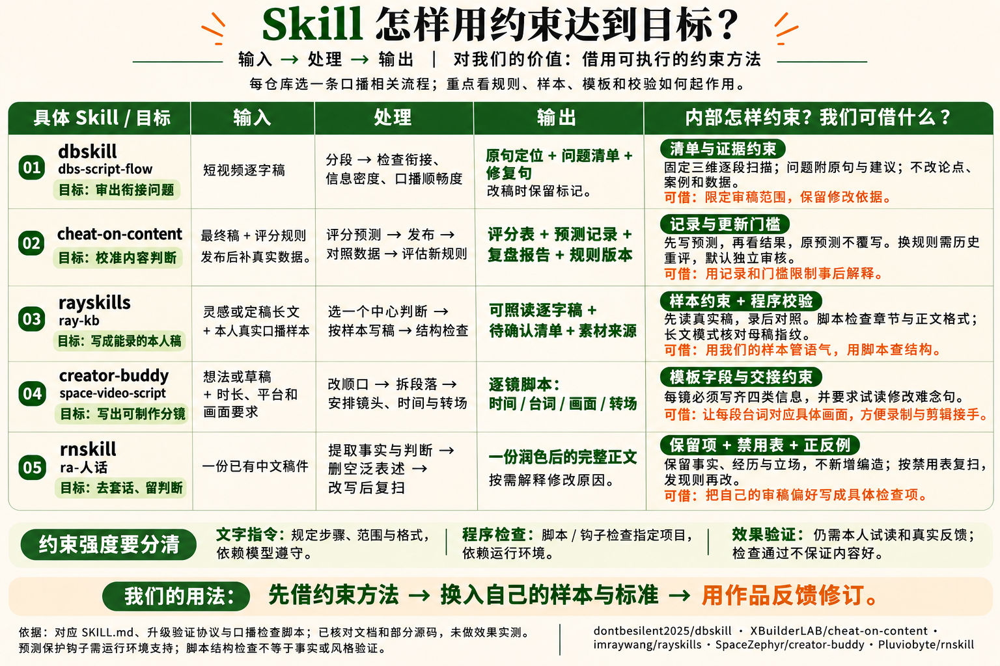

# 0028 · 创作 Skill：输入、约束与我们的价值

从输入、处理和输出看清五条具体流程，再拆解规则、样本、模板、记录与程序检查怎样引导结果。



本轮最终生成图原件，1536 × 1024；机制示意，非上游运行结果。点击图片可查看原文件。

- 原始线索：[推荐帖](https://x.com/liyuuuing/status/2121507172580475003)
- 在线网页：[https://yydshly.github.io/20261115_codex_project/demos/0028-creator-skill-mechanisms/](https://yydshly.github.io/20261115_codex_project/demos/0028-creator-skill-mechanisms/)；本地入口 `dist/index.html`。
- 研究状态：已阅读文档与部分源码，未做上游成稿效果对照。

## 它解决什么问题

解释五套创作 Skill 需要什么材料、怎样处理、交付什么，以及如何通过规则、样本、模板、记录和程序检查引导目标。五个仓库各选择一条口播相关代表流程，不冒充完整能力清单。

## 为什么关注

我们关心第三方 Skill 对已有直接生成能力的增量，尤其个人体感不同的文风、口播与审稿。研究重点是方法如何约束目标，哪些能复用，哪些需要自己的材料验证。

## 我们的理解

### 1. 第三方写作规则，先作为参考

每个人对节奏、口语和表达力度的体感不同。禁用句式、开头套路和审稿维度都带有作者偏好；需要在自己的作品上试用，不能凭安装量或作者成绩判断适合自己。

### 2. 公平比较，需要给足同样的条件

直接生成时若已有相同的目标、素材、样本、规则和工具，打包成 Skill 不保证质量更高。它的增量主要在于重复调用、减少遗漏、稳定交接，以及带入模型原本没有的个人资料与工具。

### 3. 我们的价值，重点看约束如何成立

值得借鉴的是怎样把目标拆成检查项：审稿意见对应原句，口播对齐真实样本，分镜填写固定字段，预测先留档再核对结果，结构用脚本检查。每一种机制都应说明控制什么、检查什么，以及检查不到什么。

### 4. 不必全部从零，也不必整套照搬

通用的机械步骤、文件格式和工具接口可以验证后复用。语气、审美、受众和内容判断需要换成自己的材料；外部 Skill 为我们提供候选方法，我们决定采用哪些。

### 5. 自己的 Skill 从真实作品里长出来

先直接创作，亲自试读与修改；同时保留生成稿和实际使用稿。只把反复有效的规则、样本和检查步骤固化下来，再用后续作品检验。发现规则妨碍表达时就调整，不以规则数量证明成熟。

### 6. 文档说明、程序检查和效果验证分开

本次阅读了仓库文档，并核对部分协议与源码；没有安装运行这五套 Skill，也没有做带与不带 Skill 的效果对照。网页和引导图整理的是已读机制与我们的判断，不能作为流量预测或创作效果的证明。

## 五条代表流程与内部机制

### dontbesilent2025/dbskill · dbs-script-flow

目标：把衔接、信息重复和难念句定位到原文。

- 输入：一份已经写好的短视频逐字稿。；说明只检查，还是同时修改。
- 处理：按主题切分段落，标注每段作用。 → 逐段检查逻辑衔接、信息密度和口播顺畅度。 → 按风险排序，附原句与具体修复建议。
- 输出：段落结构表与问题清单。；原文定位、原因和修复句。；要求改稿时：原文上的标记式修改与改动清单。

**固定扫描维度**：每段都过衔接、密度、口播三项检查。 把泛泛的“顺不顺”拆成具体问题，减少只点评开头或凭感觉概括。 执行方式：文字指令。

**问题绑定原文**：报告写出原句、问题原因和可替换的修复句。 让读者能回到文本复核，判断修改是否有依据。 执行方式：输出模板。

**限定改动范围**：不改论点、案例和数据；标记删除、新增及还原，不抹除原文。 把改顺表达与替换作者判断分开，方便撤回错误修改。 执行方式：文字指令与标记规范。

我们可借：借用固定检查表、原句证据和修改标记，形成我们自己的审稿规则。

边界：“哪里会划走”仍是模型判断，不是观众留存测量；三个检查维度不能覆盖所有流失原因。

### XBuilderLAB/cheat-on-content · cheat-on-content

目标：把发布前判断和发布后结果放在一起核对。

- 输入：最终稿、评分规则和可用历史样本。；发布后再补真实播放等数据、评论与观察。
- 处理：先按规则评分，在看到实际结果前写预测。 → 记录录制、发布状态，按复盘窗口回填实际结果。 → 发现偏差后提出新规则，回看历史样本并审核更新。
- 输出：评分表与发布前预测记录。；带真实数据的复盘报告。；通过更新流程后形成的新规则版本与变更记录。

**先预测，后看结果**：预测先写入，原预测不覆写；新增结果写进复盘区域。 留下当时的判断，减少知道结果后重新解释预测的空间。 执行方式：协议；预测保护钩子依赖运行环境。

**规则更新设门槛**：规则结构变化需重算历史样本，比较排序；默认还要独立模型审核。关闭外部审核时须明确标记自审。 让改规则有依据和成本，避免一次失误就随意改动。 执行方式：更新协议与工具调用要求。

**隔离预测与实绩资料**：用于盲评的材料与含实际结果的复盘、备忘记录分开。 降低评分过程被已知结果影响的机会。 执行方式：文件分工与读取范围约定。

我们可借：借发布前留档、发布后核对和有门槛的规则更新；先用我们的真实数据验证评分标准。

边界：历史样本上表现更好不代表未来预测准确。小样本、平台变化和反复调参都可能影响结果；没有实测其流量预测能力。

### imraywang/rayskills · ray-kb

目标：把灵感或长文变成接近本人表达、能继续录制的稿件。

- 输入：一个灵感、观察，或已经核验的完整长文。；本人真实口播样本；长文模式还需要可追溯的母稿。
- 处理：选一个中心判断，写前阅读表达规则和真实稿件。 → 参照样本写口语稿；拿不准的内容列进待确认区域。 → 运行结构检查；录制后对照生成稿和实际录制稿积累样本。
- 输出：可照读的逐字稿、待确认清单、素材与来源。；长文衍生稿记录母稿路径和 SHA-256。；录后对照时保留生成版与实际表达版。

**用真实样本约束语气**：写前阅读作者完整稿件；录后对照，把实际录制稿加入样本清单。 让表达有具体参照，并利用人实际怎么说来纠正生成倾向。 执行方式：样本检索与文字指令。

**把正文和待确认分开**：正文只放能念的话；每稿只讲一个中心判断，编补或存疑内容单列。 使口播正文便于录制，同时留下需要作者决定的部分。 执行方式：内容边界与输出格式。

**脚本检查可用结构**：检查必需章节、正文内的列表与括号；长文模式核对母稿指纹。 发现结构缺项、拍摄提示混入正文和衍生稿对应错母稿等问题。 执行方式：已阅读 Python 检查脚本，未执行上游工作流。

我们可借：换成我们的真实口播样本，让样本管语气，让脚本查结构，实际录制稿反过来修订样本库。

边界：脚本不判断是否像本人，也不验证事实真假或传播效果。上游样本入口指向作者的本地知识库，换人使用需要提供可读的本人样本。表达规则还允许先编经历再列为待确认；我们不直接沿用，自己的规则应改为缺真实经历时留空或补资料。

### SpaceZephyr/creator-buddy · space-video-script

目标：把文案落成录制和剪辑能继续使用的逐镜脚本。

- 输入：一句想法、选题正文或草稿。；目标时长、平台、画面来源、比例及视觉要求。
- 处理：先把书面表达改成能念的口语。 → 补齐时长、段落、镜头来源等条件。 → 按时间拆镜头，把台词、画面、呈现方式和转场写在同一行。
- 输出：逐镜头 script.md。；每镜有时间、台词、画面、呈现方式和转场。；字幕与 B-roll 需求交给后续制作环节。

**先顺口，再安排镜头**：先改长句、套话和难念表达，并要求试读。 避免一份写得精确但无法自然念出的脚本进入制作。 执行方式：编辑规则与试读要求。

**用模板暴露缺项**：逐镜填写时间、台词、画面、呈现方式、转场。引导图把画面与呈现方式合为一类展示。 把“做一条视频”的模糊目标变成能讨论和交接的具体安排。 执行方式：字段模板，未发现本文件提供自动校验。

**约定上下游交接**：口播台词交给录制，B-roll 和字幕需求交给对应后续技能。 让后续环节知道用什么材料、需要完成什么。 执行方式：工作流与文件约定。

我们可借：借固定镜头字段和交接格式，按我们的制作方式调整粒度；时间先作计划，再以真实音频和镜头调整。

边界：分镜表写到秒不证明时长准确；这里输出脚本，成片仍需后续工具和人工回看。引用的其他写作能力需另外具备。

### Pluviobyte/rnskill · ra-人话

目标：减少空泛套话，同时保留作者的事实、经历与判断。

- 输入：一份已有中文稿件。；发布场景与作者希望保留的判断和语气。
- 处理：识别事实、判断、经历和行动信息。 → 先删空泛结构，再改表达。 → 按禁用表与示例复扫，发现仍有对应表达就继续改。
- 输出：默认只给润色后的完整正文。；用户问原因时，给具体触发词与对应问题类型。

**先规定不能丢什么**：保留数字、术语、立场、不确定性与真实经历，不新增例子、数据或经历。 减少润色时把作者判断磨平或编出新事实。 执行方式：内容保留与禁止新增指令。

**用禁用表和正反例缩小选择**：列出对比句壳、伪洞察词、讲义式开头等模式，同时给修改前后的例子。 让“去 AI 味”有具体指向，给模型明确的编辑参照。 执行方式：文字规则与少量示例。

**改写后再扫描**：交付前复查列出的字符串和结构，命中后重写。 形成一次生成后自检，减少只看第一遍就结束。 执行方式：模型自检要求；这里未验证自动检测器。

我们可借：把我们反复指出的表达问题写成保留项、检查模式和正反例；用本人认可的修改作样本，避免机械禁词。

边界：禁用词表是作者偏好，不是通用的好文章标准；自检也可能漏检，不能自动生成个人风格。

## 运行与验证

- 阅读核对：2026-11-17；核心文件按固定提交复核，blob 与前轮阅读版本一致。
- 环境：Windows、Python 3.10+ 标准库、静态 HTML/CSS/JavaScript；无新增前端依赖。
- 本次只构建研究网页，不安装或执行上游 Skill。

```powershell
python projects/0028-creator-skill-mechanisms/scripts/build.py --publication
python projects/0028-creator-skill-mechanisms/scripts/check_publication.py
python scripts/projects.py render
python scripts/projects.py check
```

实际网页验证与发布结果见 [publication.md](publication.md)。引导图原件哈希见 [guide-manifest.json](assets/guide-manifest.json)。

## 后续使用

先直接创作，留下生成稿与实际使用稿；把反复有效的约束写进自己的 Skill，用后续作品比较可用性、改稿量和操作成本。样本和规则继续更新，不以模型自评分作为唯一依据。

## 来源与许可

- [原始推荐帖：五个创作 Skill 仓库](https://x.com/liyuuuing/status/2121507172580475003)：发现线索；推荐理由不等于独立验证。
- [dbskill · dbs-script-flow](https://github.com/dontbesilent2025/dbskill/blob/d322284ae22949c1a458ddee4212384fbefe8685/skills/dbs-script-flow/SKILL.md)：分段、三维检查、原句证据与标记式改稿。
- [dbskill · README](https://github.com/dontbesilent2025/dbskill/blob/d322284ae22949c1a458ddee4212384fbefe8685/README.md)：仓库范围、路由与使用边界。
- [cheat-on-content · 总协议](https://github.com/XBuilderLAB/cheat-on-content/blob/6fdeb95deccf1b0523d2641a8dab23981d4aeb0a/SKILL.md)：预测、复盘、文件分工与环境兼容说明。
- [cheat-on-content · 规则升级验证协议](https://github.com/XBuilderLAB/cheat-on-content/blob/6fdeb95deccf1b0523d2641a8dab23981d4aeb0a/shared-references/bump-validation-protocol.md)：全量重评、排序比较与默认跨模型审核。
- [cheat-on-content · 盲预测协议](https://github.com/XBuilderLAB/cheat-on-content/blob/6fdeb95deccf1b0523d2641a8dab23981d4aeb0a/shared-references/blind-prediction-protocol.md)：预测与实际结果隔离的具体规范。
- [rayskills · ray-kb](https://github.com/imraywang/rayskills/blob/ca254f09a17e2e2c0aba7651c36688c322b1f2b2/skills/ray-kb/SKILL.md)：样本阅读、单一中心判断、母稿与录后学习。
- [rayskills · oral_script_check.py](https://github.com/imraywang/rayskills/blob/ca254f09a17e2e2c0aba7651c36688c322b1f2b2/skills/ray-kb/scripts/oral_script_check.py)：已阅读源码：检查结构、正文格式与母稿指纹；不检查风格。
- [rayskills · 口播表达规则](https://github.com/imraywang/rayskills/blob/ca254f09a17e2e2c0aba7651c36688c322b1f2b2/skills/ray-kb/references/voice.md)：ray-kb 引用的表达规则与样本入口。
- [creator-buddy · space-video-script](https://github.com/SpaceZephyr/creator-buddy/blob/edf46c567ff54b72ee2157d06f3a02dbd67aaa9c/video-Skills/space-video-script/SKILL.md)：口语转换、逐镜字段和下游交接。
- [creator-buddy · README](https://github.com/SpaceZephyr/creator-buddy/blob/edf46c567ff54b72ee2157d06f3a02dbd67aaa9c/README.md)：整体能力与外部依赖范围。
- [rnskill · ra-人话](https://github.com/Pluviobyte/rnskill/blob/83d1783b892bbaa29a137895ff8338264b6872fa/skills/ra-%E4%BA%BA%E8%AF%9D/SKILL.md)：保留项、禁用表、正反例与改写后复扫。
- [rnskill · README](https://github.com/Pluviobyte/rnskill/blob/83d1783b892bbaa29a137895ff8338264b6872fa/README.md)：仓库范围；不代表只含一个润色 Skill。

固定提交与核心文件 blob 见 [research.json](research.json)。本文不复制或分发上游完整 Skill、代码和样本；具体使用范围见 [SOURCE-NOTES.md](SOURCE-NOTES.md)。本轮讨论另存 [DISCUSSION.md](DISCUSSION.md)。
