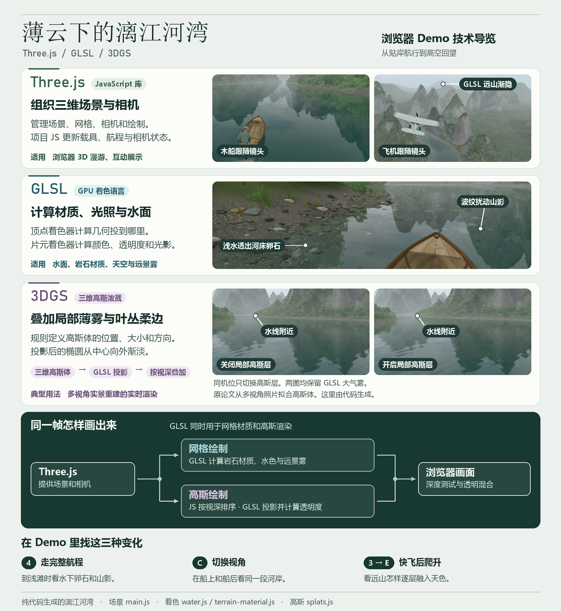
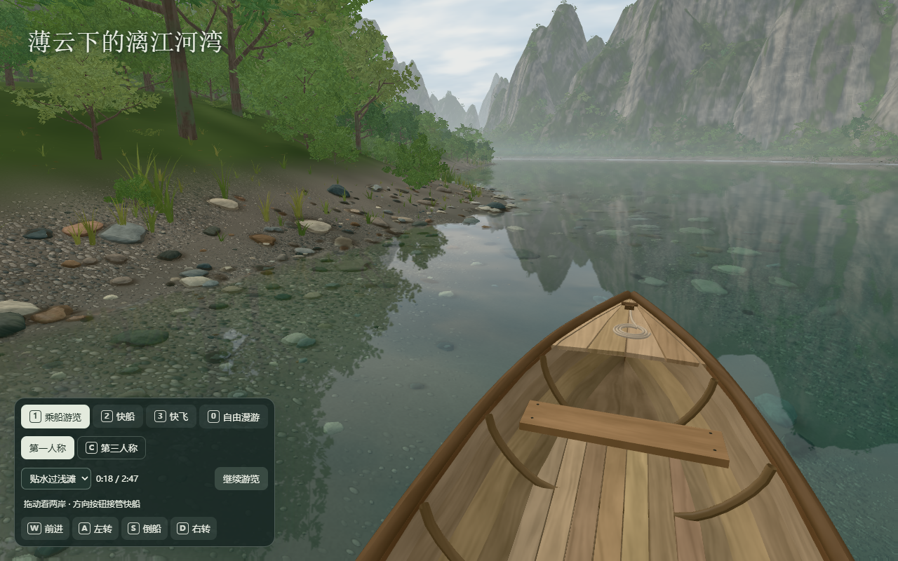

# 0033 · 薄云下的漓江河湾

从「薄云下的漓江河湾」提示词出发，用 Three.js、GLSL 和程序化三维高斯泼溅做成可步行、开船和快飞的原创喀斯特河谷。约 4 分半的引导航程把登船、浅滩、贴岸岩壁、靠泊和空中回望串在一起。沿中心线可探索约 1.50 公里河道，视野中的上下游河道约 2.06 公里。这个小样展示了如何复用一套地形、光照和水深规则，做出能从不同高度连续观察的浏览器场景。

[](assets/rendering-guide.png)

导览图使用本项目浏览器运行截图。可以先在木船上观察浅水卵石和山影，再切到第三人称看航迹，最后飞到山脊上方辨认经过的河段。高斯对照仅切换局部高斯层，两张图都保留 GLSL 大气雾。

## 我们的提示词

以下为实际对话中的需求节选，按从目标到验收的顺序整理。

> 就按薄云下的漓江河湾做一个能在浏览器里漫游的 Demo 吧，用 Three.js + GLSL + 3DGS 纯代码生成，重点把山体、浅水卵石和水面倒影做得像实拍。

> 继续，先把 4–6 分钟的完整航程串起来。从岸上登船，经过浅滩和岩壁，中途能接管木船，到宽湾靠岸后再飞起来，回看刚才经过的河段。

> 航程串起来了，继续把画面做得像实拍吧。先统一整条航程的薄云光照、山雾和水面倒影，重点解决飞机回望时山形和岩面纹理太重复的问题，还是用纯代码生成。

> 那就先优化快飞时的远景吧，把远山和山雾衔接自然一点，别一飞高就看到那条直线，还是用纯代码生成。

迭代中还加入了快船和快飞、两种视角、按钮快捷键、船上驾驶员与程序合成环境声。贴岸验收特意看岩壁、树冠、树根和水线，要求船贴着岸走时仍能看到有尺度变化的立体细节。

## 实际效果与价值

| 观察场景 | 看得到什么 | 可复用的做法 |
| --- | --- | --- |
| 浅滩与贴岸 | 水深改变河底卵石的可见度，波纹扰动山影。侧看岩棚能见到台阶、斜裂槽和沿坡埋入的树根。 | 共用河床和岸脚高程，协调岩棚、浅水折射、湿润带和船底净空。 |
| 操控与转场 | 在同一艘木船上接手和交还，进入宽湾泊位后走回干岸，再转入飞机巡航。船尾水迹和载具声随状态变化。 | 航线、载具和相机共用河谷坐标和地标，输入切换可沿用原船状态。 |
| 快飞回望 | 水上经过的沙洲和岩壁可在空中辨认。远山分层，低谷先融进雾，地形的远端逐渐贴合天空颜色。 | 用固定航段和机位重放比较材质、雾和地貌，兼顾近岸与高空构图。 |

这套方法适合生成虚构的自然场景、浏览器互动展览和可重放的图形实验。地貌、天光、载具、植被、卵石和高斯数据由代码在浏览器生成。精确对应真实漓江的某一段，需要测绘或多视角影像来约束山形、岸线和地物位置。

## Three.js、GLSL 与 3DGS 的实际分工

| 技术 | 项目里负责什么 | 适合用在哪里 |
| --- | --- | --- |
| Three.js | 管理场景、网格、相机和绘制提交。项目的 JavaScript 根据航程和输入更新载具与相机。 | 组织可交互的浏览器三维场景，管理第一人称与第三人称镜头。 |
| GLSL | 顶点着色器处理投影，片元着色器处理颜色与透明度。项目用它计算岩色、天光、水深与波纹、倒影的混合，以及远山淡入天空。 | 写动态材质、光照、空气透视和水面效果，也能给高斯层计算椭圆投影和渐变透明度。 |
| 程序化 3DGS 渲染 | 代码生成有方向和尺度的三维高斯体，JavaScript 按相机视深排序，GLSL 以半透明椭圆叠出局部贴水薄雾和叶丛边缘。 | 用于可柔和叠加的局部细节。原论文的实景流程还会从多视角影像拟合高斯体。 |

Three.js 将网格和高斯交给同一个 WebGL 渲染器。山体、河床、岩棚和载具以网格承载，高斯层与网格使用各自的 GLSL 着色器，最后在同一画面里做深度测试和透明混合。[场景入口](web/main.js) · [水面着色](web/water.js) · [远景着色](web/terrain-material.js) · [程序化高斯](web/splats.js)

## 场景实测截图



[贴岸看岩壁](assets/shore-limestone.png)与[舟上仰看树冠](assets/shore-canopy.png)为近岸渲染的实际截图。游船在弯道前减速并沿左岸经过水线上的岩棚。

[飞机俯瞰峰林](assets/aerial-karst.png)和[木船上的峰林倒影](assets/karst-reflection.png)为本地 Chromium 实际运行截图。选「乘船游览」后，可在章节列表直接跳到「贴水过浅滩」和「峰林倒映」。

[动力艇和推进尾流](assets/powered-runabout.png)与[飞机压翼转弯](assets/river-flight.png)为载具实测截图。

[木船船夫](assets/tour-skipper.png)和[快艇驾驶员](assets/runabout-driver.png)均可在第三人称中环看。[快艇驾驶席](assets/runabout-helm.png)展示第一人称的手部操控。

[贴岸接管木船](assets/wooden-helm.png)记录按下转向键后的同一艘船。[暂停后的尾流](assets/paused-wake.png)记录舷外机停止扰动后留在水面的泡沫。

[从浅滩码头登船](assets/origin-pier.png)和[游船停进宽湾泊位](assets/wide-bay-berth.png)为浏览器实测截图。木平台、坡道、入水桩和停靠船只均为场景几何。

[飞行驾驶席](assets/cockpit-flight.png)和[压翼时的座舱仪表](assets/cockpit-bank.png)展示从河段切入巡航以及操控后的实际画面。

[沿浅滩栈道走向木船](assets/journey-boardwalk.png)和[从空中回望出发岸](assets/journey-lookback.png)拍自同一条完整航程。

[统一薄云光照后的浅滩](assets/daylight-shallows.png)和[越过山脊回望河谷](assets/daylight-lookback.png)为更新后的固定机位截图。

[新版贴岸岩棚](assets/rockbank-ledges.png)和[正看根系与坡面](assets/rockbank-roots.png)拍自「贴岸看岩壁」章节的同一艘船。隆起、台阶和斜向裂槽由网格形成，随视角有实际视差。树根依岩面展开并逐渐埋入，根脚周围有局部积土。

[整体设计与实施规划](SCENE-PLAN.md)记录首版目标、岸水空航程、实现逻辑和各阶段验收门槛。

## 本地漫游

在仓库根目录运行以下命令，再用支持 WebGL 2 的浏览器打开 [本地 Demo](http://127.0.0.1:53783/)。

```powershell
python projects/0033-lijiang-river-bend/serve.py
```

- **完整航程**按 `4` 或点「完整航程」开始，按默认节奏约 4 分 30 秒。从浅滩码头的干岸沿栈道登船，经浅滩、岩壁、河弯和沙洲到宽湾。停稳后会走过栈道到干岸，再短转场到巡航机位，沿河回望沙洲、岩壁和出发岸，绕过山脊完成。船上用 WASD 或触屏方向键接管同一艘木船，回到航线附近并朝顺流方向航行时按 `1` 或「恢复游览」接回。`C` 可在船上或空中切换视角。「结束引导」保留当时的位置。航程完成后可以继续飞或重走一次。
- **乘船游览**的完整航线约 2 分 58 秒。由浅滩码头出发，依次穿过浅滩、峰林、贴岸岩壁、河弯、宽谷和沙洲，末段回望来路并停进宽湾码头。从浅滩码头直接进入时从登船开始，也可在八个章节中重看「鸟瞰入湾」。登船后可用 WASD 或触屏方向键接管当前木船，靠近航线并朝向前方时按 `1` 或「恢复游览」接回。
- **快船**驾驶带舷外机的动力艇。W 给油，S 倒船，A / D 转向，松开后滑行。随着速度提高，船首会抬起，马达后方会出现泡沫尾流。按住 W 时目标速度为 21.5 米每秒。
- **快飞**从当前岸位或船位短转场到同一河段上空，朝附近地标巡航。第一人称在驾驶员眼位，透过风挡看河谷，仪表显示空速、离地高度、飞行姿态和航向。W / S 加速和减速，A / D 压翼转向，Q / E 下降和上升，Shift 提速。地形预判会在岩峰前提前改变高度和速度。按 `0` 返回这一带经过地形验证的干岸，如果仍在离开时的泊位附近，可以回到停好的船。
- **自由漫游**用 WASD 和滚轮在岸上及木栈道移动，拖动画面转头。左下角有沿岸、浅滩、高处三个观察点和「前往泊位」入口。船上按 `0` 或「返回岸上」可回到同一河段已验证的干岸。

在码头附近按 `F` 或点同名按钮可登船。开船接近码头后松油缓行，按 `F` 进行辅助靠泊。停稳并与泊位对齐后，按钮会显示「下船」。下船落在可行走的木平台，上岸后仍能回到原船。辅助靠泊可以按 `F` 取消，也可用方向键接手。

桌面和触屏按钮上直接标明了快捷键。点按产生短时操控，按住持续输入。键盘方向键可以代替 WASD。数字 1 / 2 / 3 / 0 分别切到乘船游览、快船、快飞和返回岸上。减少动态效果设置开启时，自动游览从登船开始，岸上与空中的转场直接切换。

乘船游览、快船和快飞均可在左下角切换第一人称和第三人称，键盘 C 也可以切换。自动游览的第一人称位于乘客席，手动木船和快艇的第一人称位于驾驶员眼位。第三人称可拖动画面绕看船或飞机，也可用滚轮调整跟随距离。手动木船、快船和快飞会显示当前航速，快飞同时显示离地高度。

点右上角「开启声音」或按 `M` 可打开或静音环境声。沿岸可以听到水浪和风声，木船和快艇的引擎、溅水随油门和航速变化，飞机座舱内的风声较闷。暂停木船游览时，水声仍在，引擎回到轻怠速。每次载入页面从静音开始，切到后台时暂停处理声音。

## 生成和渲染

- [峰林地貌](web/karst.js) 将偏斜锥峰、陡壁孤峰和带鞍部的山脊交错布置。主地形的边缘接续低分辨率的远山，雾气在河谷低处更浓。[贴岸岩棚](web/bank-outcrops.js) 是从山脚伸入水线的分层网格，参与河床采样和倒影。[石灰岩材质](web/limestone.js) 按世界坐标生成错开的节理、剥落面和细小矿物颗粒。
- [同一套薄云天光](web/shaders.js) 为天空、山石、植被、载具和水面提供漫射光色与透云光强。空气散射叠加贴谷的低雾和覆盖山间的高层雾霭，镜像相机按水面两侧的实际光程计入雾色。[中远景岩面](web/terrain-material.js) 按不同山体区块生成岩色、风化面与植被，用屏幕占用过滤过细的节理，近岸岩棚继续使用细粒度岩石材质。
- [河岸植被](web/foliage.js) 生成树根、树干和非对称的分枝。近处叶片是带弯曲的网格，枝叶之间留有空隙。中远处使用由 Canvas 绘制的枝叶纹理，[植被着色](web/foliage-material.js) 表现薄云下的叶片透光、冠内遮蔽和树皮裂缝。[地表光照](web/lighting.js) 根据地形和树冠分布生成遮蔽。
- [水面](web/water.js) 以镜像相机绘制倒影，波纹按反射景物的远近扰动镜像。浅水按[地形网格生成的河床高程](web/landscape.js)和渲染深度计算折射及水色。舷外机位置、航速和油门控制波纹与尾流。[河滩卵石](web/pebbles.js) 按水流沉积带分布，细砾、扁圆石和大卵石从湿岸延伸至浅水，并有贴地阴影。
- [历史尾流](web/wake-history.js) 按桨轴走过的世界坐标记录斜率与泡沫，在原有水面通路中用定尺寸纹理采样。普通动效下停车后尾流继续散开，跳章节时重置发射位置。减少动态效果模式会在静止时保持较弱的水迹。
- [动力艇与舷外机](web/motorboat.js) 使用程序化 V 形船体、驾驶台和可转向的舷外机。慢游[木船](web/boat.js) 使用小型舷外机。[观景飞机](web/aircraft.js) 用减弱的反光和低饱和机身颜色配合薄云。[飞行控制](web/flight-motion.js) 用持续巡航、滚转与地形预判计算飞行状态。
- [飞机座舱](web/flight-cockpit.js) 的壳体、仪表与风挡由几何和着色器生成。座舱和外壳共享飞机姿态，第一人称渲染座舱，第三人称及水中倒影使用外部机体。[空中转场](web/aerial-route.js) 根据岸位或船位选取河段地标，对候选巡航点提前模拟净空，并从实际地形选回岸落点。
- [船上人物](web/boat-driver.js) 的形体和衣料由代码生成。木船船夫依航线操纵舷外机手柄，快艇驾驶员双手随方向盘转动，手肘和膝部根据手脚接触点计算坐姿。
- [自动航线](web/cruise.js) 按河岸坐标布置航点，[第三人称镜头](web/chase-camera.js) 采样地形，在靠近岸坡或山壁时调整跟随位置。
- [引导步行](web/journey-walk.js) 使用两座码头的实际栈道与干岸点。[引导航空段](web/guided-flight.js) 以原飞行控制跟随跨河谷的航线，按共享地标调整镜头，结束后连贯交还操控。水段按实际泊位和船速触发下船。
- [浅水航行](web/vessel-shallows.js) 分别为木船和快艇估算吃水与前方制动距离。进浅水时逐步减小朝岸速度，沿岸方向有空间时仍可滑行。[泊位](web/docks.js) 从实际河床和岸坡选址，靠泊轨迹经过船底和码头实体校验。[木码头](web/dock-model.js) 和[岸上步行](web/shore-access.js) 共用栈道高程。
- [贴岸岩棚](web/bank-outcrops.js) 在岩峡的两个岸段增加了不等宽的岩层和斜裂槽，河床和地表高度使用渲染网格的三角面插值。[近岸树根](web/foliage.js) 对同一地表采样并埋入根尖。岩面、碎石与砾石共用湿润范围，[水面](web/water.js) 根据实际水深在岸脚生成局部轻浪。
- [高斯层](web/splats.js) 以各向异性三维高斯表现谷底薄雾和近岸叶丛边缘。高斯按视深排序，再投影混合到画面中。
- [环境声](web/scene-audio.js) 通过 Web Audio 合成风声、水浪和船边溅水，随听者位置、航速和视角调整声像、强度和滤波。[动力声](web/vehicle-audio.js) 用不同的周期脉冲、旋桨节奏和滤波分别生成木船舷外机、快艇引擎和小型螺旋桨飞机的声音。

## 验证范围

在 Windows 的 Chromium 无头浏览器中用 SwiftShader 验证鸟瞰、登船、暂停和继续、跳到新增河段、接管快船、转向、快飞升降与返回自由漫游。也检查了 390 像素宽触屏视口的登船和升降按钮。自动航线以 40 Hz 采样机位和船底，航程中的船底覆盖区河床始终低于水面约 0.70 米。近看部分岩壁仍可看出程序化纹理。

第三人称实测覆盖快捷键、动力艇的加速和抬首、水面尾流、慢游木船马达，以及飞机的巡航、压翼转弯、减速和切回第一人称。窄屏检查覆盖贴键位的按钮、完整载具取景和飞行操作区。

本次画面在固定机位对照了岸边、浅滩、峰林倒影及两个飞行角度，并检查了水面波纹随时间变化与窗口缩放后的反射深度缓冲。

近岸细节用相同船上机位对照了树冠、岩壁正斜视及水线倒影，也检查了「贴岸看岩壁」章节、继续航行和第三人称切换。按 10 Hz 采样整个航线，在船底覆盖区测得河床最高点低于水面 0.74 米。

驾驶员实测覆盖游船自动转向、快艇原地操纵方向盘、给油转弯、眼位切换和镜像相机对头部的可见性。

贴岸测试中，按 `A` 接管的首帧延续了原木船、船夫、位置、朝向以及约 4.43 米每秒的航速。Chromium 验证了接回航线、倒车时的提示、同章节重选、暂停后的尾流消退与跳章节重置，也验证了 390 像素宽触屏上的接管与交还。

两处码头按实际地形检查了四种船型与泊位的组合。Chromium 实测了木船与快艇的浅水减速、辅助靠泊、停稳后下船、从栈道步行回干岸、从深水按 `0` 返回干岸，以及 390 像素宽触屏的选码头和上下船。

快飞转场实测从浅滩码头、贴岸木船和宽湾码头进入巡航，再返回相应河段的干岸。检验了飞行状态驱动仪表、`C` 切换时机体状态连续、座舱和外壳在主画面与倒影中的可见性、减少动态效果时直接切换，以及 320 和 390 像素宽触屏的操作。

完整航程在 Chromium 桌面和 390 像素宽触屏中从岸上出发跑到「航程完成」，默认模拟时长约 4 分 31 秒。桌面在贴岸岩壁接管并接回原航线，宽湾泊位停船时航速为零，双脚行进范围始终在栈道或干岸上。此处时长按模拟时钟记录。

薄云光照更新前后，在栈道、浅滩、岩壁、宽湾泊位和三个空中位置用相同机位对照。浅滩固定机位推进水面时间，检查了山影随波纹变化并保留浅水卵石。更新山形后重跑了桌面和触屏航程，逐帧采样的最低机翼净空约 60.6 米。

用 Chromium 采样实际混音，检查了初次载入静音、按键或触屏开启、切到后台暂停和回前台恢复。木船巡航比暂停时响，快艇给油后的混音强于怠速，飞机座舱内的高频成分弱于机外。音频采样和 390 像素宽触屏测试均未请求外部音频资源。

贴岸近景按相同船位对照了章节镜头、正看和斜看岩壁，并在桌面和 390 像素宽触屏视口重放 12 秒的过弯过程。贴岸段的船底覆盖区至少有约 0.78 米水深。岩棚表面与高度采样单独用超过 8,600 个竖直网格射线点核对，两个泊位均通过校验。

远景更新用固定机位对照了飞机处于 139–279 米高程时的第一人称、第三人称和 390 像素宽触屏视口。原本的远山灰线和矩形拐角在这些机位消失。浏览器从快飞按钮进入巡航后也能切换视角。高空向上游俯看时，河道末端仍能看到一小段截边。高斯开关在同一机位与帧状态采样，变化集中在贴水区域。真机性能与长时间运行的验收门槛见[场景规划](SCENE-PLAN.md#实施顺序与验收门槛)。

## 来源与许可

本地服务复用仓库中已固定版本的 Three.js 0.180.0 和 Reflector 模块。许可和文件来源见 [MIT 许可证](../0008-pelican-layout-study/web/vendor/three/LICENSE) 与 [来源记录](../0008-pelican-layout-study/web/vendor/three/provenance.json)。高斯投影参考 [Kerbl 等人的 3D Gaussian Splatting](https://repo-sam.inria.fr/fungraph/3d-gaussian-splatting/)。

峰体的形态变化参考[联合国教科文组织的中国南方喀斯特资料](https://whc.unesco.org/en/list/1248/)和[桂林峰林与峰丛组合的地形研究](https://www.mdpi.com/2072-4292/11/16/1950)。

近岸岩脚的溶蚀凹陷与分层参考[华南喀斯特地貌研究的桂林—阳朔段](https://onlinelibrary.wiley.com/doi/full/10.1111/j.1365-2451.2009.00736.x)。
