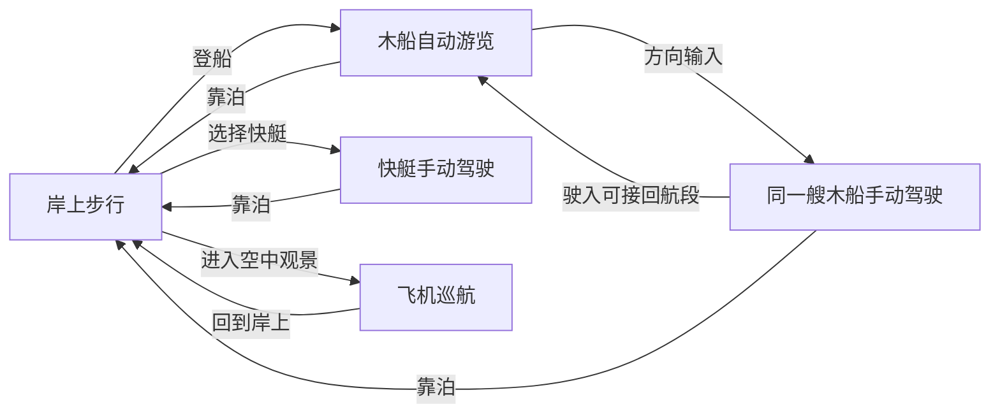

# 薄云下的漓江河湾整体设计与实施规划

首版完成目标是一条 **4–6 分钟的写实漓江主航程**。人在岸上出发，乘木船过浅滩和岩壁，中途能接管同一艘船，到宽湾或沙洲靠岸，再从空中认出刚才经过的河段。开放漫游、快艇和快飞继续提供直接入口，游览章节可以单独重看。

场景延续薄云白天和现有约 1.50 公里可探索河道。地形、材质、载具、人物、动效和声音用代码生成。实拍用于对照天气、尺度、材质和镜头运动。首版以船上常用视角、岸边步行和飞越河谷为写实验收范围。

## 实施进度

第一批完成同船接管与交还、历史尾流。「贴岸看岩壁」的 Chromium 对照验证了接管首帧的船体、船夫、位置、朝向和航速连续，也验证了暂停时已有泡沫继续散开。

第二批完成两种船的浅水减速、浅滩与宽湾两处泊位、码头上下船和深水返回干岸。八章自动航线在宽湾泊位停船，完整时间约 2 分 58 秒。

第三批完成飞行驾驶席及同河段进出空中。先从岸位或当前船位选取巡航点与近处地标，返回时验证干岸落点。浅滩码头、贴岸木船和宽湾码头可分别进入快飞，仪表和第三人称镜头由同一飞行状态驱动。

第四批完成约 4 分 30 秒的完整航程。浅滩干岸步行到船，沿原航线游览并可中途接管同一木船，宽湾靠泊后走回干岸，再从空中回看沙洲、岩壁河弯和出发岸。Chromium 桌面与 390 像素宽触屏均跑通全程。[实现与实测记录](README.md)

第五批统一了岸、水、空的薄云光色和山雾，倒影使用同一镜像场景与大气散射。空中回看的山体加大了孤峰、宽肩崖、低丘和相连峰脊的轮廓差异，岩面按距离保留对应尺度的风化和节理。[实现与实测记录](README.md)

第六批接入合成环境声。水浪、溅水、风声和三种动力声由听者位置、视角、速度和油门驱动。停好船后保留岸边环境声，飞机机内的高频风声比机外弱。点击声音按钮或按 `M` 启用与静音。[声音实现](web/scene-audio.js)

第七批完成贴岸岩壁的近景样段。凸出的岩棚和斜裂槽由真实网格形成，岸边根系沿地表埋入，湿岩、碎石、砾石和近岸轻浪使用同一岸脚高程。以同一木船机位正看、斜看和连续过弯对照。[贴岸实测](README.md)

## 开工基线和缺口

| 状态 | 验收项 | 当前依据 |
| --- | --- | --- |
| 已具备 4 项 | 可探索河湾、八章自动游览、载具基础操控与视角、两艘船的可动驾驶员 | 自动游览约 2 分 51 秒。键盘、触屏和两种视角已有 Chromium 检查记录。 |
| 需精修 2 项 | 同一片天光下的写实观感、河段之间的辨识与纵深 | 已有浅水折射、山影、近景岩棚和独立叶片。贴岸岩面仍有偏平顺的区域，近远山层次、树根与地面的衔接、人船接触还需在连续镜头中统一。 |
| 开工时缺 5 项 | 同船接管与交还、历史尾流、靠岸和上下船、飞行座舱与转场、随运动变化的环境声 | Chromium 复现了转向换船、暂停尾流归零、近岸突然减速、深水步行和直接进入空中视野。当时还没有环境声。 |
| 待真机验证 1 项 | 持续运行的帧时间和稳定性 | 现有主要对照使用 Windows Chromium 与 SwiftShader。移动镜头会刷新河床、反射和主画面，具体耗时需在指定桌面和手机上记录。 |

前两处最适合先解决。同船接管需要统一船的状态，尾流也要读取这份状态。完成后，同一条贴岸镜头就能验证船、船夫、镜头和水迹是否连续。[当前功能与验证记录](README.md) · [场景调度](web/main.js) · [水面渲染](web/water.js)

## 主航程和场景布局

沿用现有河道坐标 `x`、`t`。表里的 `t` 用于定位已有章节或选取设计点位，岸上入口和泊位的最终横向坐标由水深与坡度采样确定。

| 航段 | 场景与行为 | 跨视角识别点 |
| --- | --- | --- |
| 起点岸和浅滩，`t ≈ −22–40` | 起点岸设首个登船点，沿用鸟瞰入湾短镜头，然后进入木船乘客视角。浅滩以砾石、浅水折射和倾向水边的树冠作为近景。 | 登船点、弯曲砾石带、临水树冠 |
| 峰林和岩峡，`t ≈ 91–262` | 河面视角先看峰林倒影，再贴左岸过岩棚。路线在 `贴岸看岩壁` 附近预留可随时接管的河段。 | 两侧高低不同的峰叠、左岸岩棚及水线 |
| 宽湾、沙洲和回望，`t ≈ 519–788` | 河面打开，浅洲改变航道的宽度和色调。第二个泊位在末段选址，与一段干燥的岸上短路相连。主航程可以在这里回头看、下船或切到飞行。 | 河湾开口、沙洲轮廓、第二泊位 |
| 空中回望 | 从靠岸河段的安全空中机位入场，沿河谷飞过共同地标，转弯时能回看岩峡。保留手动快飞、提速和升降。 | 从空中可辨的沙洲、宽湾开口和岩壁所在河弯 |

主航程实测约 4 分 30 秒，其中登船步道约 13 秒、自动船行约 2 分 53 秒、等船停稳和走上干岸约 17 秒、空中回望约 68 秒。手动掌舵、绕行与停留会影响耗时。约 2 分 58 秒的自动游览可单独体验，快艇和快飞可以自由操作。[河道布局](web/river-layout.js) · [现有章节与航点](web/cruise.js)

## 载具、操控和视角

用一份载具状态记录船或飞机的标识、世界位置、朝向、速度及控制量。船的操控来源为自动航线、手动驾驶或靠泊引导，镜头的第一／第三人称独立记录。船体、驾驶员手部、镜头和尾流在同一次模拟更新中读取同一份姿态。

| 入口 | 目标行为 | 连续性规则 |
| --- | --- | --- |
| `4` 或「完整航程」 | 从浅滩干岸出发，步行登船、经浅滩与岩壁、在宽湾上岸，再飞回上游观察刚驶过的河段。 | 复用两座码头的栈道与泊位，只在木船达到宽湾泊位且停稳后下船。空中结束时保留机体状态，交还飞行操控。 |
| `1` 或「乘船游览」 | 从岸上登木船。从手动木船交还自动航线。从快艇或飞行返回时，经短转场进入所选木船章节。 | 接管时保存航线进度，交还时从当前位置前方寻找可达航点并平顺接回。超出可接回范围时继续手动，并给出可选择的航点入口。 |
| 木船游览中输入 `W/A/S/D`、方向键或触屏方向 | 在当前帧接管同一艘木船。拖动画面继续只用于看景。 | 继承位置、航向、航速、船夫和已有尾流。第一人称从乘客席短过渡到驾驶眼位，第三人称继续跟同一船体。暂停中接管时以实际停船速度入手。 |
| `2` 或「快船」 | 主航程从泊位换乘。快捷入口可经过短转场进入当前河段的安全艇位。 | 显式选择才换船。入场采用安全水深、航向和合理低速，船体和人物一起切换。 |
| `0` 或「返回岸上」 | 靠泊后从岸上离船。从水上或空中快捷返回时短转场到本河段已验证的干岸落点。 | 物理下船只在满足靠泊条件时发生。浅滩和高处观察点可作为镜头，开始步行时回对应的可站立点。 |
| `3` 或「快飞」 | 短转场接到同一河段上空的巡航飞机。飞行后可返回对应的岸上入口。 | 共享地标和航向作为镜头接点，使用已有地形净空预判选择空中入场点。 |
| `C`、拖动和跟随距离 | 切视角、环看、调整第三人称距离。 | 保留载具状态、航线进度和尾流历史。减少动态效果模式使用明确切镜，减少漂移和摆动。 |

### 船舶运动和岸线接触

- 把 [main.js](web/main.js) 中的 `updateHelm`、`keepHullAfloat` 和模式切换职责拆开。保留 [cruise.js](web/cruise.js) 的航点与采样。自动和手动共同输出船舶状态，快艇和木船分别使用船长、船宽、吃水、加速与转向参数。[现有木船](web/boat.js) · [快艇与舷外机](web/motorboat.js)
- 用 [landscape.js](web/landscape.js) 的地面高度计算水深。按船首、船尾、两舷和船底位置采样，并沿当前帧的移动方向扫测，覆盖快艇高速移动。临近该船的安全吃水时先减小朝岸的速度，保留沿岸分量。触到最浅限制时，用上一个有效姿态收住。给油、滑行、倒车和熄火以实际有符号航速和推进方向驱动动画。
- 两处泊位各记录进港方向、安全停船姿态、岸上落点和步行出口。先验证船底水深与船舷到岸的可达距离，再确认岸上落点及邻近坡面可站立。靠泊交互以低速且姿态稳定为条件，初始测试用 `0.5 m/s` 以下。离泊、登船和镜头转场完成后释放各自的输入锁。
- 手动船运动以固定时间步推进，先读输入与航线意图，再更新载具姿态，最后用插值姿态驱动人物、镜头、尾流和音效。页面失焦时清除按键与触屏按住状态，恢复时从当前帧继续。定位到章节是一次明确跳转，更新船体、镜头和尾流采样起点。

### 历史尾流

在现有解析式螺旋桨扰动外，增加一个有容量上限的历史缓冲。近桨 1–2 米仍用现有细节表现油门反应。远一些的泡沫和两侧波纹取决于船实际驶过的位置。

1. 从桨轴的世界坐标取发射点，按约每 `1.4 m` 插值记录一段。每段存位置、航迹切线、实际航速、推力方向、年龄和初始强度。初始容量 `128` 段，渲染时只读取有效记录。
2. 历史点沿河道缓慢漂移，侧波扩散并衰减，泡沫衰减更快。调试初值为泡沫约 `2.5–3 s`、波纹约 `6–7 s`。倒车使用实际推进方向，滑行用残速发出弱波，停船后停止按距离发射。
3. 将斜率与泡沫写进按世界网格对齐的低分辨率 `DataTexture`，初始用 `320 × 320`、`0.6 m` 网格、`20 Hz` 更新。纹理前两通道编码两向有符号斜率，第三通道记录泡沫。在 [water.js](web/water.js) 中增加一次采样，斜率参加现有折射与 Fresnel 混合，泡沫参加水色。按同一河床高程在浅岸衰减，控制叠加上限。先在真机量纹理更新和上传成本。
4. 视角切换保留历史。暂停航线停止发射，正常动态效果下原有尾流继续消退。减少动态效果时静止画面可以冻结弱尾流。跳章节清空前段并重置发射起点，切飞行时停止发射，留在水上的尾流继续按年龄消散。

### 飞机座舱和入场

沿用 [flight-motion.js](web/flight-motion.js) 的巡航、压翼、升降和地形预判。[飞机外壳](web/aircraft.js)和[座舱](web/flight-cockpit.js)共用飞机姿态。第一人称显示窗框、机头、操纵件、空速、离地高度、姿态和航向，第三人称和水中倒影显示飞机外壳。[空中转场](web/aerial-route.js) 采样候选航路净空，用约半秒的转场衔接附近地标，减少动态效果时直接切到巡航机位。跑道、完整起降和长航程留到扩展阶段。

## 写实画面、声音和渲染预算

Three.js 管理几何、载具姿态、镜头以及反射和河床渲染目标。GLSL 负责材质、水面光学和局部动效。代码生成的各向异性高斯负责谷底薄雾和部分树冠远缘，岩壁、船和人物仍由有深度的几何承载。

| 跨场景系统 | 实现方案 | 观察重点 |
| --- | --- | --- |
| 薄云和空气层次 | 将天空漫射、柔化日光、曝光和谷底散射统一给岩石、叶片、船壳、人物及镜像通路。先在飞机和水面基准镜头校色，再调局部明暗。 | 近山、隔岸和远山能分层，实体、接触阴影和倒影的色调一致。 |
| 岩壁、湿岸和树冠 | 贴岸可达区优先用已有的立体岩棚、矿物纹理和弯曲叶片。补岩面剥落、树根遮蔽和地表衔接。距离增加时按屏幕占用平滑切换，压低裂缝和叶片过小产生的闪烁。 | 同一块岩棚正看、斜掠时有立体视差；叶簇有透光和内层阴影；湿润带自然过渡到卵石。 |
| 水面和纵深 | 延续镜像深度、河床高程和折射采样。按河段微调浑浊度，重点检查浅滩、岩壁水线和宽湾转头时的倒影。高斯层继续负责雾与部分冠层远缘，按分块和可见性控制更新。 | 从低视角看山影，俯看时透出与深度一致的卵石，移动时水线和岸边保持对齐。 |
| 人、船和环境声 | 保持手脚接触点跟随方向盘、舷外机和船身姿态，在驾驶席常用距离精修手部、袖口、仪表和水线材质。用 Web Audio 合成发动机、水声和风声，强度随转速、航速和距离变化，从用户首次交互启用并提供静音。 | 近景抓握和座位接触稳定，松油后马达声随工况变化，离船时声源仍在艇位。 |

现有河床、反射与主画面各自记录耗时和输出尺寸。镜头或可见景物变动时，保持对应纹理和投影矩阵一致。先分别调低远处反射、河床目标和远景细节的开销，再调整整画面的渲染比例。性能恢复判定需要覆盖持续运动的镜头。先从已有 [天空与雾](web/shaders.js)、[地表光照](web/lighting.js)、[枝叶](web/foliage.js) 和 [高斯层](web/splats.js) 中复用生成逻辑。

## 实施顺序与验收门槛

| 阶段 | 交付内容 | 进入下一阶段的条件 |
| --- | --- | --- |
| **基准** | 固定场景种子、光照、摄像机参数和六组重放输入。保存当前画面和桌面／手机首测数据。 | 六组镜头可复跑，明确设备、浏览器、视口、内部渲染分辨率和画质档。 |
| **一　船上连续性** | 同船接管与交还、历史尾流、浅水减速和两处可靠的上下船点。 | 船转 90° 后能回看原航迹，松油后尾流逐渐消退。浅滩、岩峡和宽湾各重复起步、转向、倒车和停船，验证边缘响应和进出船。 |
| **二　岸、水、空连通** | 共享地标、泊位、岸路、座舱和飞行转场。快捷入口及八个游览章节继续可用。 | 完成一次 4–6 分钟引导航程。键鼠和触屏均可接管、靠岸、换视角和快飞。三个河段的水上／空中镜头能认出同一地标。 |
| **三　写实精修** | 先统一光照和雾，再完善岩棚、树冠、浅水、人船接触和合成声。 | 六组画面在静态帧和连续运动中均通过下表，关键机位无明显穿模与细节层级跳变。 |
| **四　真机收口** | 复跑八个章节和完整主航程，调整桌面与移动画质档，复核长时间运行。 | 暂以指定桌面 1080p 视口 P95 帧时间 ≤33 ms、指定手机低画质 ≤42 ms 为目标。连续跑 10 分钟，记录反复超过 100 ms 的卡顿和 WebGL 状态。实测后确定最终可交付画质。 |

六组重放每组保留一个静帧和一段 10–15 秒运动录像，比较时使用相同视角、场景时间、输出画质与操控步骤。SwiftShader 用来检查加载、输入与画面对照，真机数据用于确定性能档位。

| 重放镜头 | 通过条件 |
| --- | --- |
| 岸上靠近泊位并登船 | 岸路可走，步行和上下船的位置合理，镜头落到正确座位。 |
| 慢船穿过浅滩 | 低视点有连着岸线的倒影，下看有深浅不同的砾石，折射随视角连续变化。 |
| 贴岩壁侧看树冠 | 岩棚有真实视差，叶缘和裂隙移动时稳定，根部、湿岸和倒影连续。 |
| 快艇起步、转弯和收油 | 手和方向盘保持接触，旧尾流留在实际航迹，近桨扰动随推力即时变化。 |
| 缓速靠岸、停船并下船 | 船逐步减速并在安全水深内停住，岸上落点和下一步步行连通。 |
| 飞机越岭回看河湾 | 机舱与仪表随同一飞行状态，切到第三人称后仍在原航线，远景和近景切换稳定。 |

## 扩图条件和首批任务

首版在现有河道上完成验收，扩图依据实际快船和快飞的航行时间、玩家能否辨认地标以及真机预算。按当前 `63 m/s` 提速设定，持续直飞 60 秒约需 `3.78 km` 的连续飞行路线。是否补上下游，由主航程通过后测得的安全可飞长度和设备预算决定。[现有飞行速度与边界控制](web/flight-motion.js)

第一批实现先留存当前木船贴岸镜头的基准数据，再把木船上的输入接管和交还逻辑接入同一份船状态。随后在同一段岩壁与弯道接入历史尾流。第一批的交付场景是「贴岸看岩壁」中按 `A` 接管并继续开过河弯，船和船夫保持连续，回头能看见上一段水迹。泊位和飞机转场在这条基准通过后接入。
