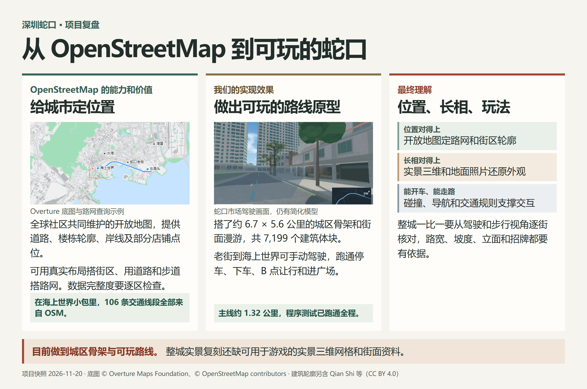

# 0034 · OpenStreetMap 与蛇口城市原型

研究 OpenStreetMap 怎样为真实城市提供地理布局和路网，并在深圳蛇口验证从城区骨架到可玩路线的过程。

[打开公开复盘网页](https://yydshly.github.io/20261115_codex_project/demos/0034-openstreetmap-shekou/) · [部署和线上验收](publication.md)

## 从开放地图选题到蛇口样板

OpenStreetMap 由全球社区共同维护。道路、步道、楼栋轮廓、岸线和部分商户记录可以作为构建真实布局的起点。车道与路缘的实际宽度、不同街段的高差、沿街实物外观还需额外证据。可用程度按街区和属性检查。 [OpenStreetMap 官方介绍](https://www.openstreetmap.org/about)

实际使用的是 Overture Maps 2026-11-18.0 区域数据。海上世界小包的 106 条交通线段均来自 OSM，96 条建筑记录中 91 条来自 OSM、5 条来自东亚建筑数据。28 条地点记录的上游为 Meta 或 Foursquare。城区扩展覆盖蛇口邮轮母港、海上世界、水湾、蛇口老街、东角头和湾厦。 [Overture 数据来源与许可](https://docs.overturemaps.org/attribution/)

## 可验证的实现效果

- **城区骨架和漫游。** 约 6.7 × 5.6 公里，生成 7,199 个建筑体块及 8,724 段道路和步道。楼高来自直接记录的体块有 110 个。城区预览支持鸟瞰、片区浏览和预设街面漫游。[城区数据汇总](assets/city-report.json)
- **可驾驶的连续路线。** 约 69 米的市场支线接入老街，老街至海上世界的主线约 1,317 米。程序测试跑通靠边停车、下车、B 点骑行让行、沿坡道进广场。可手动驾驶并分别切换时段和天气。[复跑记录](assets/validation.txt)
- **局部实景对照。** 对照照片塑造市场入口、蓝漪花园门楼和望海路沿线地标。大部分环境仍为按地图轮廓拉伸的楼体、估算的坡度和通用材质。[高程依据](assets/shekou-elevation-evidence.csv)

## 最终理解

地图确定城市在哪里、道路和地块怎样相连。实景三维、地面照片及测量资料支持同地点的外观和尺度核对。碰撞面、导航和交通规则支持连续的游戏交互。原型已验证地理骨架与局部玩法，整城一比一仍缺覆盖蛇口且授权适用的实景数据。

可延续的是路网、占地、配准参考和原玩法验收用例。要重做的是大部分估算的楼体、街面、店招和植被。首批需查询的蛇口范围已保留为 WGS84 多边形。[实景数据范围](assets/shekou-reality-mesh-area.geojson) · [深圳实景三维成果目录](https://www.sz.gov.cn/szzt2010/wgkzl/glgk/jgxxgk/gtzy/content/post_12759230.html)

## 网页和复现

- 从仓库根目录执行 `python projects/0034-openstreetmap-shekou/scripts/build.py`。用浏览器打开本项目 `dist/index.html`。构建使用 Python 标准库，将 20 个现有场景快照生成独立可打开的网页。
- 试玩依赖 WebGL。点击画面后用 WASD 或方向键，空格刹车，E 上下车。地图、截图检视和产物查询也可在报告首页使用。
- 四个原始小包与模型包用 GitHub Releases 提供。文件名、大小和 SHA-256 见 [公开下载清单](publication-data.json)。
- 项目以 2026-11-20 的功能、数据和截图为依据。实景网格尚未取得，众多建筑高度、场地尺度和附属构件仍是估算。

原始数据、材质、人物车辆和照片参考的来源分别记在[第三方署名](THIRD_PARTY_NOTICES.md)。
